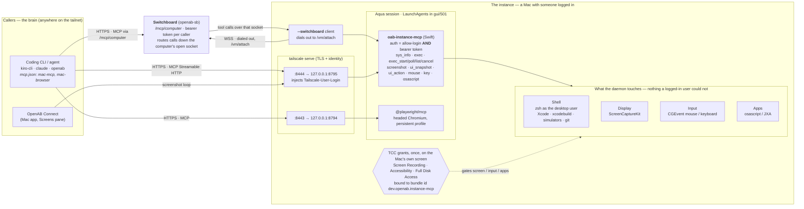
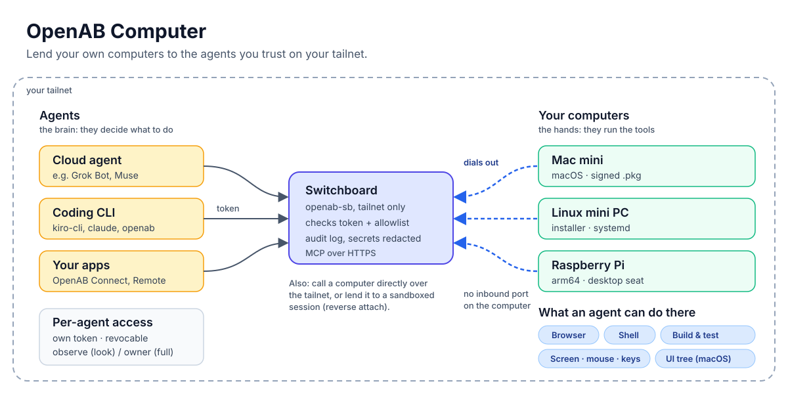

# OpenAB Computer (`oab-instance-mcp`)

> **Name.** The product is now OpenAB Computer (repository `openabdev/openab-computer`, tracked in
> [#63](https://github.com/openabdev/openab-computer/issues/63)). The executable, bundle id, release
> asset names, config directory and Linux unit names keep the old `instance-mcp` names on purpose:
> macOS TCC grants are keyed to the bundle id `dev.openab.instance-mcp`, and changing it would drop
> every grant. Commands in this README use those names.

The "hands and feet" half of [openabdev/openab#1544](https://github.com/openabdev/openab/issues/1544):
a thin daemon that lives in a Mac's logged-in desktop session and exposes the machine to a
coding CLI or agent elsewhere on the tailnet as **MCP servers**. Nothing here is smart; all
the intelligence stays in the caller.

> **Read before deploying.** `exec` is an unrestricted shell as the logged-in user, and `mouse`,
> `key` and `osascript` drive the desktop. There are two profiles: `observe` (`sys_info` and
> `screenshot`) and `owner` (every local tool and browser tool). Every `/mcp` and `/attach`
> request, and every switchboard caller, must present a bearer token. A switchboard can also keep
> a per-caller allow-list. `owner` is not a security boundary
> ([#45](https://github.com/openabdev/openab-computer/issues/45)). Run this only on a Mac you own,
> for callers you would trust with your keyboard.



Read it left to right: the model and its reasoning live in the caller; the machine only receives
tool calls, and the daemon can do nothing a logged-in user sitting at it could not do. Without a
switchboard, everything on the right is one machine and no cloud hop: `tailscale serve` terminates
TLS and stamps each request with the caller's Tailscale identity, which the daemon checks together
with a bearer token. The switchboard path (`--switchboard`) is for a Mac that can only dial out.
The daemon dials the switchboard, and the switchboard routes caller requests down that socket. On
macOS the tools that touch screen or input are gated by TCC, granted once to the stable bundle id.
The loop the tools are built for: `screenshot` → decide →
`mouse` / `key` / `osascript` / `exec` → `screenshot` to confirm. SSH already gives you a shell;
this exists for what SSH cannot reach.

## Contents

- [Goal](#goal) · [Features](#features) · [Status and known limits](#status-and-known-limits) · [Quick start](#quick-start) · [Platforms](#platforms)
- [Tools](#tools) · [Auth](#auth) · [Network interfaces and ports](#network-interfaces-and-ports)
- [Reverse attach](#lending-this-mac-to-a-sandboxed-agent-reverse-attach) · [Switchboard](#serving-a-switchboard---switchboard) · [Browser tools](#browser-tools-for-lent-sessions---upstream)
- Deploy & operate: [Download and install](#download-and-install) · [Build & test](#build--test-on-the-build-mac-the-laptop-never-compiles-swift) · [Deploy](#deploy-run-on-the-target) · [Menu bar](#menu-bar) · [Operate](#operate)
- Operator notes: [TCC & signing](#tcc-grants-survive-re-deploys-only-if-the-signature-does) · [Gotchas](#gotchas)
- Detail: [UI tools](docs/ui-tools.md) · [Operator notes and gotchas](docs/operators.md)

Components: `oab-instance-mcp` is this package (Swift on macOS, zero deps; Rust on Linux). The
browser server is `@playwright/mcp`, not ours ([`poc/pw-mcp/README.md`](poc/pw-mcp/README.md)).
Design notes: [`docs/requirements/connect-closed-loop.md`](docs/requirements/connect-closed-loop.md).

## Goal



Let agents on your tailnet use your own computers, a Mac mini, a Linux mini PC or a Raspberry Pi,
once you have authorized or paired them with a token and a tool profile. An agent can drive the
browser and everything else you would do on that machine: build, compile and test, use the desktop,
and run everyday tasks. Each grant is per agent and can be revoked. The `observe` profile gives
read-only access (screenshot and system info), and `owner` gives full control. On macOS the full
tool set is available, including the accessibility-tree tools. On Linux the browser, shell,
screenshot, mouse and key tools are available, but the accessibility-tree tools are not yet
([#102](https://github.com/openabdev/openab-computer/issues/102)).

## Features

- **Browser:** a Playwright-driven Chromium on the machine. `browser_snapshot` returns the page as an accessibility tree. The `browser_*` tools need the `owner` profile.
- **Shell, build and test:** `bash` on Linux, `exec` on macOS. Background jobs (`exec_start`, `exec_poll`, `exec_list`, `exec_cancel`) run long builds, and they keep running if the connection drops.
- **Desktop control:** screenshots, mouse and keyboard. AppleScript (`osascript`) is macOS only.
- **Accessibility tree (macOS):** `ui_snapshot` reads a window's controls with refs. `ui_action` presses or sets them by ref without moving the pointer.
- **Access control:** a bearer token per caller. A caller gets the `observe` profile (read-only: `sys_info` and `screenshot`) or `owner` (full control). A switchboard can also keep a per-caller tool allowlist.
- **Reverse attach:** lend a machine to a sandboxed agent session with a time-limited grant that can be revoked.
- **Switchboard:** the machine dials out to a relay, so callers reach it without an inbound port on the machine.
- **Platforms:** macOS (signed, notarized `.pkg`) and Linux nodes such as a Raspberry Pi or a mini PC, installed with an installer script.

The accessibility-tree tools are macOS only for now; Linux is deferred
([#102](https://github.com/openabdev/openab-computer/issues/102)).

## Status and known limits

- macOS has `ui_snapshot` (0.9.0) and `ui_action` (0.10.0). Linux has neither yet; the AT-SPI port
  is deferred ([#102](https://github.com/openabdev/openab-computer/issues/102)).
- `owner` is not a security boundary ([#45](https://github.com/openabdev/openab-computer/issues/45)).
  Only `observe` is.
- Switchboard callers are authorized by bearer token only. Binding a caller to its tailnet identity
  is open ([openabdev/openab-sb#20](https://github.com/openabdev/openab-sb/issues/20)).
- Switchboard audit logs record `ui_action` values and `key` text in full unless openab-sb 0.2.2 or
  later is in use ([#14](https://github.com/openabdev/openab-sb/issues/14),
  [#16](https://github.com/openabdev/openab-sb/pull/16)).
- Browser tools use one persistent browser profile per computer, with its cookies and logins.

## Quick start

**macOS** — download `oab-instance-mcp-VERSION-universal.pkg` from
[Releases](https://github.com/openabdev/openab-computer/releases), double-click, and follow the
permissions wizard ([details](#download-and-install)). Then point a caller at it:

```sh
kiro-cli mcp add --name mac-mcp --url https://<host>.<tailnet>.ts.net:8444/mcp \
  --header "Authorization: Bearer $(ssh <host> cat ~/.config/oab-computer/token)" \
  --scope global --timeout 30000
```

**Through a switchboard** (the usual path for a Mac that dials out): the caller uses the
switchboard's per-computer route and its own bearer token. The first call is `initialize`. If the
response sets `Mcp-Session-Id`, send that header on later calls.

```sh
curl -s https://<switchboard>.<tailnet>.ts.net/mcp/<computer> \
  -H "Authorization: Bearer <caller-token>" \
  -H "Content-Type: application/json" \
  -H "Accept: application/json, text/event-stream" \
  -d '{"jsonrpc":"2.0","id":1,"method":"initialize","params":{"protocolVersion":"2025-06-18","capabilities":{},"clientInfo":{"name":"curl","version":"0"}}}'
```

**Linux** (Raspberry Pi, Intel mini PC) — one installer does the whole node
([full guide](docs/linux-setup.md)):

```sh
V=$(curl -fsSL https://api.github.com/repos/openabdev/openab-computer/releases/latest | python3 -c 'import sys,json;print(json.load(sys.stdin)["tag_name"][1:])')
A=$(dpkg --print-architecture)   # arm64 | amd64
curl -fsSLO "https://github.com/openabdev/openab-computer/releases/download/v$V/oab-instance-mcp-$V-linux-$A.tar.gz"
tar xzf oab-instance-mcp-$V-linux-$A.tar.gz && cd oab-instance-mcp-$V-linux-$A
./install-linux.sh                # a box with no desktop: add --headless-seat
```

The URL is `https://<host>.<tailnet>.ts.net:8444/mcp` and the bearer token is in
`~/.config/oab-instance-mcp/token` on the node.

## Platforms

| | macOS | Linux |
|---|---|---|
| Implementation | Swift (Network.framework + ScreenCaptureKit) | Rust (`poc/reverse-attach-linux/`) |
| Screen / input | ScreenCaptureKit · CGEvent, gated by TCC | grim (JPEG encoded in-process) · wlroots virtual pointer · wtype on a wlroots seat (labwc, sway) |
| Shell | `exec` / `exec_start*` (`zsh -f`) | `bash` / `exec_start*` (`bash -c`) |
| Apps | `osascript` / JXA | — (use `bash`: `gdbus`, `xdg-open`) |
| Accessibility tree (`ui_snapshot` / `ui_action`) | ✅ (0.9.0 / 0.10.0) | deferred ([#102](https://github.com/openabdev/openab-computer/issues/102)) |
| Reverse attach · browser upstream | ✅ | ✅ |
| Install | signed/notarized `.pkg` | `-linux-{arm64,amd64}.tar.gz` + `install-linux.sh` |
| Guide | this README | [`docs/linux-setup.md`](docs/linux-setup.md) |

The rest of this README is the macOS reference; the two platforms share the wire contract, auth
and reverse-attach shape, so callers configure them identically. On Linux the job tools
(`exec_start`, `exec_poll`, `exec_list`, `exec_cancel`) take the same arguments and return the
same `structuredContent`; their logs are under `$XDG_STATE_HOME/oab-instance-mcp/jobs/`
(default `~/.local/state/…`), and they are `owner`-only there too
([`docs/linux-setup.md`](docs/linux-setup.md#background-jobs)).

## Tools

| tool | what | notes |
|---|---|---|
| `sys_info` | host, OS, chip, displays, tailnet IPs, console user, TCC status | call first; tells the model what will work |
| `exec` | `zsh -f -c <command>` as the desktop user | `cwd` (a leading `~` is expanded and validated — a missing dir or unreadable external volume returns a clear error, not a hang), `env`, `timeout_secs` (≤600), `max_output_bytes` (≤1 MiB/stream). Spawned with `POSIX_SPAWN_SETSID`; timeout → `killpg` → exit 137, `timed_out=true`. `structuredContent` carries exit/stdout/stderr/duration. Use for commands that finish in seconds |
| `exec_start` | start a background job, return a `job_id` immediately | for work that outlives one request (release builds). Same shell/session/TCC as `exec`; `cwd`, `env`, `timeout_secs` (0 = no timeout, stop via `exec_cancel`). stdout/stderr are tee'd to `~/Library/Logs/oab-instance-mcp/jobs/<job_id>.out`/`.err` (never truncated; survive after the job is forgotten; `tail -f`-able) |
| `exec_poll` | fetch a job's state + incremental output | `job_id`, optional `stdout_since`/`stderr_since` byte offsets (from the prior poll) for only-new output; reads from the log files by seek. Terminal `state` (`exited`/`killed`) carries `exit_code`; `out_path`/`err_path` point at the files |
| `exec_list` | all running jobs + the 10 most recently finished | recover a forgotten `job_id` or see what is running; each entry has state, pid, exit_code, command, cwd, timestamps, stdout/stderr byte sizes |
| `exec_cancel` | stop a running job (or drop a finished one) | `job_id`, `signal` `KILL` (default) / `TERM` — signals the whole process group; poll once more for final output. Finished jobs are dropped from the registry (log files stay on disk) |
| `screenshot` | ScreenCaptureKit → JPEG/PNG as MCP `image` content | `display`, `scale` (px per point, default 1.0), `region` {x,y,w,h} crop in points, `format`, `quality`. Needs Screen Recording TCC. Read small UI text with `region` + `scale: 2` |
| `ui_snapshot` | Accessibility tree of a native app's window, read-only | Read-only. `owner` only. Targets the frontmost window by default; arguments, bounds and masking are in [docs/ui-tools.md](docs/ui-tools.md#ui_snapshot). Needs Accessibility TCC. macOS only |
| `ui_action` | Act on a `ui_snapshot` node by ref, without moving the pointer | `owner` only. Actions: `press`, `set_value`, `focus`, `show_menu`, `confirm`, `cancel`, `increment`, `decrement`. Refs are tied to a snapshot; stale refs are refused. No pointer movement; `activate: true` is opt-in. Secure fields are refused over a switchboard by default. Full detail: [docs/ui-tools.md](docs/ui-tools.md#ui_action). Needs Accessibility TCC. macOS only |
| `mouse` | CGEvent: `move` `click` `double_click` `right_click` `drag` `scroll` | coordinates in display points = screenshot pixels at scale 1. `modifiers`. Needs Accessibility TCC |
| `key` | CGEvent: `type` (unicode, layout-independent) / `press` combos (`cmd+shift+4`) | Needs Accessibility TCC |
| `osascript` | AppleScript / JXA via `/usr/bin/osascript` in the GUI session | `timeout_secs` (default 15). First script against an app raises an Automation consent dialog on the Mac — screenshot, then `mouse` click Allow |

Which tool reads the screen: `browser_snapshot` for web pages, `ui_snapshot` for native apps
(exact roles, titles and frames, cheaper than reading an image), and `screenshot` + `mouse` for
custom-drawn or canvas content that has no accessibility tree. A `ui_snapshot` contains field
values and on-screen text (secure text fields are masked, other fields are not), so a caller
that stores snapshots must mask them first. An element whose role cannot be read is kept as a
leaf with no value and no children, since it cannot be ruled out as a secure field.

To act on a native app without taking the pointer: `ui_snapshot` → `ui_action {snapshot_id, ref,
action}` → `ui_snapshot` again to confirm. `set_value` replaces the whole value, and some apps
commit a field only on `confirm` or when focus moves. Drags, gestures and custom-drawn content
that has no accessibility node stay on `screenshot` + `mouse`. Ref containment and stale-ref
rules are in [docs/ui-tools.md](docs/ui-tools.md#refs-and-stale-refs).

The loop the tools are designed for: `screenshot` → decide → `mouse`/`key`/`osascript` → `screenshot` to confirm.
Verified 2026-09-22 from the laptop: open TextEdit, type a line, read it back, close via the save
sheet's Delete button located from a screenshot, quit — 0.15–0.8 s per call.

Planned: a streaming capture sink for OpenAB Connect (see requirement doc).

## Auth

Evaluated per request in `AuthPolicy`; the server refuses to start with nothing configured.
Configured checks are **AND**-combined: a request must pass every check that is set.

- `--allow-login <email>` — matches `Tailscale-User-Login` case-insensitively (both sides are
  lowercased; the principal logged is the lowercased login), which `tailscale serve` **injects and
  overwrites** (verified: a client-supplied header is replaced). This is the primary control.
- `--token <s>` / `--token-file <p>` — additionally require `Authorization: Bearer`, constant-time
  compared. The token after the `Bearer` scheme (case-insensitive) must match byte for byte;
  whitespace around the whole header value is stripped by the HTTP parser, nothing inside it is.
  **`deploy.sh` now generates one at `~/.config/oab-computer/token` on macOS (mode 600; Linux keeps `~/.config/oab-instance-mcp/token`) and passes
  `--token-file`**, so the deployed agent requires *both* an allow-listed Tailscale login *and* the
  bearer token. This is defence-in-depth: a leaked tailnet auth key that enrols a node as
  your Tailscale login passes the login check but still gets `401` without the token (verified
  2026-09-23: no token → 401, correct token → 200, wrong token → 401). The token is stable across
  re-deploys; rotate by deleting `~/.config/oab-computer/token` (macOS) and re-deploying. The first 0.12 run copies a 0.11 token from `~/.config/oab-instance-mcp/token` once, when `~/.config/oab-computer` is created; after that the old file is never read again, so a deleted token is not restored from it. (The switchboard files and grants still live under `~/.config/oab-instance-mcp` for now.) The menu bar shows a masked form and
  copies the full token (see below); it is never written to `agent.log`.
- `--insecure-local` — allow bare loopback requests with no Tailscale headers. Debugging only.
- `/healthz` is unauthenticated and says only `ok`.

Trust model: `exec` is a full shell as the logged-in user. `/mcp` is "my CLI on my Mac". A
sandboxed agent never gets `/mcp`; it gets a **reverse attach** under the `observe` or `owner`
profile (below).

## Network interfaces and ports

This section describes `main` (app version 0.12.0). The latest release is v0.11.0, so a released
build may differ. Checked by reading the code and by a read-only look at a running agent
(an older 0.10.1 install) and a bare 0.12.0 launch. The menu bar item's Network section shows the
same facts (see [What the menu shows](#what-the-menu-shows)).

The app runs `tailscale serve` in three cases, all for port 8444 only: (a) `serve --bg --https=8444 ...`
after you turn tailnet access on, from the wizard's tailnet page or the menu; (b) the same command at
launch, to re-apply the mapping when you had already turned access on and the mapping is missing; (c)
`serve --https=8444 off` after you turn access off, and as an automatic safety removal when no
Tailscale login is detected and no `--allow-login` is configured. Every other Tailscale call is
read-only.

### Listening sockets

| Address:port | Protocol | Who can reach it | What it is for | How it is enabled | Auth |
|---|---|---|---|---|---|
| `127.0.0.1:8795` (`--host`, `--port`; `--path` for the `/mcp` route) | TCP, plain HTTP/1.1 | Processes on this Mac only | `/mcp` (POST, DELETE), `/attach` (reverse attach; off with `--no-attach`), `/healthz`. Anything else is 404 | Always, on IPv4 loopback by default. No-flag launch from Finder, the installer's LaunchAgent, or a manual launch. A no-flag launch also briefly binds the port to test it is free, without listening | `/mcp` and `/attach`: [Auth](#auth). `/healthz`: none |
| `https://<host>.<tailnet>.ts.net:8444` → `127.0.0.1:8795` | HTTPS, terminated by Tailscale | Your tailnet only | The way other machines reach the agent | `scripts/install-prebuilt.sh` (and the `.pkg`) run `tailscale serve --bg --https=8444`. The app runs the same command only after you turn tailnet access on, from the wizard's tailnet page or the menu's "Allow tailnet access…", and removes it with "Turn Off Tailnet Access". A launch with no stored opt-in does not create it. A launch with a stored opt-in re-applies it when it is missing. A mapping that already exists is shown as "On (existing mapping, not managed by this app)" and left alone until you choose "Manage with this app" | Every configured check must pass. The installer configures both: a Tailscale login on the allow list **and** the bearer token |
| `127.0.0.1:8794` | TCP, HTTP | Processes on this Mac. Your tailnet too, if the `:8443` mapping below exists | Playwright MCP, a **separate process** the app only connects to (`--upstream`) | Its own LaunchAgent (`poc/pw-mcp/install.sh`). The app never starts it | None in the app |
| `https://<host>.<tailnet>.ts.net:8443` → `127.0.0.1:8794` | HTTPS, terminated by Tailscale | Your whole tailnet | Direct access to Playwright MCP (a proof-of-concept path) | Only `poc/pw-mcp/install.sh` runs `tailscale serve --bg --https=8443`. Not the app, not `install-prebuilt.sh` | **None.** No bearer token, login check or tool profile. It bypasses the agent's auth |

The macOS app opens one listening socket. It uses no UDP and no Unix domain sockets. The `:8444`
mapping is made by the installer, by the app after you turn tailnet access on, or by the app's launch
re-apply of that choice. The `:8443` mapping belongs to the
Playwright installer, not to the app.

### Outbound connections

| What | To where | When | What it is for |
|---|---|---|---|
| Upstream MCP, HTTP(S) | The URL given to `--upstream`. The installer uses `http://127.0.0.1:8794/mcp`. The app does not require loopback | Only with `--upstream`. The installer adds it when the Playwright agent is loaded | Browser tools |
| Switchboard, WebSocket | `wss://<switchboard-host>.<tailnet>.ts.net/vm/attach`. `ws://` only to loopback | Only with `--switchboard` or a saved switchboard config. Redials for the life of the process | [Serving a switchboard](#serving-a-switchboard---switchboard) |
| Reverse attach, WebSocket | `ws(s)://<runtime>/tools/attach/<session>`. The runtime and port come from the grant | Only after a `POST /attach`. Saved grants are redialled at launch | [Reverse attach](#lending-this-mac-to-a-sandboxed-agent-reverse-attach) |
| Mint call, HTTP(S) | `http(s)://<runtime>/admin/sessions/<session>/tools-attach` | Only when the `/attach` body carries an `admin_credential` | Get a one-time attach secret |
| `tailscale status --self --peers=false --json` | Local child process (read-only) | On the no-flag first-run launch, on every menu-bar launch with an allow list (to read the login), when the app reads the existing mapping at launch, when you turn tailnet access on, and in the recheck while no Tailscale login is detected | Find your Tailscale login and tailnet name, and tell whether `tailscaled` is running |
| `tailscale serve status --json` | Local child process (read-only) | When the app checks the `:8444` mapping: at launch, when you turn tailnet access on or off, and on the recheck while no Tailscale login is detected | See whether `:8444` is mapped, and to what |
| `tailscale serve --bg --https=8444 http://127.0.0.1:8795` and `tailscale serve --https=8444 off` | Local child process (changes the mapping) | When you turn tailnet access on or off in the wizard or the menu. If you had turned it on, a launch re-applies it once when the mapping is missing. With no Tailscale login detected and no `--allow-login` configured, launch and the recheck run `serve --https=8444 off` if `:8444` still maps to this app | Create or remove the tailnet HTTPS mapping on `:8444` |

The menu bar and the permission wizard also start local processes (`open`, `launchctl`, a
`--permission-check` re-run of the app). These make no network connections.

### What the app never does

This is about the macOS app process. Tools such as `exec` start child processes that can do anything
your user can.

- It opens no UDP socket and no Unix domain socket.
- It does not bind a non-loopback address unless you pass `--host`.
- It serves no TLS. Tailscale terminates TLS in front of it.
- It never runs `tailscale funnel`, `up`, `set` or `cert`. It runs `tailscale serve` (and
  `serve … off`) only for port 8444. It does so after you turn tailnet access on or off, for the
  one launch re-apply of a choice you already made, and for one safety removal: when no Tailscale
  login is detected and no `--allow-login` is configured, at launch and on its recheck, it runs `tailscale serve --https=8444 off` if
  `:8444` still maps to this app, because the bearer token alone would then guard that path.
- Nothing in the menu's Network section probes a port or changes a setting, except the explicit tailnet actions the menu offers. The rows are read from
  the app's own state.
- On the switchboard path it dials out and opens no extra listener.

### Exposing it

The tailnet mapping belongs to `tailscaled`. The installer creates it, or the app does when you turn
tailnet access on (and re-applies it at launch if you had turned it on and it is missing). Removing it (`tailscale serve --https=8444 off`, or "Turn Off Tailnet Access" in
the menu) closes the tailnet path and leaves the loopback listener.

A caller must pass every configured check. The installer always sets both, so a tailnet caller needs
an allow-listed Tailscale login **and** the bearer token. A no-flag launch falls back to the token
alone if it cannot find your login, and so does a manual launch without `--allow-login`. The `:8443`
Playwright mapping has no auth: remove it with `tailscale serve --https=8443 off`. Browser tools
still work, because the agent reaches Playwright over loopback. The app does not
guard `--host`: a non-loopback value binds in plain HTTP. The menu's Local MCP row then says
"reachable from other devices", but the app does not block it. The app
trusts a `Tailscale-User-Login` header from any peer, so on a non-loopback bind only the bearer
token stops a forged header. Keep the default, and always set a token.

### What the menu shows

The menu bar item has a **Network** section with one row for each of the app's own listener and connections described above. The rows come
from the app's own state (its `--host`, `--port` and `--upstream` options, its tailnet record and its
attach manager), not from a port scan. The menu connects to nothing to fill them in. When it cannot
tell, it says so. The Tailnet row reads "checking…" from launch until the first `serve status` read
finishes, then "Off", "On" or "unknown (not checked by this app)"; it never shows "Off" before that read.
Example:

```
Network
Local MCP: http://127.0.0.1:8795/mcp (this Mac only)
Tailnet: On, https://<host>.<tailnet>.ts.net:8444/mcp (your tailnet only)
Browser tools: 127.0.0.1:8794 (separate process, this Mac only)
Switchboard: not configured
Reverse attach: 0 live grants
```

The Tailnet row comes only from Tailscale state (the read-only `serve status` result and your stored
choice), never from `--public-url`. A `--public-url` that is not the local URL appears on its own row,
"Public URL: <url> (as configured with --public-url, not checked)". Whenever the app has no
Tailscale state (an installer owns another port, or the launch has not yet read `serve status`), the
Tailnet row reads "unknown", whatever the public URL is.

Clicking the Local MCP row or the Tailnet URL copies it. Tailnet can also read "Off", "On (existing
mapping, not managed by this app), <url>" or "opted in, not applied (see the log)". Browser tools
appears only when an `--upstream` named `browser` is configured, and says "(remote)" for a
non-loopback host. Reverse attach reads "off" with `--no-attach`. The tailnet actions (Allow, Turn
Off, Manage with this app) and the Switchboard actions (Configure, Reconnect, Disconnect & forget)
stay in the menu: the tailnet actions right after the Tailnet row, the Switchboard actions after the
permissions block.

### macOS app and Linux node

The Linux node (`poc/reverse-attach-linux/`) has the same single loopback listener, with these
differences:

- It reads `BIND` from the environment, not flags. A bare binary listens on `127.0.0.1:8790`.
  `scripts/install-linux.sh` sets `127.0.0.1:8795`.
- `/attach` is always on. There is no `--no-attach`.
- There is no switchboard and no menu bar.
- `install-linux.sh` runs `sudo tailscale serve` for `:8444` only with passwordless sudo.
  Otherwise it prints the command.
- `install-linux.sh` also starts Playwright MCP on `127.0.0.1:8794` (user unit `oab-pw-mcp.service`)
  when `node` and `npm` are present, and sets `MCP_UPSTREAM=browser=http://127.0.0.1:8794/mcp`. Skip
  it with `--no-browser`. It makes no tailnet mapping for 8794. `MCP_UPSTREAM` takes plain `http://`
  URLs only.
- The Linux node does use a Unix domain socket: it connects, as a client, to the Wayland socket for
  display and pointer control. It does not listen on one.
- The mint call is plain `http://` only. A `wss://` runtime with `admin_credential` is refused.

Not verified: the Linux node was not run.

## Lending this Mac to a sandboxed agent (reverse attach)

An agent in an `openab-pty` session cannot reach this Mac — the pod has no tailnet egress by design
(it does reach the internet, for its model API, git and package registries). So
**this Mac dials the pod** and serves MCP over that socket with a narrowed tool list. Design:
[`docs/adr/reverse-attach.md`](docs/adr/reverse-attach.md); wire contract: openab-pty
`CLIENT-CONTRACT.md` §9.

```
  Connect / Remote ──POST /attach (your credential)──► this Mac ──WS dials in──► openab-pty pod
                                                                                    └─► CLI in the session
```

```sh
# "lend my Mac to session laptop for an hour, look only"; the Mac mints the attach secret at
# the runtime with its admin credential (used once, not stored) and dials in. Use "owner" for
# full control (shell, input and browser).
curl -s -X POST -H "Authorization: Bearer $TOKEN" -H 'Content-Type: application/json' \
  -d '{"runtime":"ws://<pod>.<tailnet>.ts.net:8090","session":"laptop","profile":"observe",
       "ttl_secs":3600,"admin_credential":"<openab-pty admin credential>"}' \
  https://<host>.<tailnet>.ts.net:8444/attach
# → 202 {"id":"…","profile":"observe","requested_profile":"observe","state":"idle"|"attached",…}
#   GET /attach lists · DELETE /attach/{id} revokes
```

- **`/attach` uses the same `AuthPolicy` as `/mcp`** — the human's tailnet login + bearer. The grant
  lives on this Mac; the phone can be put away after the tap.
- **Profiles** are per grant and fixed for its life. There are two
  ([#59](https://github.com/openabdev/openab-computer/issues/59)): `owner` = every local tool and
  every browser tool; `observe` = `sys_info` + `screenshot` only. A request without `profile` gets
  `observe`. Any other value is a 400 `profile must be one of [owner, observe]`, including the
  removed name `sandbox`. The retired `desktop` runs as `observe` and the grant says so
  (`requested_profile`, `warning`); see
  [Upgrading from 0.8.x](docs/tool-profiles.md#upgrading-from-08x-59). Hidden tools are absent
  from `tools/list`, and a forced `tools/call` is an *unknown tool* error. Widening is a new
  grant. Full per-profile tool lists: [`docs/tool-profiles.md`](docs/tool-profiles.md).
- ⚠️ **`owner` is not a security boundary; only `observe` is**
  ([#45](https://github.com/openabdev/openab-computer/issues/45)). `owner` includes a shell in
  several forms (`exec`, `osascript`, `key`, `mouse`), and the browser tools run with this
  computer's logged-in browser profile. Filtering text cannot fix this. When an agent needs full
  control, **lend a dedicated computer** (a Linux hands node or a throwaway VM), not the Mac you
  work on. `ProfileBoundaryTests` fails any profile that claims to be narrower while still allowing
  a shell-capable tool.
- Either `secret` (already minted by the operator at the runtime) or `admin_credential` (the Mac
  mints, TTL is the runtime's) — exactly one. A new grant for the same runtime+session replaces the
  old one; that is renewal. `ttl_secs` is forwarded all the way to the runtime (not just held by
  the Mac): Connect/Remote offer exactly 1/2/4/12/24 hours; OpenAB Computer accepts up to 24h, and a
  runtime with a lower operator ceiling rejects the request rather than silently shortening it.
- **Redial:** close codes and backoff follow openab-pty
  [CLIENT-CONTRACT §9.2](https://github.com/openabdev/openab-pty/blob/main/runtime/CLIENT-CONTRACT.md).
  Tool lists per profile are in [`docs/tool-profiles.md`](docs/tool-profiles.md).
- **Liveness and exec:** the Mac keeps a receive outstanding during tool calls, so it answers the
  runtime's pings, and pings the runtime every 15 s. On these attaches `exec` refuses a
  `timeout_secs` over 100 s, because the runtime fails any call still running after 120 s; use
  `exec_start` + `exec_poll` for long work. Nothing on the attached socket is trusted as identity:
  the grant is the identity, and a `Tailscale-User-Login` header there would be pod-supplied.
- `--no-attach` disables the plane (`/attach` → 404).

### Serving a switchboard (`--switchboard`)

An [openab-sb](https://github.com/openabdev/openab-sb) switchboard lets callers (Connect,
agents) reach a computer that can only dial out. This daemon can be that computer: it dials the
switchboard's `GET /vm/attach` and serves its tools there, under one profile, for as long as it
runs.

```sh
openab-sb gen-secret                    # on the switchboard: verifier → [vm].secret_sha256
oab-instance-mcp --token-file ~/.config/oab-computer/token \
  --switchboard wss://<switchboard>.<tailnet>.ts.net/vm/attach \
  --switchboard-secret-file ~/.config/oab-instance-mcp/switchboard.secret \
  --switchboard-profile observe         # observe (default) | owner
```

- **Profile:** the profile here is this computer's ceiling. The switchboard's per-caller
  allowlist applies on top, so a caller gets the intersection. With `owner` that allowlist is the
  only limit. The retired `desktop` serves `observe` with a warning in the agent log, and the
  installer writes `observe` for a `switchboard.profile` file that still says `desktop` (#59).
- **Audit exposure:** the switchboard writes its audit line before it forwards a call, so this
  daemon cannot keep argument values out of that log. openab-sb 0.2.2 or later
  ([openabdev/openab-sb#16](https://github.com/openabdev/openab-sb/pull/16)) redacts `ui_action`
  `value` and `key` `text` to a redacted length. An older switchboard with `audit_args = true`
  records them in full, so do not send secrets through `set_value` or `key` over one. Upgrading
  does not clean an existing log, so rotate audit files written by an older release.
- **Secure fields:** `ui_action` `set_value` on a password field is refused through a switchboard
  by default, and nothing is typed into the app. To allow it, write `allow` to
  `~/.config/oab-instance-mcp/switchboard.secure-set-value` and re-run the installer (flag
  `--switchboard-allow-secure-set-value`). Do this only when the switchboard has
  `audit_args = false` or runs openab-sb 0.2.2 or later. Otherwise, fill secure fields over a
  direct `/mcp` connection.
- **Transport:** `ws://` is accepted for loopback only. Anything else needs `wss://`.
- **Redial:** stops on `4002` (replaced by another daemon) and `4003` (secret revoked). Redials
  with backoff (1 s → 60 s, ±20 %) on `4005`, `1001`, drops and proxy errors. Retries every ~5
  minutes on `401`/`403` instead of stopping. The contract is openab-sb `SOUTHBOUND-CONTRACT.md`.
- **Rotation:** the secret file is re-read on every dial. Update the file, and the next retry
  picks it up.
- **Installed with the package:** put the URL in `~/.config/oab-instance-mcp/switchboard.url`, the
  secret in `switchboard.secret` (mode 600) and, optionally, the profile in `switchboard.profile`
  and `allow` in `switchboard.secure-set-value`.
  Then re-run the installer: it writes the flags into the LaunchAgent plist whenever both files
  exist, so upgrades keep them.
- **Saved files (menu bar):** Configure writes `switchboard.url`, `switchboard.secret` and
  `switchboard.profile` together with a digest marker over the URL and profile. The daemon dials the
  saved files only when the marker matches, so a URL or profile edited by hand is ignored until the
  menu bar saves again, and the daemon logs one line saying so. Rotating the secret by hand keeps
  the saved config. Saved files apply in two cases only: the flags name the installer's
  `switchboard.secret`, or the process is a `--menu-bar` process given no switchboard flags. A
  headless process with no switchboard flags never dials from saved files. A process given explicit
  flags for another secret file dials those flags, and its menu cannot edit the saved files. When
  saved files apply, the daemon logs one line saying so.
- **Unreadable secret:** if the flagged secret file is missing and nothing is saved, a `--menu-bar`
  process starts with the switchboard off and logs why. It keeps serving `/mcp` and `/attach`, and
  it does not exit. A headless process (no `--menu-bar`) exits with status 66, as before. Configure
  the switchboard from the menu bar or re-run the installer.
- **Exiting:** the HTTP endpoint keeps serving after the switchboard attach stops. To dial again
  after a `4002` or `4003`, choose **Reconnect** in the menu bar, or restart the process.

### Browser tools for lent sessions (`--upstream`)

The sandbox has no path to any browser, so browser control is served **from this Mac**: with
`--upstream browser=http://127.0.0.1:8794/mcp` (deploy.sh adds it when the Playwright MCP
LaunchAgent from [`poc/pw-mcp`](poc/pw-mcp/README.md) is installed) the daemon re-serves
Playwright's tools under its own `tools/list`, filtered by the connection's profile:

- `owner` sees all 32 `browser_*` tools, and any that Playwright adds later; `observe` sees none
  (#59). The browser is this computer's persistent profile, with its cookies, so browser access is
  owner-level: `browser_evaluate` and `browser_run_code_unsafe` run arbitrary JavaScript there.
- `browser_navigate` + `browser_snapshot` returns the page as an accessibility tree — the first
  video title on a channel page is one text line, no screenshot, no OCR. The browser is a real
  window on this Mac's desktop, so Connect's Screens pane shows what the agent is doing.
- Upstream down → its tools are absent from `tools/list`; everything else works. The upstream's
  `Mcp-Session-Id` is re-established automatically. Local tool names win on collision.

## Download and install

Tagged releases publish a universal, Developer-ID-signed and Apple-notarized installer:

1. Download `oab-instance-mcp-VERSION-universal.pkg` from
   [GitHub Releases](https://github.com/openabdev/openab-computer/releases).
2. Sign into Tailscale and keep a desktop user logged in.
3. Double-click the package. It auto-detects your Tailscale login/name, preserves or creates the
   bearer token, installs the LaunchAgent, detects the Playwright upstream, and configures
   `tailscale serve :8444`.
4. On first launch, the **Set Up Mac Permissions** window opens if a required permission is missing. It
   has two pages. Page 1 asks for Screen Recording and Accessibility, and you cannot finish it until
   both are on. Click Allow on each row, turn the switch on in System Settings, and return to the
   wizard, which re-tests on its own. Use Check Again if the row does not update. Page 2 is optional
   Full Disk Access, which has a Skip link. Browser tools work without any of them. Future releases
   keep the same Developer ID + bundle id, so grants survive.
5. The same wizard remains available from the menu bar as **Set Up Permissions…**; use the menu
   item to copy the MCP URL and bearer token into OpenAB Connect/Remote.

Linux hands nodes: see [Quick start](#quick-start) and [`docs/linux-setup.md`](docs/linux-setup.md).

The `.app.zip` beside the package is an advanced/manual artifact. After unzipping:

```sh
/path/to/oab-instance-mcp.app/Contents/Resources/install-prebuilt.sh \
  /path/to/oab-instance-mcp.app --allow-login auto
```

The installer never re-signs the app: doing so would change the identity TCC grants are bound to.
See [`docs/releasing.md`](docs/releasing.md) for artifacts, signing/notarization, required secrets,
local packaging smoke, and the current first-release signing blocker.

## Build & test (on the build Mac; the laptop never compiles Swift)

```sh
rsync -a --delete --exclude .build --exclude .git ./ <mac>:~/src/oab-instance-mcp/
ssh <mac> 'cd ~/src/oab-instance-mcp && swift build -c release && swift test'
ssh <mac> 'cd ~/src/oab-instance-mcp && bash scripts/smoke.sh'   # loopback, every step time-bounded
```

`~/src` is on the internal disk on purpose: `~/build` is a RAID symlink and LaunchAgents cannot
read the RAID (TCC on external volumes).

## Deploy (run on the target)

```sh
ssh <mac> 'cd ~/src/oab-instance-mcp && \
  KEYCHAIN=~/Library/Keychains/signing.keychain-db KEYCHAIN_PASSWORD_FILE=~/.config/signing/keychain-password \
  bash scripts/deploy.sh you@example.com <codesign-identity-sha1>'
```

`deploy.sh` wraps the binary in `~/.local/oab-instance-mcp/oab-instance-mcp.app` (bundle id
`dev.openab.instance-mcp`) so TCC grants bind to a stable identity, signs it with the
given Apple Development identity (any cert of yours; TCC grants are keyed on identity + bundle id, so keep using the same one), installs LaunchAgent `dev.openab.instance-mcp` in `gui/501`,
and runs `tailscale serve --bg --https=8444 http://127.0.0.1:8795`.

Then, once, on the Mac's own screen, System Settings → Privacy & Security:

- Screen & System Audio Recording → enable **OpenAB Computer** (older builds: `oab-instance-mcp`)
- Accessibility → enable **OpenAB Computer** (older builds: `oab-instance-mcp`)

From 0.9.0 the app shows as **OpenAB Computer** in System Settings, Finder and the menu bar. Older
docs and earlier builds call it **oab-instance-mcp**; it is the same app (bundle id
`dev.openab.instance-mcp`), so grants made under the old name carry over.

then `launchctl kickstart -k gui/501/dev.openab.instance-mcp`. `sys_info` reports both as `true` when
done. Grants survive re-signing with the same identity + bundle id (verified across 0.1.0→0.2.0).

Also on the Mac: `sudo pmset -a displaysleep 0`. With display sleep on, an idle Mac returns black
screenshots and, once the lock engages, drops injected input.

## Menu bar

With `--menu-bar` (deploy.sh sets it) the agent shows a status item: the name "OpenAB Computer" and version, the public MCP URL
(click to copy), a masked bearer token line (click to copy the full token), live ✓/✗/? rows for
Screen Recording, Accessibility, and Full Disk Access, **Set Up Permissions…** (the same window, which opens on launch when a permission is missing and
reopens while Screen Recording or Accessibility is still off), session / call counters with the
last tool call, Open Log, Restart, and Quit. The setup window opens the exact System Settings pane
for each permission. Its Allow button calls the system permission request and re-tests, and it
opens the pane only if the permission is still off. The window re-tests when the app becomes
active or the user clicks Check Again. The menu bar checks Screen Recording and Accessibility every
30 seconds without prompting, and it calls the system permission request only when you click Allow.
It never captures a screenshot by itself. The icon fills briefly on each
tool call.

With `--menu-bar`, the menu also shows a switchboard section and the reverse-attach grant list. The
switchboard section appears in every menu bar process and reads "not configured" until a switchboard
is saved. The setup is described in [Serving a switchboard](#serving-a-switchboard---switchboard),
and the profiles in [docs/tool-profiles.md](docs/tool-profiles.md). The menu offers:

- **Switchboard status:** connected (with its profile), dialling, backing off (with the seconds
  until the next try), or stopped, plus the last close code and time and this computer's name.
  A startup note appears when saved files override the launch flags (their URL or profile differs),
  and a disabled state appears when the flagged secret is unreadable.
- **Configure…:** the URL, the secret and the profile. The secret field is never shown back; the
  dialog only says whether one is saved. Leave it blank to keep the saved secret. The profile
  offers `observe` (the default) and `owner`. Choosing `owner` asks for confirmation first, because
  `owner` is shell-equivalent. Changing the URL or profile reconnects at once and drops the current
  attach. A new secret applies on the next dial; if the switchboard is not attached, saving dials
  at once.
- **Reconnect:** drops the current attach and dials again. After a `4002` it asks first, since
  another daemon with the same secret would be displaced again.
- **Disconnect & forget…:** after confirmation, deletes `switchboard.url`, `switchboard.secret`
  and `switchboard.profile` and stops dialling. The LaunchAgent plist keeps its flags until the
  installer is re-run, so until then the daemon starts with the switchboard off.
- **Reverse-attach grants:** each live grant, with its session, profile, state and expiry. `owner`
  grants are marked shell-equivalent. A grant whose request named a retired profile shows that name
  and the warning. **Revoke** asks for confirmation, then ends the grant on this Mac.

## Operate

```sh
ssh <mac> 'launchctl print gui/501/dev.openab.instance-mcp | grep -E "state|pid"'
ssh <mac> 'tail -20 ~/Library/Logs/oab-instance-mcp/agent.log'      # one line per session open / tools/call / deny
ssh <mac> 'launchctl kickstart -k gui/501/dev.openab.instance-mcp'  # restart
ssh <mac> '/Applications/Tailscale.app/Contents/MacOS/Tailscale serve status'
curl -s https://<host>.<tailnet>.ts.net:8444/healthz
ssh <mac> 'ls -lt ~/Library/Logs/oab-instance-mcp/jobs/'             # exec_start job logs (<id>.out/.err), GC'd after 7 days
ssh <mac> 'tail -f ~/Library/Logs/oab-instance-mcp/jobs/<job_id>.out'  # follow a background build live
```

Measured from the laptop: `sys_info` 0.75 s, `exec` 0.47 s, a 1 s exec timeout returns in 1.6 s.

## TCC grants survive re-deploys only if the signature does

Screen Recording, Accessibility and Full Disk Access are keyed on the **code-signing identity +
bundle id**, not the path. So a grant you make once in System Settings stays across upgrades
**only if every build is signed by the same identity**. An ad-hoc signature (`codesign -s -`)
has no stable identity — macOS treats each one as a new app and silently drops every grant, and
the symptom is the Screens pane freezing / `screen_recording=false` after a deploy.

Therefore `deploy.sh` **refuses to install anything but a Team-signed bundle** (team `6LPQNY95AQ`).
Run it from a console session (the login keychain is locked over SSH, which is why ad-hoc kept
sneaking in). You grant each permission **once**; later versions keep it. Override for a throwaway
local build with `ALLOW_ADHOC=1`, accepting that you will have to re-grant.

## Gotchas

The gotchas that each cost a deploy cycle, with their fixes, are in
[`docs/operators.md`](docs/operators.md).
