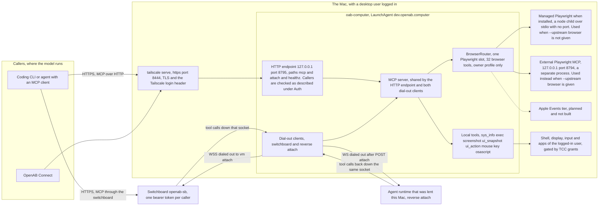
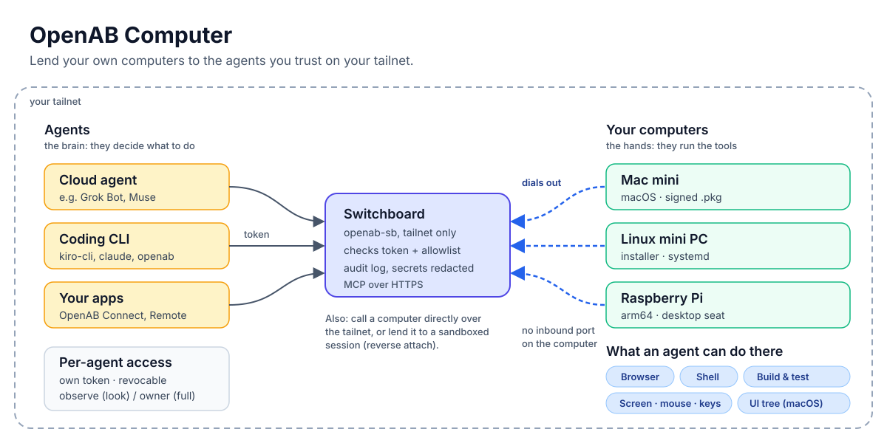
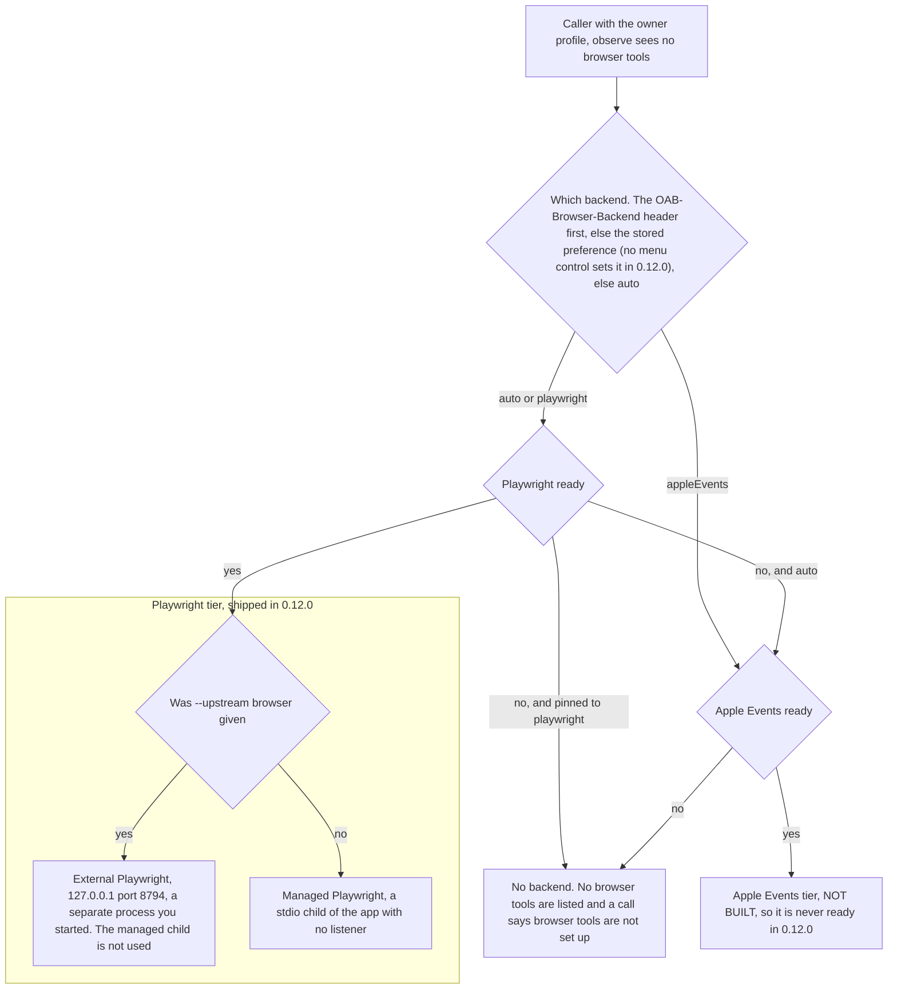

# OpenAB Computer (`oab-computer`)

> **Name.** The product is OpenAB Computer (repository `openabdev/openab-computer`, tracked in
> [#63](https://github.com/openabdev/openab-computer/issues/63)). Since 0.12.0 the executable, bundle
> id (`dev.openab.computer`), LaunchAgent, systemd units, directories and release assets are all named
> `oab-computer`. It was `oab-instance-mcp` up to 0.11; see
> [Upgrading from 0.11 or earlier](#upgrading-from-011-or-earlier). Commands in this README use the new names.

The "hands and feet" half of [openabdev/openab#1544](https://github.com/openabdev/openab/issues/1544):
a thin daemon that lives in a Mac's logged-in desktop session and exposes the machine to a
coding CLI or agent elsewhere on the tailnet as **MCP servers**. Nothing here is smart; all
the intelligence stays in the caller.

> **Read before deploying.** `exec` is an unrestricted shell as the logged-in user, and `mouse`,
> `key` and `osascript` drive the desktop. There are two profiles: `observe` (`sys_info` and
> `screenshot`) and `owner` (every local tool and browser tool). Every `/mcp` and `/attach`
> request, and every switchboard caller, must present a bearer token. A switchboard can also keep
> a per-caller allow-list. `owner` is not a security boundary
> ([#45](https://github.com/openabdev/openab-computer/issues/45)). Run this only on a Mac you own,
> for callers you would trust with your keyboard.
>
> Installing the `.pkg` (or `install-prebuilt.sh`) runs `tailscale serve --bg --https=8444`, so the
> Mac is reachable on your tailnet at `:8444` right after the install. A caller still needs the
> bearer token and an allowed Tailscale login. A plain app launch without the installer creates no
> mapping until you turn tailnet access on, but it leaves an existing `:8444` mapping in place. See [Download and install](#download-and-install).



Read it left to right: the model and its reasoning live in the caller; the machine only receives
tool calls, and the daemon can do nothing a logged-in user sitting at it could not do. Without a
switchboard, everything on the right is one machine and no cloud hop: `tailscale serve` terminates
TLS and stamps each request with the caller's Tailscale identity, which the daemon checks together
with a bearer token. The switchboard path (`--switchboard`) is for a Mac that can only dial out.
The daemon dials the switchboard, and the switchboard routes caller requests down that socket. On
macOS the tools that touch screen or input are gated by TCC, granted once to the stable bundle id.
The loop the tools are built for: `screenshot` → decide →
`mouse` / `key` / `osascript` / `exec` → `screenshot` to confirm. SSH already gives you a shell;
this exists for what SSH cannot reach.

The browser part of the diagram is covered in [Browser tools](#browser-tools). The
Apple Events tier is drawn with a dotted arrow because it is planned and not built. The diagram shows
the macOS app. The Linux node is described in [`docs/linux-setup.md`](docs/linux-setup.md).

## Contents

- [Goal](#goal) · [Features](#features) · [Status and known limits](#status-and-known-limits) · [Quick start](#quick-start) · [Platforms](#platforms)
- [Tools](#tools) · [Auth](#auth) · [Network interfaces and ports](#network-interfaces-and-ports)
- [Reverse attach](#lending-this-mac-to-a-sandboxed-agent-reverse-attach) · [Switchboard](#serving-a-switchboard---switchboard) · [Browser tools](#browser-tools)
- Deploy & operate: [Download and install](#download-and-install) · [Upgrading from 0.11](#upgrading-from-011-or-earlier) · [Build & test](#build--test-on-the-build-mac-the-laptop-never-compiles-swift) · [Deploy](#deploy-run-on-the-target) · [Menu bar](#menu-bar) · [Operate](#operate)
- Operator notes: [TCC & signing](#tcc-grants-survive-re-deploys-only-if-the-signature-does) · [Gotchas](#gotchas)
- Detail: [Docs index](docs/README.md) · [Upgrade guide](docs/upgrade-0.12.md) · [Browser tools guide](docs/browser-tools.md) · [UI tools](docs/ui-tools.md) · [Operator notes and gotchas](docs/operators.md)

Components: `oab-computer` is this package (Swift on macOS, zero deps; Rust on Linux). Browser
tools come from `@playwright/mcp`, which is not our code. On macOS the app installs, runs and
removes it for you (see [Browser tools](#browser-tools)); an
external one is the advanced option ([`poc/pw-mcp/README.md`](poc/pw-mcp/README.md)).
Design notes: [`docs/requirements/connect-closed-loop.md`](docs/requirements/connect-closed-loop.md).

## Goal



Let agents on your tailnet use your own computers, a Mac mini, a Linux mini PC or a Raspberry Pi,
once you have authorized or paired them with a token and a tool profile. An agent can drive the
browser and everything else you would do on that machine: build, compile and test, use the desktop,
and run everyday tasks. Each grant is per agent and can be revoked. The `observe` profile gives
read-only access (screenshot and system info), and `owner` gives full control. On macOS the full
tool set is available, including the accessibility-tree tools. On Linux the browser, shell,
screenshot, mouse and key tools are available, but the accessibility-tree tools are not yet
([#102](https://github.com/openabdev/openab-computer/issues/102)).

## Features

- **Browser:** a Playwright-driven Chromium on the machine. `browser_snapshot` returns the page as an accessibility tree. The `browser_*` tools need the `owner` profile.
- **Shell, build and test:** `bash` on Linux, `exec` on macOS. Background jobs (`exec_start`, `exec_poll`, `exec_list`, `exec_cancel`) run long builds, and they keep running if the connection drops.
- **Desktop control:** screenshots, mouse and keyboard. AppleScript (`osascript`) is macOS only.
- **Accessibility tree (macOS):** `ui_snapshot` reads a window's controls with refs. `ui_action` presses or sets them by ref without moving the pointer.
- **Access control:** a bearer token per caller. A caller gets the `observe` profile (read-only: `sys_info` and `screenshot`) or `owner` (full control). A switchboard can also keep a per-caller tool allowlist.
- **Reverse attach:** lend a machine to a sandboxed agent session with a time-limited grant that can be revoked.
- **Switchboard:** the machine dials out to a relay, so callers reach it without an inbound port on the machine.
- **Platforms:** macOS (signed, notarized `.pkg`) and Linux nodes such as a Raspberry Pi or a mini PC, installed with an installer script.

The accessibility-tree tools are macOS only for now; Linux is deferred
([#102](https://github.com/openabdev/openab-computer/issues/102)).

## Status and known limits

- macOS has `ui_snapshot` (0.9.0) and `ui_action` (0.10.0). Linux has neither yet; the AT-SPI port
  is deferred ([#102](https://github.com/openabdev/openab-computer/issues/102)).
- `owner` is not a security boundary ([#45](https://github.com/openabdev/openab-computer/issues/45)).
  Only `observe` is.
- Switchboard callers are authorized by bearer token only. Binding a caller to its tailnet identity
  is open ([openabdev/openab-sb#20](https://github.com/openabdev/openab-sb/issues/20)).
- Switchboard audit logs record `ui_action` values and `key` text in full unless openab-sb 0.2.2 or
  later is in use ([#14](https://github.com/openabdev/openab-sb/issues/14),
  [#16](https://github.com/openabdev/openab-sb/pull/16)).
- Browser tools use one persistent browser profile per computer, with its cookies and logins.
- The browser router in 0.12.0 has only the Playwright backend. The Apple Events tier is not built,
  and neither is the "use my installed Chrome" fallback if macOS refuses the downloaded Chromium
  ([#128](https://github.com/openabdev/openab-computer/issues/128)).
- Linux in 0.12.0 and earlier has no managed browser tier: Playwright there is an external unit on
  `127.0.0.1:8794`. The managed tier ([#119](https://github.com/openabdev/openab-computer/issues/119),
  [ADR](docs/adr/linux-browser-tier.md)) comes in releases after 0.12.0; the tarball's installer and
  `oab-computer browser ...` then replace that unit. See [Linux setup](docs/linux-setup.md).
- The Linux installer asked for `wlrctl` in 0.12.0 and earlier, although nothing uses it, and exited 78 on
  Ubuntu arm64 where it is not packaged. It no longer asks for it
  ([#130](https://github.com/openabdev/openab-computer/issues/130)).

## Quick start

**macOS** — download `oab-computer-VERSION-universal.pkg` from
[Releases](https://github.com/openabdev/openab-computer/releases), double-click, and follow the
permissions wizard ([details](#download-and-install)). Then point a caller at it:

```sh
kiro-cli mcp add --name mac-mcp --url https://<host>.<tailnet>.ts.net:8444/mcp \
  --header "Authorization: Bearer $(ssh <host> cat ~/.config/oab-computer/token)" \
  --scope global --timeout 30000
```

**Through a switchboard** (the usual path for a Mac that dials out): the caller uses the
switchboard's per-computer route and its own bearer token. The first call is `initialize`. If the
response sets `Mcp-Session-Id`, send that header on later calls.

```sh
curl -s https://<switchboard>.<tailnet>.ts.net/mcp/<computer> \
  -H "Authorization: Bearer <caller-token>" \
  -H "Content-Type: application/json" \
  -H "Accept: application/json, text/event-stream" \
  -d '{"jsonrpc":"2.0","id":1,"method":"initialize","params":{"protocolVersion":"2025-06-18","capabilities":{},"clientInfo":{"name":"curl","version":"0"}}}'
```

**Linux** (Raspberry Pi, Intel mini PC) — one installer does the whole node
([full guide](docs/linux-setup.md)):

```sh
V=X.Y.Z   # a release after 0.12.0: this page describes its installer. 0.12.0 ships the older installer
         # (unauthenticated browser unit on 8794, root actions through sudo, exits 78 on Ubuntu arm64)
A=$(dpkg --print-architecture)   # arm64 | amd64
curl -fsSLO "https://github.com/openabdev/openab-computer/releases/download/v$V/oab-computer-$V-linux-$A.tar.gz"
tar xzf oab-computer-$V-linux-$A.tar.gz && cd oab-computer-$V-linux-$A
./install-linux.sh                # a box with no desktop: add --headless-seat
```

The URL is `https://<host>.<tailnet>.ts.net:8444/mcp` and the bearer token is in
`~/.config/oab-computer/token` on the node.

## Platforms

| | macOS | Linux |
|---|---|---|
| Implementation | Swift (Network.framework + ScreenCaptureKit) | Rust (`poc/reverse-attach-linux/`) |
| Screen / input | ScreenCaptureKit · CGEvent, gated by TCC | grim (JPEG encoded in-process) · wlroots virtual pointer · wtype on a wlroots seat (labwc, sway) |
| Shell | `exec` / `exec_start*` (`zsh -f`) | `bash` / `exec_start*` (`bash -c`) |
| Apps | `osascript` / JXA | — (use `bash`: `gdbus`, `xdg-open`) |
| Accessibility tree (`ui_snapshot` / `ui_action`) | ✅ (0.9.0 / 0.10.0) | deferred ([#102](https://github.com/openabdev/openab-computer/issues/102)) |
| Browser tools | managed Playwright (installed from the wizard, stdio child, no port) or external via `--upstream` | managed Playwright (`oab-computer browser install`, stdio child, no port) after 0.12.0; external unit on loopback `8794` in 0.12.0 and earlier ([#119](https://github.com/openabdev/openab-computer/issues/119)) |
| Reverse attach | ✅ | ✅ |
| Install | signed/notarized `.pkg` | `-linux-{arm64,amd64}.tar.gz` + `install-linux.sh` |
| Guide | this README | [`docs/linux-setup.md`](docs/linux-setup.md) |

The rest of this README is the macOS reference; the two platforms share the wire contract, auth
and reverse-attach shape, so callers configure them identically. On Linux the job tools
(`exec_start`, `exec_poll`, `exec_list`, `exec_cancel`) take the same arguments and return the
same `structuredContent`; their logs are under `$XDG_STATE_HOME/oab-computer/jobs/`
(default `~/.local/state/…`), and they are `owner`-only there too
([`docs/linux-setup.md`](docs/linux-setup.md#background-jobs)).

## Tools

| tool | what | notes |
|---|---|---|
| `sys_info` | host, OS, chip, displays, tailnet IPs, console user, TCC status | call first; tells the model what will work |
| `exec` | `zsh -f -c <command>` as the desktop user | `cwd` (a leading `~` is expanded and validated — a missing dir or unreadable external volume returns a clear error, not a hang), `env`, `timeout_secs` (≤600), `max_output_bytes` (≤1 MiB/stream). Spawned with `POSIX_SPAWN_SETSID`; timeout → `killpg` → exit 137, `timed_out=true`. `structuredContent` carries exit/stdout/stderr/duration. Use for commands that finish in seconds |
| `exec_start` | start a background job, return a `job_id` immediately | for work that outlives one request (release builds). Same shell/session/TCC as `exec`; `cwd`, `env`, `timeout_secs` (0 = no timeout, stop via `exec_cancel`). stdout/stderr are tee'd to `~/Library/Logs/oab-computer/jobs/<job_id>.out`/`.err` (never truncated; survive after the job is forgotten; `tail -f`-able) |
| `exec_poll` | fetch a job's state + incremental output | `job_id`, optional `stdout_since`/`stderr_since` byte offsets (from the prior poll) for only-new output; reads from the log files by seek. Terminal `state` (`exited`/`killed`) carries `exit_code`; `out_path`/`err_path` point at the files |
| `exec_list` | all running jobs + the 10 most recently finished | recover a forgotten `job_id` or see what is running; each entry has state, pid, exit_code, command, cwd, timestamps, stdout/stderr byte sizes |
| `exec_cancel` | stop a running job (or drop a finished one) | `job_id`, `signal` `KILL` (default) / `TERM` — signals the whole process group; poll once more for final output. Finished jobs are dropped from the registry (log files stay on disk) |
| `screenshot` | ScreenCaptureKit → JPEG/PNG as MCP `image` content | `display`, `scale` (px per point, default 1.0), `region` {x,y,w,h} crop in points, `format`, `quality`. Needs Screen Recording TCC. Read small UI text with `region` + `scale: 2` |
| `ui_snapshot` | Accessibility tree of a native app's window, read-only | Read-only. `owner` only. Targets the frontmost window by default; arguments, bounds and masking are in [docs/ui-tools.md](docs/ui-tools.md#ui_snapshot). Needs Accessibility TCC. macOS only |
| `ui_action` | Act on a `ui_snapshot` node by ref, without moving the pointer | `owner` only. Actions: `press`, `set_value`, `focus`, `show_menu`, `confirm`, `cancel`, `increment`, `decrement`. Refs are tied to a snapshot; stale refs are refused. No pointer movement; `activate: true` is opt-in. Secure fields are refused over a switchboard by default. Full detail: [docs/ui-tools.md](docs/ui-tools.md#ui_action). Needs Accessibility TCC. macOS only |
| `mouse` | CGEvent: `move` `click` `double_click` `right_click` `drag` `scroll` | coordinates in display points = screenshot pixels at scale 1. `modifiers`. Needs Accessibility TCC |
| `key` | CGEvent: `type` (unicode, layout-independent) / `press` combos (`cmd+shift+4`) | Needs Accessibility TCC |
| `osascript` | AppleScript / JXA via `/usr/bin/osascript` in the GUI session | `timeout_secs` (default 15). First script against an app raises an Automation consent dialog on the Mac — screenshot, then `mouse` click Allow |
| `browser_*` (32) | Playwright browser tools, `owner` only (`observe` sees none) | On macOS they go through the browser router to the managed or external Playwright; on Linux (after 0.12.0) they come from the managed Playwright, and in 0.12.0 and earlier from the external one (`MCP_UPSTREAM`). Names are listed below the table. `browser_evaluate` and `browser_run_code_unsafe` run arbitrary JavaScript in the computer's persistent profile. See [Browser tools](#browser-tools) and [docs/tool-profiles.md](docs/tool-profiles.md) |

The 32 `browser_*` names, grouped by how well the planned Apple Events tier could serve them
(`BrowserToolCatalog`). That tier is not built in 0.12.0, so today every call goes to Playwright and the
grouping only shows what a later tier could cover:

| Planned Apple Events support | Tools |
|---|---|
| full | `browser_navigate`, `browser_navigate_back`, `browser_fill_form`, `browser_select_option`, `browser_wait_for`, `browser_close` |
| limited | `browser_snapshot`, `browser_find`, `browser_click`, `browser_type`, `browser_press_key`, `browser_hover`, `browser_tabs`, `browser_resize`, `browser_evaluate`, `browser_mouse_wheel` |
| none | `browser_take_screenshot`, `browser_console_messages`, `browser_run_code_unsafe`, `browser_file_upload`, `browser_drop`, `browser_pdf_save`, `browser_network_requests`, `browser_network_request`, `browser_handle_dialog`, `browser_emulate_media`, `browser_drag`, `browser_mouse_move_xy`, `browser_mouse_click_xy`, `browser_mouse_drag_xy`, `browser_mouse_down`, `browser_mouse_up` |

Which tool reads the screen: `browser_snapshot` for web pages, `ui_snapshot` for native apps
(exact roles, titles and frames, cheaper than reading an image), and `screenshot` + `mouse` for
custom-drawn or canvas content that has no accessibility tree. A `ui_snapshot` contains field
values and on-screen text (secure text fields are masked, other fields are not), so a caller
that stores snapshots must mask them first. An element whose role cannot be read is kept as a
leaf with no value and no children, since it cannot be ruled out as a secure field.

To act on a native app without taking the pointer: `ui_snapshot` → `ui_action {snapshot_id, ref,
action}` → `ui_snapshot` again to confirm. `set_value` replaces the whole value, and some apps
commit a field only on `confirm` or when focus moves. Drags, gestures and custom-drawn content
that has no accessibility node stay on `screenshot` + `mouse`. Ref containment and stale-ref
rules are in [docs/ui-tools.md](docs/ui-tools.md#refs-and-stale-refs).

The loop the tools are designed for: `screenshot` → decide → `mouse`/`key`/`osascript` → `screenshot` to confirm.
Verified 2026-09-22 from the laptop: open TextEdit, type a line, read it back, close via the save
sheet's Delete button located from a screenshot, quit — 0.15–0.8 s per call.

Planned: a streaming capture sink for OpenAB Connect (see requirement doc).

## Auth

Evaluated per request in `AuthPolicy`; the server refuses to start with nothing configured.
Configured checks are **AND**-combined: a request must pass every check that is set.

- `--allow-login <email>` — matches `Tailscale-User-Login` case-insensitively (both sides are
  lowercased; the principal logged is the lowercased login), which `tailscale serve` **injects and
  overwrites** (verified: a client-supplied header is replaced). This is the primary control.
- `--token <s>` / `--token-file <p>` — additionally require `Authorization: Bearer`, constant-time
  compared. The token after the `Bearer` scheme (case-insensitive) must match byte for byte;
  whitespace around the whole header value is stripped by the HTTP parser, nothing inside it is.
  **`deploy.sh` now generates one at `~/.config/oab-computer/token` (mode 600) and passes
  `--token-file`**, so the deployed agent requires *both* an allow-listed Tailscale login *and* the
  bearer token. This is defence-in-depth: a leaked tailnet auth key that enrols a node as
  your Tailscale login passes the login check but still gets `401` without the token (verified
  2026-09-23: no token → 401, correct token → 200, wrong token → 401). The token is stable across
  re-deploys; rotate by deleting `~/.config/oab-computer/token` (macOS) and re-deploying. The first 0.12 run copies a 0.11 token from `~/.config/oab-instance-mcp/token` once, when `~/.config/oab-computer` is created; after that the old file is never read again, so a deleted token is not restored from it. The menu bar shows a masked form and
  copies the full token (see below); it is never written to `agent.log`.
- `--insecure-local` — allow bare loopback requests with no Tailscale headers. Debugging only.
- `/healthz` is unauthenticated and says only `ok`.

Trust model: `exec` is a full shell as the logged-in user. `/mcp` is "my CLI on my Mac". A
sandboxed agent never gets `/mcp`; it gets a **reverse attach** under the `observe` or `owner`
profile (below).

## Network interfaces and ports

This section describes v0.12.0 (and `main` at the time of writing). Where the Linux bullets say "after 0.12.0", they describe `main`, not the 0.12.0 release. Checked by reading the code and by a read-only look at a running agent
(an older 0.10.1 install) and a bare 0.12.0 launch. The menu bar item's Network section shows the
same facts (see [What the menu shows](#what-the-menu-shows)).

The app runs `tailscale serve` in three cases, all for port 8444 only: (a) `serve --bg --https=8444 ...`
after you turn tailnet access on, from the wizard's tailnet page or the menu; (b) the same command at
launch, to re-apply the mapping when you had already turned access on and the mapping is missing; (c)
`serve --https=8444 off` after you turn access off, and as an automatic safety removal when no
Tailscale login is detected and no `--allow-login` is configured. Every other Tailscale call is
read-only.

### Listening sockets

| Address:port | Protocol | Who can reach it | What it is for | How it is enabled | Auth |
|---|---|---|---|---|---|
| `127.0.0.1:8795` (`--host`, `--port`; `--path` for the `/mcp` route) | TCP, plain HTTP/1.1 | Processes on this Mac only | `/mcp` (POST, DELETE), `/attach` (reverse attach; off with `--no-attach`), `/healthz`. Anything else is 404 | Always, on IPv4 loopback by default. No-flag launch from Finder, the installer's LaunchAgent, or a manual launch. A no-flag launch also briefly binds the port to test it is free, without listening | `/mcp` and `/attach`: [Auth](#auth). `/healthz`: none |
| `https://<host>.<tailnet>.ts.net:8444` → `127.0.0.1:8795` | HTTPS, terminated by Tailscale | Your tailnet only | The way other machines reach the agent | `scripts/install-prebuilt.sh` (and the `.pkg`) run `tailscale serve --bg --https=8444`. The app runs the same command only after you turn tailnet access on, from the wizard's tailnet page or the menu's "Allow tailnet access…", and removes it with "Turn Off Tailnet Access". A launch with no stored opt-in does not create it. A launch with a stored opt-in re-applies it when it is missing. A mapping that already exists is shown as "On (existing mapping, not managed by this app)" and left alone until you choose "Manage with this app" | Every configured check must pass. The installer configures both: a Tailscale login on the allow list **and** the bearer token |
| `127.0.0.1:8794` | TCP, HTTP | Processes on this Mac only. Other machines reach the browser tools only through the app's `--upstream` | Playwright MCP, a **separate process** the app only connects to (`--upstream`). It has no `:8443` or other tailnet access path | Its own LaunchAgent (`poc/pw-mcp/install.sh`), which binds `--host 127.0.0.1` and creates no `tailscale serve` mapping. The app never starts this one. The *managed* Playwright (see [Browser tools](#browser-tools)) is a different thing: a child over stdio that listens on nothing | None in Playwright. The app's [Auth](#auth) applies to callers before it relays browser tools |

The macOS app opens one listening socket. It uses no UDP and no Unix domain sockets. The tables here describe the macOS app; the Linux node's listeners are in
[Linux setup](docs/linux-setup.md#ports) and in the section "macOS app and Linux node" below. The `:8444`
mapping is made by the installer, by the app after you turn tailnet access on, or by the app's launch
re-apply of that choice. Nothing in this repo maps `:8443` any more. Older versions of
`poc/pw-mcp/install.sh` did (`tailscale serve --bg --https=8443 http://127.0.0.1:8794`), which put
the unauthenticated Playwright MCP on your whole tailnet. Re-running the new installer does not
remove it. Check for it and remove it on any Mac that ran the old installer:

```sh
tailscale serve status              # look for :8443 pointing at http://127.0.0.1:8794
tailscale serve --https=8443 off    # remove only that mapping
```

Browser tools keep working afterwards, because the app reaches Playwright over loopback. The new
installer runs the read-only `serve status` at the end and prints a warning if it finds the mapping.

### Outbound connections

| What | To where | When | What it is for |
|---|---|---|---|
| On-demand Playwright install, HTTPS | The app's own downloads (Node, Chromium) go to `nodejs.org` and `storage.googleapis.com` and refuse redirects to any other host. The downloaded Node's `npm ci` then connects to `registry.npmjs.org`; the app does not bound or inspect npm's connections or redirects, and the lockfile pins every package to that host and to a `sha512` digest. The install's final health check also starts the installed Chromium once, and its own connections are Chromium's (see below) | Only when you choose to install or update Playwright (the install step is offered, pre-checked, and you can uncheck it). Never at launch, never in the background | Download Node, the pinned `@playwright/mcp` and the pinned Chromium. See [What the app downloads](#what-the-app-downloads) |
| Upstream MCP, HTTP(S) | The URL given to `--upstream`. The installer uses `http://127.0.0.1:8794/mcp`. The app does not require loopback | Only with `--upstream`. The installer adds it when the Playwright agent is loaded | Browser tools |
| Switchboard, WebSocket | `wss://<switchboard-host>.<tailnet>.ts.net/vm/attach`. `ws://` only to loopback | Only with `--switchboard` or a saved switchboard config. Redials for the life of the process | [Serving a switchboard](#serving-a-switchboard---switchboard) |
| Reverse attach, WebSocket | `ws(s)://<runtime>/tools/attach/<session>`. The runtime and port come from the grant | Only after a `POST /attach`. Saved grants are redialled at launch | [Reverse attach](#lending-this-mac-to-a-sandboxed-agent-reverse-attach) |
| Mint call, HTTP(S) | `http(s)://<runtime>/admin/sessions/<session>/tools-attach` | Only when the `/attach` body carries an `admin_credential` | Get a one-time attach secret |
| `tailscale status --self --peers=false --json` | Local child process (read-only) | On the no-flag first-run launch, on every menu-bar launch with an allow list (to read the login), when the app reads the existing mapping at launch, when you turn tailnet access on, and in the recheck while no Tailscale login is detected | Find your Tailscale login and tailnet name, and tell whether `tailscaled` is running |
| `tailscale serve status --json` | Local child process (read-only) | When the app checks the `:8444` mapping: at launch, when you turn tailnet access on or off, and on the recheck while no Tailscale login is detected | See whether `:8444` is mapped, and to what |
| `tailscale serve --bg --https=8444 http://127.0.0.1:8795` and `tailscale serve --https=8444 off` | Local child process (changes the mapping) | When you turn tailnet access on or off in the wizard or the menu. If you had turned it on, a launch re-applies it once when the mapping is missing. With no Tailscale login detected and no `--allow-login` configured, launch and the recheck run `serve --https=8444 off` if `:8444` still maps to this app | Create or remove the tailnet HTTPS mapping on `:8444` |

The menu bar and the permission wizard also start local processes (`open`, `launchctl`, a
`--permission-check` re-run of the app). These make no network connections.

### What the app downloads

This section is about the macOS app. The Linux install downloads the same three pinned things (Linux builds, about 259 MB, see [Linux setup](docs/linux-setup.md#what-the-install-downloads)).

Nothing is bundled in the app and nothing is fetched until you ask. The on-demand Playwright install
downloads three things into `~/Library/Application Support/oab-computer/playwright/` (never inside
the app bundle), for the architecture of this Mac:

| What | From | Version |
|---|---|---|
| Node.js (includes `npm`) | `https://nodejs.org/dist/v24.22.3/` | 24.22.3 |
| `@playwright/mcp` and its dependencies (3 npm packages) | `https://registry.npmjs.org/`, fetched by the downloaded Node's `npm ci --ignore-scripts` | 0.0.82 (with `playwright-core` 1.64.0-alpha-1789764292000) |
| Chromium (Chrome for Testing) | `https://storage.googleapis.com/chrome-for-testing-public/154.0.8037.0/` | 154.0.8037.0 |

Download: about 249 MB (Apple silicon) or 260 MB (Intel). On disk once installed: about 593 MB (Apple silicon) or 606 MB (Intel).
While it runs, the install needs the downloads plus the unpacked files, so about 842 MB of free space on Apple silicon
(about 867 MB on Intel), and an internet connection. The check is the larger of three times the download and the download plus the
unpacked size. It is not the 593 MB figure: that is what remains afterwards.

- Every file is checked against sizes and SHA-256 digests built into the signed app, **before** it is
  extracted. The npm packages are checked against a lockfile built into the app (`sha512` integrity
  for each package, all from `registry.npmjs.org`). The downloaded Node must also pass a code-signature
  check against the Node.js release team. A mismatch installs nothing.
- Archives are checked before anything is written (no absolute paths, `..`, links that leave the
  folder, devices, or oversize entries) and are extracted by the app itself, not by `tar` or `unzip`.
- `npm` makes its own connections to `registry.npmjs.org`; the app's host list does not bound `npm`,
  which is why the lockfile allows no other host.
- The app never adds or removes `com.apple.quarantine`. If macOS refuses to run the downloaded
  browser, the install stops with that message.
- The Chromium it installs is a browser: the connections it makes while running (the pages it opens, and any background service Chrome for Testing contacts) are Chromium's, not the installer's, and the app does not bound them. On the pinned build it opened no listening TCP or UDP socket, and it exits when its stdin closes.
- The install adds no LaunchAgent and no listener. An update is only ever offered, never applied
  silently. Removing Playwright deletes the version folders that carry the installer's marker (even when `install.json` is unreadable, invalid or hand-made), and also the browser profile and its cookies when the installer's own, readable `install.json` confirms it created that profile (a profile or output folder that already existed is never used: install stops and leaves it alone). A hand-made `install.json` is never replaced or removed: install refuses and remove leaves it alone (a version folder carrying the installer's marker is still removed). An `install.json` that is unreadable or invalid proves nothing, so remove leaves it and the profile and output folder too, even if this app created them.
- The numbers above come from the manifest in `release/playwright-pins/`; the release check
  (`scripts/playwright-pins.py`, run in CI) fails if they drift.

### What the app never does

This is about the macOS app process. Tools such as `exec` start child processes that can do anything
your user can.

- It opens no UDP socket and no Unix domain socket.
- It does not bind a non-loopback address unless you pass `--host`.
- It serves no TLS. Tailscale terminates TLS in front of it.
- It never runs `tailscale funnel`, `up`, `set` or `cert`. It runs `tailscale serve` (and
  `serve … off`) only for port 8444. It does so after you turn tailnet access on or off, for the
  one launch re-apply of a choice you already made, and for one safety removal: when no Tailscale
  login is detected and no `--allow-login` is configured, at launch and on its recheck, it runs `tailscale serve --https=8444 off` if
  `:8444` still maps to this app, because the bearer token alone would then guard that path.
- Nothing in the menu's Network section probes a port or changes a setting, except the explicit tailnet actions the menu offers. The rows are read from
  the app's own state.
- On the switchboard path it dials out and opens no extra listener.
- It downloads nothing at launch and nothing in the background. The only download is the on-demand Playwright install, which runs when you ask for it and is listed under [What the app downloads](#what-the-app-downloads).
- It never adds or removes `com.apple.quarantine` on anything it downloads.

### Exposing it

The tailnet mapping belongs to `tailscaled`. The installer creates it, or the app does when you turn
tailnet access on (and re-applies it at launch if you had turned it on and it is missing). Removing it (`tailscale serve --https=8444 off`, or "Turn Off Tailnet Access" in
the menu) closes the tailnet path and leaves the loopback listener.

A caller must pass every configured check. The installer always sets both, so a tailnet caller needs
an allow-listed Tailscale login **and** the bearer token. A no-flag launch falls back to the token
alone if it cannot find your login, and so does a manual launch without `--allow-login`. Playwright MCP
has no auth of its own, so it stays on loopback and is reached only through the app. The app does not
guard `--host`: a non-loopback value binds in plain HTTP. The menu's Local MCP row then says
"reachable from other devices", but the app does not block it. The app
trusts a `Tailscale-User-Login` header from any peer, so on a non-loopback bind only the bearer
token stops a forged header. Keep the default, and always set a token.

### What the menu shows

The menu bar item has a **Network** section with one row for each of the app's own listener and connections described above. The rows come
from the app's own state (its `--host`, `--port` and `--upstream` options, its tailnet record and its
attach manager), not from a port scan. The menu connects to nothing to fill them in. When it cannot
tell, it says so. The Tailnet row reads "checking…" from launch until the first `serve status` read
finishes, then "Off", "On" or "unknown (Tailscale status unreadable)"; it never shows "Off" before that read.
Example:

```
Network
Local MCP: http://127.0.0.1:8795/mcp (this Mac only)
Tailnet: On, https://<host>.<tailnet>.ts.net:8444/mcp (your tailnet only)
Browser tools: 127.0.0.1:8794 (separate process, this Mac only)
Switchboard: not configured
Reverse attach: 0 live grants
```

The Tailnet row comes only from Tailscale state (the read-only `serve status` result and your stored
choice), never from `--public-url`. A `--public-url` that is not the local URL is shown only on the top URL line. When the app has no
Tailscale state of its own (an installer owns another port), the Tailnet row reads "unknown (not
checked by this app)", whatever the public URL is. The Browser tools row says "this Mac only" about
the app's own `--upstream` address. Playwright has no tailnet mapping; the note under the table above covers older installs.

Clicking the Local MCP row or the Tailnet URL copies it. Tailnet can also read "Off", "On (existing
mapping, not managed by this app), <url>" or "opted in, not applied (see the log)". Browser tools
shows the external `--upstream browser` address (and says "(remote)" for a
non-loopback host), or, with no such upstream, the managed Playwright state ("Playwright ready", "Playwright not installed", "Playwright install not usable" or "Playwright unavailable"),
for example `Browser tools: Playwright ready`. Reverse attach reads "off" with `--no-attach`. The tailnet actions (Allow, Turn
Off, Manage with this app) and the Switchboard actions (Configure, Reconnect, Disconnect & forget)
stay in the menu: the tailnet actions right after the Tailnet row, the Switchboard actions after the
permissions block.

### macOS app and Linux node

The Linux node (`poc/reverse-attach-linux/`) has one daemon listener (`127.0.0.1:8795` when installed
by `install-linux.sh`). After 0.12.0 the browser is a managed child with no TCP or UDP port of its own (it holds
two private Unix sockets in its own `0700` temporary directory, see
[Linux setup](docs/linux-setup.md#ports)); 0.12.0 and earlier, and any host that still runs the old
browser unit, also have a Playwright listener on `8794` with no authentication. The differences from
macOS:

- It reads `BIND` from the environment, not flags. A bare binary listens on `127.0.0.1:8790`.
  `scripts/install-linux.sh` sets `127.0.0.1:8795`.
- `/attach` is always on. There is no `--no-attach`.
- There is no switchboard and no menu bar.
- 0.12.0 and earlier: `install-linux.sh` runs `sudo tailscale serve` when passwordless sudo exists, and installs
  `oab-computer-pw-mcp.service` on unauthenticated `127.0.0.1:8794` plus an `MCP_UPSTREAM` line when
  `node` and `npm` exist, unless `--no-browser` is given.
- After 0.12.0, `install-linux.sh` never runs `sudo` on its own. It prints each root action (linger,
  `tailscale serve` for `:8444`, the AppArmor profile, missing libraries, fonts) with its exact
  command and reason, and runs them only with `--apply-system-changes`.
- After 0.12.0, `install-linux.sh` downloads nothing without consent. On a terminal it shows what the browser
  install downloads and asks `[Y/n]`; with no terminal it downloads only with `--browser managed` or
  `--yes`; `--browser none` (or `--no-browser`) skips it. It writes no browser unit and no
  `MCP_UPSTREAM` line. What is downloaded, how big and where it goes is in
  [Linux setup](docs/linux-setup.md#what-the-install-downloads); it matches the macOS table above
  except for the per-architecture sizes, the install root below, and that the downloaded Node.js gets no code-signature check on Linux (only the pinned SHA-256)
  and there is no quarantine step. The install root is `${XDG_DATA_HOME:-$HOME/.local/share}/oab-computer/playwright/`,
  and `oab-computer browser remove` deletes only what carries the installer's marker.
- `MCP_UPSTREAM` takes plain `http://` URLs only, and every `name=url` entry the daemon uses must be a literal loopback
  `http://127.0.0.1:<port>` or `http://[::1]:<port>` URL: any other host stops the daemon with exit 64. A `browser=` entry that a managed install ignores is not checked.
  A managed install wins over a `browser=` entry unless `MCP_BROWSER_BACKEND=external` is set.
- A host that still runs an old browser unit has an **unauthenticated** port 8794: any local user on
  this node can call every browser tool there, including `browser_run_code_unsafe` (arbitrary Node
  code). The installer warns with the exact `systemctl --user disable --now <unit>` command and does
  not touch the unit; see [Upgrading a host that already has a browser unit](docs/linux-setup.md#upgrading-a-host-that-already-has-a-browser-unit).
- After 0.12.0, sign in once, for a login the browser keeps: `ssh -t <node> '~/.local/oab-computer/oab-computer browser signin'`
  ([Sign in](docs/linux-setup.md#sign-in)). The profile is obfuscated with `--password-store=basic`,
  not strongly encrypted.
- The Linux node does use a Unix domain socket: it connects, as a client, to the Wayland socket for
  display and pointer control. The daemon itself does not listen on one; the managed browser's process
  tree holds two listening Unix sockets of its own in a private `0700` directory (see above).
- The mint call is plain `http://` only. A `wss://` runtime with `admin_credential` is refused.

## Lending this Mac to a sandboxed agent (reverse attach)

An agent in an `openab-pty` session cannot reach this Mac — the pod has no tailnet egress by design
(it does reach the internet, for its model API, git and package registries). So
**this Mac dials the pod** and serves MCP over that socket with a narrowed tool list. Design:
[`docs/adr/reverse-attach.md`](docs/adr/reverse-attach.md); wire contract: openab-pty
`CLIENT-CONTRACT.md` §9.

```
  Connect / Remote ──POST /attach (your credential)──► this Mac ──WS dials in──► openab-pty pod
                                                                                    └─► CLI in the session
```

```sh
# "lend my Mac to session laptop for an hour, look only"; the Mac mints the attach secret at
# the runtime with its admin credential (used once, not stored) and dials in. Use "owner" for
# full control (shell, input and browser).
curl -s -X POST -H "Authorization: Bearer $TOKEN" -H 'Content-Type: application/json' \
  -d '{"runtime":"ws://<pod>.<tailnet>.ts.net:8090","session":"laptop","profile":"observe",
       "ttl_secs":3600,"admin_credential":"<openab-pty admin credential>"}' \
  https://<host>.<tailnet>.ts.net:8444/attach
# → 202 {"id":"…","profile":"observe","requested_profile":"observe","state":"idle"|"attached",…}
#   GET /attach lists · DELETE /attach/{id} revokes
```

- **`/attach` uses the same `AuthPolicy` as `/mcp`** — the human's tailnet login + bearer. The grant
  lives on this Mac; the phone can be put away after the tap.
- **Profiles** are per grant and fixed for its life. There are two
  ([#59](https://github.com/openabdev/openab-computer/issues/59)): `owner` = every local tool and
  every browser tool; `observe` = `sys_info` + `screenshot` only. A request without `profile` gets
  `observe`. Any other value is a 400 `profile must be one of [owner, observe]`, including the
  removed name `sandbox`. The retired `desktop` runs as `observe` and the grant says so
  (`requested_profile`, `warning`); see
  [Upgrading from 0.8.x](docs/tool-profiles.md#upgrading-from-08x-59). Hidden tools are absent
  from `tools/list`, and a forced `tools/call` is an *unknown tool* error. Widening is a new
  grant. Full per-profile tool lists: [`docs/tool-profiles.md`](docs/tool-profiles.md).
- ⚠️ **`owner` is not a security boundary; only `observe` is**
  ([#45](https://github.com/openabdev/openab-computer/issues/45)). `owner` includes a shell in
  several forms (`exec`, `osascript`, `key`, `mouse`), and the browser tools run with this
  computer's logged-in browser profile. Filtering text cannot fix this. When an agent needs full
  control, **lend a dedicated computer** (a Linux hands node or a throwaway VM), not the Mac you
  work on. `ProfileBoundaryTests` fails any profile that claims to be narrower while still allowing
  a shell-capable tool.
- Either `secret` (already minted by the operator at the runtime) or `admin_credential` (the Mac
  mints, TTL is the runtime's) — exactly one. A new grant for the same runtime+session replaces the
  old one; that is renewal. `ttl_secs` is forwarded all the way to the runtime (not just held by
  the Mac): Connect/Remote offer exactly 1/2/4/12/24 hours; OpenAB Computer accepts up to 24h, and a
  runtime with a lower operator ceiling rejects the request rather than silently shortening it.
- **Redial:** close codes and backoff follow openab-pty
  [CLIENT-CONTRACT §9.2](https://github.com/openabdev/openab-pty/blob/main/runtime/CLIENT-CONTRACT.md).
  Tool lists per profile are in [`docs/tool-profiles.md`](docs/tool-profiles.md).
- **Liveness and exec:** the Mac keeps a receive outstanding during tool calls, so it answers the
  runtime's pings, and pings the runtime every 15 s. On these attaches `exec` refuses a
  `timeout_secs` over 100 s, because the runtime fails any call still running after 120 s; use
  `exec_start` + `exec_poll` for long work. Nothing on the attached socket is trusted as identity:
  the grant is the identity, and a `Tailscale-User-Login` header there would be pod-supplied.
- `--no-attach` disables the plane (`/attach` → 404).

### Serving a switchboard (`--switchboard`)

An [openab-sb](https://github.com/openabdev/openab-sb) switchboard lets callers (Connect,
agents) reach a computer that can only dial out. This daemon can be that computer: it dials the
switchboard's `GET /vm/attach` and serves its tools there, under one profile, for as long as it
runs.

```sh
openab-sb gen-secret                    # on the switchboard: verifier → [vm].secret_sha256
oab-computer --token-file ~/.config/oab-computer/token \
  --switchboard wss://<switchboard>.<tailnet>.ts.net/vm/attach \
  --switchboard-secret-file ~/.config/oab-computer/switchboard.secret \
  --switchboard-profile observe         # observe (default) | owner
```

- **Profile:** the profile here is this computer's ceiling. The switchboard's per-caller
  allowlist applies on top, so a caller gets the intersection. With `owner` that allowlist is the
  only limit. The retired `desktop` serves `observe` with a warning in the agent log, and the
  installer writes `observe` for a `switchboard.profile` file that still says `desktop` (#59).
- **Audit exposure:** the switchboard writes its audit line before it forwards a call, so this
  daemon cannot keep argument values out of that log. openab-sb 0.2.2 or later
  ([openabdev/openab-sb#16](https://github.com/openabdev/openab-sb/pull/16)) redacts `ui_action`
  `value` and `key` `text` to a redacted length. An older switchboard with `audit_args = true`
  records them in full, so do not send secrets through `set_value` or `key` over one. Upgrading
  does not clean an existing log, so rotate audit files written by an older release.
- **Secure fields:** `ui_action` `set_value` on a password field is refused through a switchboard
  by default, and nothing is typed into the app. To allow it, write `allow` to
  `~/.config/oab-computer/switchboard.secure-set-value` and re-run the installer (flag
  `--switchboard-allow-secure-set-value`). Do this only when the switchboard has
  `audit_args = false` or runs openab-sb 0.2.2 or later. Otherwise, fill secure fields over a
  direct `/mcp` connection.
- **Transport:** `ws://` is accepted for loopback only. Anything else needs `wss://`.
- **Redial:** stops on `4002` (replaced by another daemon) and `4003` (secret revoked). Redials
  with backoff (1 s → 60 s, ±20 %) on `4005`, `1001`, drops and proxy errors. Retries every ~5
  minutes on `401`/`403` instead of stopping. The contract is openab-sb `SOUTHBOUND-CONTRACT.md`.
- **Rotation:** the secret file is re-read on every dial. Update the file, and the next retry
  picks it up.
- **Installed with the package:** put the URL in `~/.config/oab-computer/switchboard.url`, the
  secret in `switchboard.secret` (mode 600) and, optionally, the profile in `switchboard.profile`
  and `allow` in `switchboard.secure-set-value`.
  Then re-run the installer: it writes the flags into the LaunchAgent plist whenever both files
  exist, so upgrades keep them.
- **Saved files (menu bar):** Configure writes `switchboard.url`, `switchboard.secret` and
  `switchboard.profile` together with a digest marker over the URL and profile. The daemon dials the
  saved files only when the marker matches, so a URL or profile edited by hand is ignored until the
  menu bar saves again, and the daemon logs one line saying so. Rotating the secret by hand keeps
  the saved config. Saved files apply in two cases only: the flags name the installer's
  `switchboard.secret`, or the process is a `--menu-bar` process given no switchboard flags. A
  headless process with no switchboard flags never dials from saved files. A process given explicit
  flags for another secret file dials those flags, and its menu cannot edit the saved files. When
  saved files apply, the daemon logs one line saying so.
- **Unreadable secret:** if the flagged secret file is missing and nothing is saved, a `--menu-bar`
  process starts with the switchboard off and logs why. It keeps serving `/mcp` and `/attach`, and
  it does not exit. A headless process (no `--menu-bar`) exits with status 66, as before. Configure
  the switchboard from the menu bar or re-run the installer.
- **Exiting:** the HTTP endpoint keeps serving after the switchboard attach stops. To dial again
  after a `4002` or `4003`, choose **Reconnect** in the menu bar, or restart the process.

### Browser tools

On macOS the app installs, runs and removes its own Playwright (the managed tier; see
[What the app downloads](#what-the-app-downloads)), and serves the 32 `browser_*` tools to every
caller with the `owner` profile: direct `/mcp`, a switchboard, or a lent session. An external
Playwright is the other option (`--upstream`, below). Both feed the same router.

The router reads an `OAB-Browser-Backend` request header (direct `/mcp` requests only; switchboard
and reverse-attach callers use the stored preference, or `auto`) with the values `auto`, `playwright` or
`appleEvents`. Only the Playwright backend exists in 0.12.0, so `appleEvents` answers "not set up".
The Apple Events tier is not built. Design: [ADR](docs/adr/browser-tiers.md).



Under `auto` Playwright wins whenever it is ready. A named backend that is not ready is never
replaced silently. Every result from a selected backend carries `structuredContent.backend`; the
"not set up" and guarded-selection errors come before a backend is chosen and carry none.

User guide for both platforms: [`docs/browser-tools.md`](docs/browser-tools.md).

#### Lent sessions and `--upstream`

The sandbox has no path to any browser, so browser control is served **from this Mac**: with
`--upstream browser=http://127.0.0.1:8794/mcp` (the installer adds it when the external Playwright MCP
LaunchAgent from [`poc/pw-mcp`](poc/pw-mcp/README.md) is installed; most Macs use the managed Playwright from the
wizard instead and need no `--upstream`) the daemon re-serves
Playwright's tools under its own `tools/list`, filtered by the connection's profile:

- `owner` sees the 32 `browser_*` tools the catalog lists; `observe` sees none (#59). On macOS the
  tools go through a router ([ADR](docs/adr/browser-tiers.md)); a tool Playwright adds later is
  filtered out until the catalog, the vector file and the tests are updated together. Port 8794 is
  loopback, not private: any process on this Mac can reach it, and the daemon uses it only when
  you pass `--upstream browser=…` (literal `127.0.0.1` or `::1`, no redirects) and the listener
  runs as your user. The browser is this computer's persistent profile, with its cookies, so browser access is
  owner-level: `browser_evaluate` and `browser_run_code_unsafe` run arbitrary JavaScript there.
- `browser_navigate` + `browser_snapshot` returns the page as an accessibility tree — the first
  video title on a channel page is one text line, no screenshot, no OCR. The browser is a real
  window on this Mac's desktop, so Connect's Screens pane shows what the agent is doing.
- Upstream down → its tools are absent from `tools/list`; everything else works. The upstream's
  `Mcp-Session-Id` is re-established automatically. Local tool names win on collision.
- **Managed Playwright (no listener).** Without `--upstream browser=…` the app can run an installed
  Playwright MCP itself, as a child process over stdio: nothing listens on any port. It looks under
  `~/Library/Application Support/oab-computer/playwright/` (`--playwright-root <dir>` changes it;
  `install.json` there names the install). The child starts on first use, is restarted with a
  backoff (1 s, 2 s, 4 s, up to 30 s) and is marked unavailable after 5 failures in 2 minutes. Its
  stderr is kept in memory only and is never written to a log. With nothing installed, the browser
  tools are not listed, a call says Playwright is not installed, and `sys_info` and the menu show
  the same.
- **Installing, updating and removing the managed Playwright.** The setup wizard has a **Browser
  tools** page after Full Disk Access and before the optional tailnet page. Its Playwright box is
  **pre-checked**; the text shows the download size, the three hosts, the install folder and the free
  disk needed, all taken from the manifest built into the app, and says to **uncheck it to skip**.
  Nothing is downloaded until you press **Continue** with the box checked; with the box unchecked,
  Continue goes on and downloads nothing. The wizard always finishes: offline, or after a failed
  download or check, the page shows what went wrong with **Retry** and **Continue without**, and
  Playwright simply stays not installed. Closing the window is not completion. The same steps are in
  the menu bar: **Set up browser tools…**, **Install Playwright…** (asks first, with the same text),
  **Update Playwright… (x → y)** (shown only when this app carries a newer pinned version; it asks
  before downloading, and a failed update leaves the installed version running), **Remove
  Playwright…** (asks first; removes the marker-carrying version folders even when `install.json` is bad, and
  the browser profile and its cookies when the app's own readable `install.json` confirms it created that profile. A hand-made, unreadable or invalid
  `install.json` and what it points to stay, and the app then says it removed only part; Chrome,
  Safari and `~/.local/oab-computer/` are never touched), and **Open Playwright
  window to sign in…**. With `--upstream browser=…` the page and the menu items (except sign-in) are still offered,
  with a note that the external provider is used first in Automatic mode. A launch with every
  permission granted opens the Browser tools page until it has been completed once. Opening the
  menu reads `install.json` and checks the installed files, and starts nothing. The installer
  and what it fetches are described under [What the app downloads](#what-the-app-downloads); an
  install, update or removal takes effect on the next `browser_*` call with no restart.
- **Signing in once.** **Open Playwright window to sign in…** starts the managed browser if needed and
  opens a headed Chromium window on the managed browser's own persistent profile (not your Chrome or
  Safari). Sign in to the sites you want agents to use; the session stays in that profile, including
  after the app or the browser restarts. Removing Playwright deletes the profile only when this app
  created it and its install record is readable; otherwise the profile stays. The profile holds cookies, so
  browser tools are owner-level (see above). Some sites may refuse an automated browser, and the app
  cannot change that.

## Download and install

Tagged releases publish a universal, Developer-ID-signed and Apple-notarized installer:

1. Download `oab-computer-VERSION-universal.pkg` from
   [GitHub Releases](https://github.com/openabdev/openab-computer/releases).
2. Sign into Tailscale and keep a desktop user logged in.
3. Double-click the package. It auto-detects your Tailscale login/name, preserves or creates the
   bearer token, installs the LaunchAgent, detects the Playwright upstream, and runs
   `tailscale serve --bg --https=8444`. **So the Mac is reachable on your tailnet at `:8444` as soon as
   the package finishes, before the wizard asks.** A caller still needs the bearer token and an allowed
   Tailscale login. The "opt-in" for tailnet access applies to launching the app without the installer
   (for example a plain app launch): then the app creates no mapping until you turn tailnet access on,
   but it leaves an existing `:8444` mapping in place (for example one from an earlier install; the menu
   shows it as an existing mapping) and never overwrites a mapping it does not own. After an install, the wizard's tailnet page and the menu item
   **Turn Off Tailnet Access** control the mapping.
4. On first launch, the **Set Up Mac Permissions** window opens if a required permission is missing. It
   has three pages. Page 1 asks for Screen Recording and Accessibility, and you cannot finish it until
   both are on. Click Allow on each row, turn the switch on in System Settings, and return to the
   wizard, which re-tests on its own. Use Check Again if the row does not update. Page 2 is optional
   Full Disk Access, which has a Skip link. Page 3 offers to install Playwright (pre-checked; uncheck it
   to skip; see [Browser tools](#browser-tools)), and the wizard completes
   with or without it. A fourth page, tailnet access, appears only when a Tailscale login is detected.
   Browser tools work without Full Disk Access. Future releases
   keep the same Developer ID + bundle id, so grants survive (the 0.12 rename changed the bundle id once; see [Upgrading from 0.11 or earlier](#upgrading-from-011-or-earlier)).
5. The same wizard remains available from the menu bar as **Set Up Permissions…** (and **Set up browser tools…**, which opens it on the Browser tools page); use the menu
   item to copy the MCP URL and bearer token into OpenAB Connect/Remote.

Linux hands nodes: see [Quick start](#quick-start) and [`docs/linux-setup.md`](docs/linux-setup.md).

The `.app.zip` beside the package is an advanced/manual artifact. After unzipping:

```sh
/path/to/oab-computer.app/Contents/Resources/install-prebuilt.sh \
  /path/to/oab-computer.app --allow-login auto
```

The installer never re-signs the app: doing so would change the identity TCC grants are bound to.
See [`docs/releasing.md`](docs/releasing.md) for artifacts, signing/notarization, required secrets and
local packaging smoke.

## Upgrading from 0.11 or earlier

A step-by-step guide with backup and rollback is in [`docs/upgrade-0.12.md`](docs/upgrade-0.12.md). The summary follows.

0.12.0 renames the product's technical names from `oab-instance-mcp` to `oab-computer`. This is a
breaking change with no compatibility layer: nothing is read from or written to the old names, except
the token copy in step 3 (the old path is its source only) and the warn-only check for the old agent. The product name stays OpenAB Computer.

| | 0.11 and earlier | 0.12.0 |
|---|---|---|
| Executable, app file | `oab-instance-mcp`, `oab-instance-mcp.app` | `oab-computer`, `oab-computer.app` |
| Bundle id, LaunchAgent label | `dev.openab.instance-mcp` | `dev.openab.computer` |
| Playwright LaunchAgent, Linux unit | `dev.openab.instance-mcp.pw-mcp`, `oab-pw-mcp.service` | `dev.openab.computer.pw-mcp`, `oab-computer-pw-mcp.service` |
| Linux unit | `oab-instance-mcp.service` | `oab-computer.service` |
| Install, config, logs | `~/.local/oab-instance-mcp`, `~/.config/oab-instance-mcp`, `~/Library/Logs/oab-instance-mcp` | `~/.local/oab-computer`, `~/.config/oab-computer`, `~/Library/Logs/oab-computer` |
| Saved grants, audit log (macOS), state (Linux) | `~/Library/Application Support/oab-instance-mcp`, `$XDG_STATE_HOME/oab-instance-mcp` | `~/Library/Application Support/oab-computer`, `$XDG_STATE_HOME/oab-computer` |
| Keychain service (attach secrets) | `dev.openab.instance-mcp.grant` | `dev.openab.computer.grant` |
| Environment variables | `OAB_INSTANCE_MCP_*` | `OAB_COMPUTER_*` |
| Release assets | `oab-instance-mcp-VERSION-*` | `oab-computer-VERSION-*` |

To upgrade:

1. Install 0.12.0 with the new installer (the `.pkg`, `install-prebuilt.sh`, or `install-linux.sh` from the
   new Linux tarball). The installer only warns when it finds the old agent. It never stops or removes it.
2. macOS: grant Screen Recording and Accessibility again (and Full Disk Access if you use it). TCC
   grants are keyed to the bundle id, which changed. To drop the stale entries, run
   `tccutil reset ScreenCapture dev.openab.instance-mcp` and
   `tccutil reset Accessibility dev.openab.instance-mcp` (and `tccutil reset SystemPolicyAllFiles dev.openab.instance-mcp` for Full Disk Access).
3. The bearer token is copied automatically from `~/.config/oab-instance-mcp/token` to
   `~/.config/oab-computer/token`, mode 600, and the old file stays in place. macOS: the copy happens when the
   new config directory is first created. Linux: `install-linux.sh` copies whenever
   `~/.config/oab-computer/token` does not exist yet. If `~/.config/oab-computer` already exists on macOS, nothing is copied and a new token is generated when the token file is missing. An existing new token is never overwritten. On Linux a new token is generated only when neither file exists. A user who never had an old token gets a new one and must update their clients.
4. Not migrated, so redo them by hand, but only after the new installer or app has run once so that `~/.config/oab-computer` exists: switchboard settings (`switchboard.url`, `switchboard.secret`,
   `switchboard.profile`, `switchboard.secure-set-value`), saved grants and their Keychain secrets (lend again),
   logs and audit files (on Linux, grants and audit under `~/.local/state/oab-instance-mcp` stay there too). You may copy the switchboard files, logs and audit files from the old directory
   if you want them. Do not copy `grants.json`: the grant secrets stay under the old Keychain service, so
   lend each grant again.
5. Remove the old agent. It still holds port 8795 and fights the new one.

   macOS:

   ```sh
   launchctl bootout gui/$(id -u)/dev.openab.instance-mcp
   rm ~/Library/LaunchAgents/dev.openab.instance-mcp.plist
   # only if you used the Playwright agent:
   launchctl bootout gui/$(id -u)/dev.openab.instance-mcp.pw-mcp
   rm ~/Library/LaunchAgents/dev.openab.instance-mcp.pw-mcp.plist
   # then restart the new agent, which could not bind port 8795 while the old one held it:
   launchctl kickstart -k gui/$(id -u)/dev.openab.computer
   ```

   If you used the Playwright agent, you can instead install the managed Playwright from the wizard
   (menu: **Set up browser tools…**) and not reinstall the external agent. To keep the external agent, install the new one
   from a clone of this repo (`poc/pw-mcp/install.sh`),
   then run the main installer (the `.pkg` or `install-prebuilt.sh`) again. The installer adds the browser
   upstream to the agent only when the new Playwright agent is already loaded, and a restart alone does not.

   Linux:

   ```sh
   systemctl --user disable --now oab-instance-mcp.service
   rm ~/.config/systemd/user/oab-instance-mcp.service
   # only if you used the Playwright unit. With an installer after 0.12.0, run this disable only once
   # `oab-computer browser status` shows the managed browser working:
   systemctl --user disable --now oab-pw-mcp.service
   # the unit file stays until the soak is over; then remove it, see
   # docs/linux-setup.md#removing-the-old-browser-setup-after-the-soak
   systemctl --user daemon-reload
   # then restart the new unit, which could not bind port 8795 while the old one held it:
   systemctl --user enable oab-computer.service   # restart alone does not enable it for the next login
   systemctl --user restart oab-computer.service
   ```

   (After 0.12.0 the installer enables the unit itself once the old one is gone, if the unit carries the installer's marker line; run it again after the `disable --now`. For a unit it did not write, it prints the `enable --now` command instead.)

   After the new agent works you can delete the old directories.

## Build & test (on the build Mac; the laptop never compiles Swift)

```sh
rsync -a --delete --exclude .build --exclude .git ./ <mac>:~/src/oab-computer/
ssh <mac> 'cd ~/src/oab-computer && swift build -c release && swift test'
ssh <mac> 'cd ~/src/oab-computer && bash scripts/smoke.sh'   # loopback, every step time-bounded
```

`~/src` is on the internal disk on purpose: `~/build` is a RAID symlink and LaunchAgents cannot
read the RAID (TCC on external volumes).

## Deploy (run on the target)

```sh
ssh <mac> 'cd ~/src/oab-computer && \
  KEYCHAIN=~/Library/Keychains/signing.keychain-db KEYCHAIN_PASSWORD_FILE=~/.config/signing/keychain-password \
  bash scripts/deploy.sh you@example.com <codesign-identity-sha1>'
```

`deploy.sh` wraps the binary in `~/.local/oab-computer/oab-computer.app` (bundle id
`dev.openab.computer`) so TCC grants bind to a stable identity, signs it with the
given Apple Development identity (any cert of yours; TCC grants are keyed on identity + bundle id, so keep using the same one), installs LaunchAgent `dev.openab.computer` in `gui/501`,
and runs `tailscale serve --bg --https=8444 http://127.0.0.1:8795`.

Then, once, on the Mac's own screen, System Settings → Privacy & Security:

- Screen & System Audio Recording → enable **OpenAB Computer**
- Accessibility → enable **OpenAB Computer**

The app shows as **OpenAB Computer** in System Settings, Finder and the menu bar. Its bundle id is
`dev.openab.computer` since 0.12.0 (earlier builds used `dev.openab.instance-mcp`), so grants made to
a build before 0.12.0 do not carry over.

then `launchctl kickstart -k gui/501/dev.openab.computer`. `sys_info` reports both as `true` when
done. Grants survive re-signing with the same identity + bundle id (verified across 0.1.0→0.2.0).

Also on the Mac: `sudo pmset -a displaysleep 0`. With display sleep on, an idle Mac returns black
screenshots and, once the lock engages, drops injected input.

## Menu bar

With `--menu-bar` (deploy.sh sets it) the agent shows a status item: the name "OpenAB Computer" and version, the public MCP URL
(click to copy), a masked bearer token line (click to copy the full token), live ✓/✗/? rows for
Screen Recording, Accessibility, and Full Disk Access, **Set Up Permissions…** (the same window, which opens on launch when a permission is missing and
reopens while Screen Recording or Accessibility is still off), session / call counters with the
last tool call, the Playwright items (install, update, remove, sign in; see [Browser tools](#browser-tools)), Open Log, Restart, and Quit. The setup window opens the exact System Settings pane
for each permission. Its Allow button calls the system permission request and re-tests, and it
opens the pane only if the permission is still off. The window re-tests when the app becomes
active or the user clicks Check Again. The menu bar checks Screen Recording and Accessibility every
30 seconds without prompting, and it calls the system permission request only when you click Allow.
It never captures a screenshot by itself. The icon fills briefly on each
tool call.

With `--menu-bar`, the menu also shows a switchboard section and the reverse-attach grant list. The
switchboard section appears in every menu bar process and reads "not configured" until a switchboard
is saved. The setup is described in [Serving a switchboard](#serving-a-switchboard---switchboard),
and the profiles in [docs/tool-profiles.md](docs/tool-profiles.md). The menu offers:

- **Switchboard status:** connected (with its profile), dialling, backing off (with the seconds
  until the next try), or stopped, plus the last close code and time and this computer's name.
  A startup note appears when saved files override the launch flags (their URL or profile differs),
  and a disabled state appears when the flagged secret is unreadable.
- **Configure…:** the URL, the secret and the profile. The secret field is never shown back; the
  dialog only says whether one is saved. Leave it blank to keep the saved secret. The profile
  offers `observe` (the default) and `owner`. Choosing `owner` asks for confirmation first, because
  `owner` is shell-equivalent. Changing the URL or profile reconnects at once and drops the current
  attach. A new secret applies on the next dial; if the switchboard is not attached, saving dials
  at once.
- **Reconnect:** drops the current attach and dials again. After a `4002` it asks first, since
  another daemon with the same secret would be displaced again.
- **Disconnect & forget…:** after confirmation, deletes `switchboard.url`, `switchboard.secret`
  and `switchboard.profile` and stops dialling. The LaunchAgent plist keeps its flags until the
  installer is re-run, so until then the daemon starts with the switchboard off.
- **Reverse-attach grants:** each live grant, with its session, profile, state and expiry. `owner`
  grants are marked shell-equivalent. A grant whose request named a retired profile shows that name
  and the warning. **Revoke** asks for confirmation, then ends the grant on this Mac.

## Operate

```sh
ssh <mac> 'launchctl print gui/501/dev.openab.computer | grep -E "state|pid"'
ssh <mac> 'tail -20 ~/Library/Logs/oab-computer/agent.log'      # one line per session open / tools/call / deny
ssh <mac> 'launchctl kickstart -k gui/501/dev.openab.computer'  # restart
ssh <mac> '/Applications/Tailscale.app/Contents/MacOS/Tailscale serve status'
curl -s https://<host>.<tailnet>.ts.net:8444/healthz
ssh <mac> 'ls -lt ~/Library/Logs/oab-computer/jobs/'             # exec_start job logs (<id>.out/.err), GC'd after 7 days
ssh <mac> 'tail -f ~/Library/Logs/oab-computer/jobs/<job_id>.out'  # follow a background build live
```

Measured from the laptop: `sys_info` 0.75 s, `exec` 0.47 s, a 1 s exec timeout returns in 1.6 s.

## TCC grants survive re-deploys only if the signature does

Screen Recording, Accessibility and Full Disk Access are keyed on the **code-signing identity +
bundle id**, not the path. So a grant you make once in System Settings stays across upgrades
**only if every build is signed by the same identity**. An ad-hoc signature (`codesign -s -`)
has no stable identity — macOS treats each one as a new app and silently drops every grant, and
the symptom is the Screens pane freezing / `screen_recording=false` after a deploy.

Therefore `deploy.sh` **refuses to install anything but a Team-signed bundle** (team `6LPQNY95AQ`).
Run it from a console session (the login keychain is locked over SSH, which is why ad-hoc kept
sneaking in). You grant each permission **once**; later versions keep it. Override for a throwaway
local build with `ALLOW_ADHOC=1`, accepting that you will have to re-grant.

## Gotchas

The gotchas that each cost a deploy cycle, with their fixes, are in
[`docs/operators.md`](docs/operators.md).
