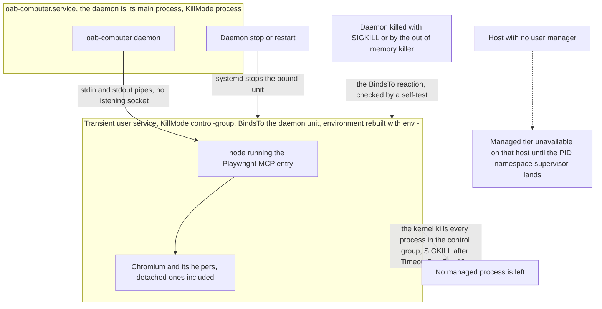

# ADR: Linux managed Playwright tier

- **Status:** Accepted. Implemented through L3 (shared pins, download and install, the managed child and router, the installer, `browser signin` and the docs); hardening (L4), release work (L5) and the PID-namespace supervisor (L6) are pending. The 0.12.0 release does not contain it: 0.12.0 and earlier run an external unit on `127.0.0.1:8794`. Operator guide: [`docs/linux-setup.md`](../linux-setup.md).
- **Issues:** [#119](https://github.com/openabdev/openab-computer/issues/119) (this work), [#118](https://github.com/openabdev/openab-computer/issues/118) (macOS tiers)
- **Requirement:** [`docs/requirements/linux-browser-tier.md`](../requirements/linux-browser-tier.md) (requirements, cutover runbook, test plan, PR split)
- **Related:** [`browser-tiers.md`](browser-tiers.md) (the macOS ADR; its questions are cited here as "macOS Q*n*"), [`reverse-attach.md`](reverse-attach.md), [`docs/linux-setup.md`](../linux-setup.md), [`docs/tool-profiles.md`](../tool-profiles.md)

## Context

On macOS the app installs and supervises its own Playwright (PRs for #118). On Linux the
`browser_*` tools are still served by an **external** Playwright MCP that the installer starts as a
separate systemd unit and that listens on `127.0.0.1:8794`. That listener has no authentication,
so any local user can reach it, and it serves `browser_run_code_unsafe` (arbitrary Node code).
The old unit also survives a daemon stop and has no pinned downloads.

Goal: the same managed tier on Linux, on amd64 and arm64.

1. `@playwright/mcp` runs as a **stdio child** of the daemon. It and its Chromium open no
   TCP or UDP port. Port 8794 is retired for the managed path. Target: no Unix listener either.
   That target is **not met** by the L2 build: it holds two private Unix listening sockets in the
   child's `0700` `TMPDIR` (open under V2 and #132). The Linux docs claim only "no TCP or UDP port".
2. Node, the npm packages and Chromium come from **pinned URLs with pinned sizes and SHA-256
   digests** in a manifest embedded in the release binary. The binary never fetches pins.
3. **Update is side by side with a health check** and keeps the old version on failure. It is
   prompted, never silent.
4. **Remove deletes only what the installer marked as its own.**
5. **Stopping the daemon leaves no managed process behind**, including a detached Chromium, and
   including after `kill -9` or an out-of-memory kill of the daemon.
6. A **persistent profile** keeps sign-ins. The one-time headed sign-in happens where a seat exists.

Non-goals: Windows; new tool names (the 32 `browser_*` names and the `owner`/`observe` rule do
not change); cookie import; an Apple Events equivalent; authentication on an external 8794
listener; bundling Node or Chromium in the release tarball; telemetry.

The design makes three claims it does not make: that a download is **safe** (it is integrity
against a pinned manifest), that any site accepts an automated browser, and that the Linux
release tarball has the authenticity of a notarized app.

## Decision

1. **Install, update, remove, status, preflight, sweep and run logic live in Rust, in the daemon
   binary** (`oab-computer browser <install|update|remove|status|signin|plan|preflight>`). One
   binary, one implementation of the ownership rules, tested by the `cargo test` jobs that already
   run on both architectures. `scripts/install-linux.sh` stays thin: prerequisites, token, units,
   the consent prompt, then it runs `oab-computer browser install`. It holds no download, digest,
   extract or delete logic.
2. **Pins have one source**, `release/playwright-pins/`. The macOS generated Swift constant and
   the Linux binary embed the same `pins.json`, `package.json` and `package-lock.json`.
3. **The managed child needs a kernel-enforced whole-tree stop mechanism** that succeeded in a
   self-test on the host. First release: a transient systemd user service with
   `KillMode=control-group`. Hosts where no mechanism verifies get "managed tier unavailable" and
   no managed child.
4. **Managed beats external.** An external listener is used only with explicit trust.
5. **User scope.** The browser runs as the user, so it reaches the user's Wayland socket and its
   profile belongs to the user. A system unit would lose the seat and need root.
6. **Port 8794 is retired for the managed path.** It stays loopback-only, and an external
   Playwright keeps working only under the explicit trust of decision 4.

### Data layout and ownership

Root: `${XDG_DATA_HOME:-$HOME/.local/share}/oab-computer/playwright/`. Names mirror macOS so one
set of ownership tests describes both.

```text
playwright/
  install.json            0600, write-then-rename; manifest id, version, digests, time, previous
  .install.lock           flock target, kept permanently
  .sweep.lock             flock target of the start-time sweep, kept permanently
  run/                    0700, run records for every child; contains .oab-owned-data
  pending-cleanup.json    0600, written by update: previous manifest id, no URLs
  pw-config.json          0600, launch options, carries the installer's marker key
  <manifest id>/          version directory; contains .oab-owned
    node/  pkg/node_modules/  chromium/
  profile/  output/  home/   0700 each, each contains .oab-owned-data
  .staging-<uuid>/        0700, contains .oab-staging; removed on cancel and at startup
```

- A version directory is deleted only if it has a regular `.oab-owned` file.
- `install.json`, `pending-cleanup.json`, `profile/`, `output/`, `home/`, `run/` and
  `pw-config.json` are deleted only when `install.json` is readable, was written by this installer,
  **and** the item carries its marker. These decisions are made before the first deletion, because
  `install.json` is itself deleted during `remove`. Anything else stays and `remove` prints what it
  left.
- The root and every directory beneath it must be a plain directory owned by the user, checked
  with `lstat` and `openat(O_NOFOLLOW)`. A symlink at any of those positions stops the operation.
- Nothing from before the markers is ever touched by `install`, `update`, `remove` or the sweep:
  the old browser units and drop-ins, the old `pw-mcp` directory, the old profile and output
  directories, the old `pw-config.json`, and `~/.cache/ms-playwright`.

### Process containment

The stop guarantee rests on a kernel mechanism. The other layers always apply but are never the
only guarantee.

| Layer | Covers | Misses |
| --- | --- | --- |
| New session and process group | `killpg` of node and non-detached helpers | A detached Chromium |
| `PR_SET_PDEATHSIG` | Node dies when its parent thread dies, including daemon `SIGKILL` | Grandchildren; tied to the spawning thread |
| Closing stdin | Node and Chromium may exit on EOF | Unverified on the pinned build |
| Tree walk on graceful stop | Finds a detached Chromium by walking `/proc` | Daemon `SIGKILL` |
| Transient user service, `KillMode=control-group`, `BindsTo` the daemon unit | The kernel kills every process in the cgroup | Hosts with no user manager; the `BindsTo` reaction to `SIGKILL` under `Restart=always` is verified by a self-test |
| PID-namespace supervisor (later PR) | Same guarantee without systemd | Hosts that restrict user namespaces |
| Sweep before every child start | Recovery after a crash | It runs only at the next start, so it is not the guarantee |

The runtime unit is only selected when the daemon is the unit's main process. Otherwise `BindsTo`
could pull in a second daemon and leave the browser running after a `SIGKILL`. CLI children
(sign-in, health check) bind to their own CLI scope, not to the daemon, so a sign-in survives a
daemon restart. A `kill -9` of the CLI ends the leader (`PR_SET_PDEATHSIG`), but the unit itself
lasts until its `RuntimeMaxSec` (300 s for the health check, 30 minutes for a sign-in) or until the
next child start's sweep stops it. Stopping one child never ends another child's processes: a stop
leaves alone what another live run record claims.

The browser unit sets `KillMode=control-group`, `SendSIGKILL=yes`, `TimeoutStopSec=10`,
`NoNewPrivileges`, `RestrictSUIDSGID`, `LockPersonality`, `RestrictRealtime`,
`ProtectKernelTunables`, `ProtectKernelModules`, `ProtectControlGroups` and `UMask=0077`. Where a
mount namespace is available it adds `PrivateTmp`, `ProtectHome=read-only`, `ProtectSystem=full` and
`ReadWritePaths=<data root>`. It sets `MemoryMax` and `TasksMax` (Chromium counts threads as
tasks, so `TasksMax` stays generous). It never sets `RestrictNamespaces`,
`MemoryDenyWriteExecute`, `SystemCallFilter` or `PrivateDevices`, because Chromium's sandbox and V8
need them. The daemon unit keeps `KillMode=process` on purpose, so apps started through the `bash`
tool survive a daemon restart.

The child's environment is cleared inside the unit with `env -i` and rebuilt from an allow-list.
Without that, a user service inherits the user manager's environment, which can contain bearer,
cloud or `GH_*` values.

The diagram shows the layout and what ends the managed processes. The managed child and its containment are built (L2); the PID-namespace supervisor is not (L6).



The session and process group, `PR_SET_PDEATHSIG`, closing stdin, the `/proc` tree walk and the
sweep before every start are extra layers. They are not drawn because none of them is the
guarantee. A CLI child (sign-in, health check) is bound to its own scope, not to the daemon.

### Router

Linux has one tier, so the router answers one question: which Playwright serves `browser_*`.

- **`OAB_BROWSER=off`** switches the managed tier off. With a managed install the backend is `off`
  and a stale `MCP_UPSTREAM browser=` line is ignored; with nothing installed such a line alone still
  serves as external.
- **Managed** is selected when `install.json` is valid, the version directory exists and
  containment is verified. If containment is not verified the backend is
  `unavailable: containment_unverified` and does not fall to external.
- **External** requires explicit trust (macOS Q12) and then enforces: the host is the literal
  `127.0.0.1` or `[::1]` (otherwise the daemon exits 64 and the unit does not restart-loop);
  redirects are refused; errors map to fixed classes with no upstream text; and the listener's
  owning uid is checked on every connection actually used, before any request is sent, failing
  closed on a different uid or an unreadable table. A same-uid impostor is outside this control.
  Loopback is not private, and the docs never call it private.
- No retry on another backend and no silent fallback from a named backend.

### Decided questions

Seventeen questions were put to the owner and each is decided. An entry gives the chosen option, the
reason, and the options not taken.

#### D1. How do macOS and Linux share one pin set?

**Chosen: one `pins.json`, schema 2, keyed by platform id** (`darwin-arm64`, `darwin-x64`,
`linux-x64`, `linux-arm64`). `package.json` and the lockfile stay single and shared. The Swift
and Rust validators both read it and both satisfy a shared `conformance/pins_vectors.json`. This
touches shipped macOS code once, in a PR that changes nothing else.

Rationale: one file keeps the pins from diverging, and the shared vector file makes both validators
agree.

Rejected:

- *A second file `pins-linux.json` with its own generator and a CI check that shared fields agree.*
  No macOS change, but two files and two release checks to keep in step.
- *Linux pins only inside the Rust crate as a generated `.rs` file.* Smallest macOS impact, but a
  third copy of the pins and no shared vector file.

#### D2. Where does the Linux Chromium come from, per platform?

**Chosen: Chrome for Testing on every platform that hosts the pinned version.** Where it does
not, pin the Playwright CDN build for that platform and record the source in the pins. The release
check fails if a platform has neither.

Rationale: one Chromium version on all four platforms, with a recorded fallback source.

Rejected:

- *The Playwright CDN build on both Linux platforms.* One uniform Linux source, but a different
  build family from macOS.
- *Chrome for Testing for `linux-x64` only, and arm64 only through the user's installed Chromium.*
  Smallest download surface, but arm64 loses the pinned tier.

#### D3. What code downloads, verifies and extracts inside the daemon?

**Chosen: a small set of audited crates.** A synchronous HTTPS client on the existing rustls
provider, `sha2`, `flate2` (pure-Rust backend) and `rustix` (`openat`, `mkdirat`, `symlinkat`,
`prctl`). Tar and zip validation is written in the repository, as the Swift side did. CI records
the binary size and `cargo tree` and fails when the stripped release binary exceeds **6 MiB** on
either architecture. Raising it is an explicit, reviewed edit of the CI file.

Rationale: in-process crates avoid two more required host tools and a python3 floor, and keep one
implementation of the ownership rules.

Rejected:

- *Run `curl` and `sha256sum` as subprocesses.* Fewer dependencies, but two more required host
  tools and subprocess output to parse.
- *A Python helper in the tarball.* Reuses code from `playwright-pins.py`, but adds a python3
  version floor and a second implementation of rules the runtime also needs.

#### D4. How is the managed child contained so nothing survives the daemon?

**Chosen: a verified kernel-enforced whole-tree mechanism is required.** First release: a
transient systemd user service with `KillMode=control-group`, `BindsTo` the daemon unit, an
`env -i` environment, and `RuntimeMaxSec` for CLI children. A later PR adds a PID-namespace
supervisor for hosts without a user manager. A host where no mechanism verifies gets "managed tier
unavailable" and no managed child. The process-tree layers are always applied but are never the
only guarantee.

Rationale: only a kernel-enforced mechanism meets "no managed process survives a stop". The
process-tree layers cannot survive daemon `SIGKILL` or an out-of-memory kill on their own.

Rejected:

- *systemd only, permanently.* Least code, but containers and hosts without a user manager never
  get the managed tier.
- *Process-tree layers only.* Works everywhere, but after daemon `SIGKILL` a detached Chromium can
  survive until the next start. That breaks the requirement.

#### D5. What wins when a managed install and a `MCP_UPSTREAM browser=` line both exist?

**Chosen: managed wins whenever it is installed.** External is used only when
`MCP_BROWSER_BACKEND=external` is also set. A stale `MCP_UPSTREAM` is ignored with one logged
event and a `sys_info` field. With nothing installed, `MCP_UPSTREAM=browser=` alone still works as
external, with the new loopback, redirect, error and owner-uid checks. `OAB_BROWSER=off` switches the
managed tier off: with a managed install the result is no `browser_*` tools (a stale line is ignored
and `external` needs `MCP_BROWSER_BACKEND=external`), and with nothing installed a lone line still
serves as external.

Rationale: a migrated host must not silently keep preferring the unauthenticated 8794 listener
(macOS Q12), and the installer must not rewrite files it did not write.

Rejected:

- *An explicit `MCP_UPSTREAM` wins, as on macOS.* Simplest rule, but a migrated host keeps using
  8794 until someone removes the line.
- *The installer edits the unit and removes the line after a backup.* One daemon rule, but the
  installer would rewrite a file it may not have written.

#### D6. What does a non-interactive `install-linux.sh` do about the download?

**Chosen: interactive installs prompt with default yes. Non-interactive installs skip the
download** unless `--browser managed` or `--yes` is given, and print how to install later.

Rationale: hundreds of megabytes are not downloaded because a flag was absent. Consent must be
stated.

Rejected:

- *Keep today's default: download unless `--no-browser`.* Compatible with existing automation, but
  consent becomes the absence of a flag.
- *Never prompt; always a separate `oab-computer browser install`.* Departs from the macOS
  decision that the install step is pre-checked in an interactive install.

#### D7. May the installer run root actions on its own?

**Chosen: no `sudo` by default**, including `loginctl enable-linger` and `tailscale serve`. Each
root action is printed with its exact command and reason. `--apply-system-changes` lists them and
runs them with `sudo`. Its only entry point is `scripts/install-linux.sh`; `oab-computer browser`
never runs a root action and refuses the flag. The AppArmor profile is scoped to the installing user's own data path, not
`/home/*`. As implemented (L1b), the profile is one glob over every version directory under that
data path, so one load serves `install` and every later `update`; `update` does not print a new
profile per version.

Rationale: root changes are announced with their exact command, not made silently.

Rejected:

- *Keep today's behaviour: use non-interactive `sudo` when available and report afterwards.*
  Least friction, but it changes system files without a prior statement.
- *Prompt for the sudo secret for each group.* Explicit, but the installer would handle a root
  credential and could not run unattended.

#### D8. How does a headless-seat node get its one-time sign-in?

**Chosen: the existing `screenshot`, `mouse` and `key` tools are the default path.** Run
`browser signin` over SSH, then drive the window with those tools. The docs repeat the warning that
switchboards older than 0.2.2 log tool arguments. The docs also carry a **recipe, not installed
by us**, for `wayvnc` bound to loopback with authentication, reached by an SSH forward and stopped
afterwards. There is no `signin --vnc`.

Rationale: it uses tools that already exist and installs no listener that exposes the desktop.

Rejected:

- *Ship `browser signin --vnc`.* Easier, but the installer would manage a desktop-exposing TCP
  listener.
- *No sign-in on headless seats.* Smallest surface, largest loss of use.

#### D9. What happens to the old profile and its cookies on a migrated host?

**Chosen: start fresh.** The managed install creates its own profile and the user signs in once.
The old profile directory is left untouched and `browser status` lists it as holding cookies.

Rationale: copying cookies is a secret-handling act, and an old profile may not open in the pinned
Chromium.

Rejected:

- *An explicit `browser import-profile <dir>` that copies after a prompt.* Saves the sign-in, adds
  a copy of secrets.
- *Copy automatically during install.* No action needed, but a silent copy of cookies with no way
  to decline.

#### D10. Who removes the old units and directories after a cutover?

**Chosen: a person, from a documented list, after the soak.** `browser status` lists each leftover
with its size, and the docs mark which commands need root. The installer never deletes them.

Rationale: the installer cannot prove it owns paths that predate the ownership markers.

Rejected:

- *A `browser legacy remove` command with per-item confirmation.* Convenient, but it deletes
  paths that have no marker.
- *Automatic removal after some days of managed use.* Deletes unmarked data with nobody present.

#### D11. Which Chromium password store holds cookie encryption on Linux?

**Chosen: always `--password-store=basic`.** Headed and headless runs then read the same key,
so saved sessions stay readable on nodes with no keyring. The launch-vector function writes the
flag into `pw-config.json` before every start, and tests enforce it. The docs call this
obfuscation under a `0700` profile directory, **not strong encryption**.

Rationale: without it, a locked or absent keyring can make saved sessions unreadable.

Rejected:

- *Chromium's default.* Hosts with a keyring get its protection, but sessions can break when the
  keyring is locked, absent in a headless start, or different between runs.
- *Require a libsecret keyring.* Stronger at rest, but an unattended node has no unlocked keyring.

#### D12. How is the Linux release tarball authenticated?

**Chosen: GitHub build-provenance attestations** on the Linux tarballs, with a documented,
optional one-line verification command beside the `sha256sum -c` step. The docs state that the
check does not make the download safe.

Rationale: the project holds no signing key, and the check stays optional with no claim of safety.

Rejected:

- *Keep only the `.sha256` file and say it is integrity, not authenticity.* No workflow change,
  but no independent signal at all.
- *Sign with a project-held key and ship the public key.* Independent of GitHub, but adds key
  custody and rotation work.

#### D13. How are the four existing hosts cut over, and how long is the soak?

**Chosen: the host on the new unit goes first.** After one week of normal use with no browser
incident, the three hosts on the old unit follow together. Old units stay disabled but present
for the soak.

Rationale: the host with the installer's own pieces exercises install and rollback with the fewest
unknowns, and a defect does not hit every host at once.

Rejected:

- *All four in one sitting.* Fastest, but a defect shows up everywhere at once.
- *One host at a time with a soak after each.* Slowest and safest, with four rollbacks possible.

#### D14. How long does the old browser path stay in the release?

**Chosen: `pw-mcp.sh` ships one more minor release, marked deprecated**, with the installer no
longer writing the unit. Then it is removed.

Rationale: a host that rolls back the binary still has a script to restore, and the installer stops
writing the unauthenticated unit.

Rejected:

- *Remove the script and unit text in the same release.* Cleanest, but a binary rollback has no
  script to restore.
- *Keep both paths indefinitely.* Two browser installers to test and a standing unauthenticated
  listener recipe in the release.

#### D15. Does Linux filter unknown upstream browser tools like macOS?

**Chosen: filter the managed backend to the 32-name catalog.** This changes nothing visible, because
the pinned package lists exactly those tools. The external path forwards every upstream tool
as today.

Rationale: no visible change for the managed backend, and an operator's external Playwright keeps
its extra tools.

Rejected:

- *Filter both.* One rule, but an external Playwright with extra tools loses them.
- *Forward everything in both.* No change, and the parity gap stays.

#### D16. Which distributions and architectures are supported?

**Chosen: Debian 12 and later, Raspberry Pi OS, and Ubuntu 22.04 and later, on amd64 and arm64,
with a glibc at or above the measured floor.** Other glibc distributions get the generic preflight
and are best effort. Alpine and other musl systems are refused with a clear message.

"Tested" means: an automated release smoke on Ubuntu 22.04 and 24.04 for both architectures; a
Debian 12 container job that runs install, preflight and the health check up to the containment
check; and a manual full run per release on Debian 12 hosts and Raspberry Pi OS hardware.

Rationale: it matches the host classes in use.

Rejected:

- *Add Fedora and Arch with their own package hints.* Wider reach, but more hint maintenance and
  no host to test on.
- *Debian family only.* Smallest matrix, but the headless server host class runs Ubuntu.

#### D17. May an offline node use an installed Chromium without a prior refusal?

**Chosen: keep the macOS Q3 rule and add `browser install --from-dir <dir>`.** The same pinned
archives and npm package tarballs are copied in by hand, checked against the same embedded digests
and the lockfile integrity values, and installed with `npm ci --offline`. Neither the download hosts
nor the npm registry are contacted. The installed-browser fallback (`--use-system-chromium`) is
allowed only after a recorded refusal (`launch_refused` or `sandbox_unavailable`). A failed libc or
architecture check is not such a refusal.

Rationale: offline nodes keep the pinned build and no trust is relaxed.

Rejected:

- *Allow `--use-system-chromium` whenever the host is offline.* Simple, but it extends macOS Q3 to
  a case it did not decide.
- *No offline support.* A node must reach the download hosts or stay on the external path under
  explicit trust.

## Consequences

- One pin source and one set of validators for macOS and Linux. The schema bump touches shipped
  macOS code, so it lands alone (L0 in the requirement's PR split).
- The Rust daemon grows: new dependencies and a stripped-binary budget of 6 MiB per architecture
  (today about 2 MiB). CI enforces the budget.
- **Hosts without a working user manager have no managed tier** until the PID-namespace mechanism
  lands. The tier is unavailable there rather than weaker.
- The installer prints root actions instead of running them, so an unattended install needs
  `--apply-system-changes` or a person to run the printed commands.
- Migrated hosts need a fresh sign-in. Old profiles, units and directories stay until a person
  removes them.
- The sweep kills a same-uid process whose executable lives under the installer's own version or
  staging directories, including one the user started by hand from there. The docs and `status`
  say so. On macOS the proof of ownership differs; the parity checklist records this difference.
- Sites that block automated browsers may refuse the managed Chromium. This is a known limitation
  and the docs name no site list.

## Security notes

- **No TCP or UDP listener.** The managed tree opens no TCP or UDP port. Two private Unix
  listening sockets remain in its `0700` `TMPDIR` (measured; open under V2 and #132), so the
  target "no Unix listener" is unmet. `browser status` runs a
  self-check over `/proc/net/{tcp,tcp6,udp,udp6,unix}` and reports listeners owned by the managed
  tree, and the release smoke runs the same check on both architectures. The launch vector never
  contains `--port`, `--host`, `--allowed-hosts` or `--no-sandbox`.
- **Integrity, not safety.** Downloads are checked against embedded size and SHA-256 values. The
  manifest is only as trustworthy as the binary carrying it, and the Linux tarball is authenticated
  more weakly than the notarized macOS app. Provenance attestations (D12) are optional.
- **Archive extraction** is two-stage and written in the repository: absolute paths, `..`,
  entries through an earlier symlink, escaping symlinks, hardlinks, device nodes, setuid modes,
  duplicate paths, oversize entries and over-long or NUL names are rejected before anything is
  created in staging.
- **No root without a statement.** Every root action is printed with its exact command (D7), and
  the AppArmor profile is scoped to the installing user's data path.
- **Environment.** `env -i` plus an allow-list keeps bearer, cloud and `GH_*` values out of the
  child. Logs and errors carry fixed fields and counts only: no tokens, page data, tool arguments or
  URLs.
- **External listener.** Loopback is not private. Any local user can reach an external Playwright,
  and it serves `browser_run_code_unsafe`. The managed path exists to remove that exposure.
- **Sign-in on a headless seat** sends typed secrets through tool-call arguments, or through a VNC
  listener the user starts. Both are documented, not hidden.
- **Cookies** are protected only as far as Chromium's `basic` store goes (D11).
- **Deletion** is limited to marked, installer-owned paths, re-validated with `lstat` immediately
  before removal, and `remove` reports what it left in place.
