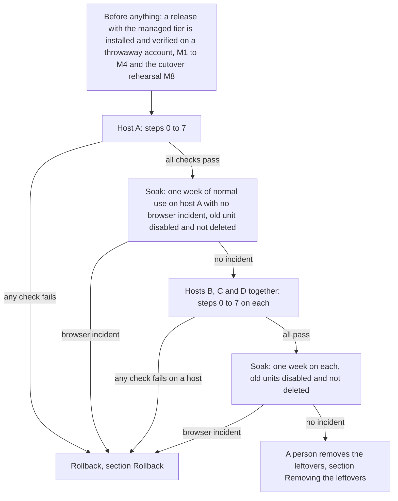
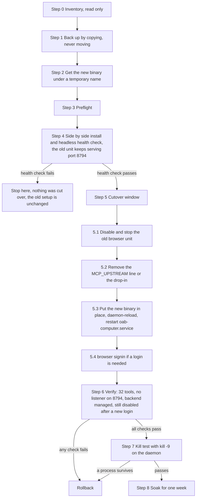
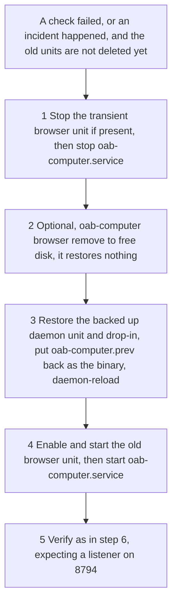

# Cutover and rollback: from the old browser unit to the managed browser

This guide is for a person who moves a Linux hands node from the old external Playwright unit (an
unauthenticated listener on `127.0.0.1:8794`) to the managed browser that the daemon starts itself
(`oab-computer browser install`). It is the runbook of
[requirements, section 2](requirements/linux-browser-tier.md#2-cutover-runbook) with the commands
written out. The decisions behind it are in the [ADR](adr/linux-browser-tier.md): D9 (a fresh profile,
the old one untouched), D10 (a person removes the leftovers), D13 (one host first, a one-week soak,
then the rest) and D14 (`pw-mcp.sh` is deprecated for one more minor release).

Read it once before you start. Every step has a command, a check and a way back.

## What exists, and what has not been done

- **Not released.** The managed tier is built through L5. The commands below need a release that
  contains it (written `X.Y.Z` here). 0.12.0 and earlier do not contain it. The things that arrive with
  the first release containing L5 are marked "from that release" below: the `legacy_units`, `legacy`
  and `legacy_listener` fields of `browser status`, the deprecation notice of `pw-mcp.sh`, the release
  smoke and the build-provenance attestation of the Linux tarballs.
- **Nothing has been cut over.** Writing this guide did not change any host. The cutover is yours to
  perform, host by host, as below.
- **Decided, not open.** V2 (the listener rule) and D7 (the AppArmor profile) are decided by the
  owner. They are summarized under [Decisions that shape this guide](#decisions-that-shape-this-guide).

## The hosts

Hosts are described by what they run, never by name. Facts are collected in step 0, not assumed.

| Host | What it runs | Where `MCP_UPSTREAM` is | The old browser unit | Data |
| --- | --- | --- | --- | --- |
| **A** (new-style unit) | `oab-computer.service`, written by the 0.12.0 installer | In `oab-computer.service` itself | `oab-computer-pw-mcp.service` | `~/.local/oab-computer` |
| **B, C, D** (old-style unit) | `oab-computer.service` | In a drop-in file under `oab-computer.service.d/` or `oab-instance-mcp.service.d/` | `oab-pw-mcp.service` | `~/.local/oab-instance-mcp/pw-mcp` |

Requirement section 2 and D13 name two classes: one new-style host and the old-style hosts that "follow
together". The four existing hosts map to them: A is the class N host, and B, C and D are the three class O
hosts. A VM or any other host beyond these four is not covered by D13. It uses the class O procedure
only after the owner says when, not as part of the second wave. A host still running `oab-instance-mcp.service` (0.11 or
earlier) first needs [Upgrading from 0.11](linux-setup.md#upgrading-from-011); this guide starts after
that.

## The order



Within one host, the steps are these. Nothing changes the old setup before step 5, and a failed check
anywhere ends in the rollback.



Notation. Commands run on the host being moved, as the user that runs the daemon, in that user's
login session (over `ssh`, so that `XDG_RUNTIME_DIR` and the user manager are set). `OLD` stands for the
old browser unit on that host: `oab-computer-pw-mcp.service` on host A, `oab-pw-mcp.service` on B to D.
The binary is `~/.local/oab-computer/oab-computer` (not on `PATH`). Checks that call the daemon from
outside use the commands of [Verify from another tailnet machine](linux-setup.md#6-verify-from-another-tailnet-machine).

## Step 0. Inventory, read only

Record what the host really has. Nothing here changes anything. The file may hold your Tailscale login
name, so it is created private and kept outside any repository.

```sh
umask 077
INV="$HOME/oab-cutover-inventory-$(date +%Y%m%d).txt"
{
  echo "== date, architecture, glibc"; date -u; uname -m; ldd --version | head -n 1
  echo "== AppArmor user namespace restriction"; cat /proc/sys/kernel/apparmor_restrict_unprivileged_userns 2>&1
  echo "== units"; systemctl --user list-units 'oab-*' --all --no-pager; systemctl --user list-unit-files 'oab-*' --no-pager
  echo "== unit files and drop-ins as systemd sees them"
  for u in oab-computer.service oab-pw-mcp.service oab-computer-pw-mcp.service; do echo "-- $u"; systemctl --user cat "$u" 2>&1; done
  echo "== files in the unit directory"; ls -laR ~/.config/systemd/user/ 2>&1
  echo "== port 8794"; ss -ltnp 'sport = :8794'
  echo "== legacy directories"
  du -sh ~/.local/oab-computer/pw-mcp ~/.local/oab-computer/pw-profile ~/.local/oab-computer/pw-output \
    ~/.local/oab-instance-mcp/pw-mcp ~/.cache/ms-playwright 2>&1
  echo "== disk"; df -h ~
  echo "== seat socket"; ls "/run/user/$(id -u)" 2>&1 | grep -E '^wayland-[0-9]+$'
  echo "== status"; ~/.local/oab-computer/oab-computer browser status 2>&1
} > "$INV" 2>&1
less "$INV"
```

**Verify.** The file names the old unit, says where the `MCP_UPSTREAM` line is (inside
`oab-computer.service` on host A, in a drop-in file on B to D), shows whether port 8794 is held, and
holds the architecture, glibc version and free disk. If `oab-computer.service` is missing and
`oab-instance-mcp.service` is present, stop: that host is on 0.11 or earlier and first follows
[Upgrading from 0.11](linux-setup.md#upgrading-from-011). The 0.12.0 binary has no `browser` command,
so the last line of the file is an error message there; that is expected at this step.

**Roll back to here.** Nothing to undo. Delete the inventory file when you no longer need it.

## Step 1. Back up by copying, never moving

The backup directory is a sibling of the installer's `playwright/` directory, never inside it, so the
installer never mistakes it for its own data. The profile is not copied (D9).

```sh
BK="${XDG_DATA_HOME:-$HOME/.local/share}/oab-computer/backup-$(date +%Y%m%d)"
mkdir -p "$BK" && chmod 700 "$BK"
cp -a ~/.local/oab-computer/oab-computer "$BK/oab-computer.prev"
cp -a ~/.config/systemd/user/oab-computer.service "$BK/"
for f in ~/.config/systemd/user/oab-pw-mcp.service ~/.config/systemd/user/oab-computer-pw-mcp.service \
         ~/.local/oab-computer/pw-config.json; do
  if [ -e "$f" ]; then cp -a "$f" "$BK/"; fi
done
for d in ~/.config/systemd/user/oab-computer.service.d ~/.config/systemd/user/oab-instance-mcp.service.d; do
  if [ -d "$d" ]; then cp -a "$d" "$BK/"; fi
done
(cd "$BK" && find . | sort)
```

**Verify.** The listing shows `oab-computer.prev`, `oab-computer.service`, the old unit file and, on
B to D, the drop-in directory with the file that holds `MCP_UPSTREAM`. Write the `$BK` path down: the
rollback uses it (`BK=<that path>`).

**Roll back to here.** Nothing to undo. The backup stays; the installer never deletes it.

## Step 2. Get the new binary under a temporary name

Do **not** run `install-linux.sh` here: it replaces the daemon binary and restarts the daemon, which
is step 5. Download, check and unpack the release, and copy the binary beside the old one.

```sh
V=X.Y.Z                                   # a release that contains the managed tier
A=$(dpkg --print-architecture)            # arm64 or amd64
mkdir -p ~/oab-cutover-dl && cd ~/oab-cutover-dl
curl -fsSLO "https://github.com/openabdev/openab-computer/releases/download/v$V/oab-computer-$V-linux-$A.tar.gz"
curl -fsSLO "https://github.com/openabdev/openab-computer/releases/download/v$V/oab-computer-$V-linux-$A.tar.gz.sha256"
sha256sum -c "oab-computer-$V-linux-$A.tar.gz.sha256"
# Optional, beside the checksum, from that release (the 0.12.x tarballs carry no attestation):
gh attestation verify "oab-computer-$V-linux-$A.tar.gz" --repo openabdev/openab-computer
tar xzf "oab-computer-$V-linux-$A.tar.gz"
install -m 755 "oab-computer-$V-linux-$A/oab-computer" ~/.local/oab-computer/oab-computer.new
~/.local/oab-computer/oab-computer.new browser plan
```

**Verify.** `sha256sum -c` prints `OK`. `browser plan` prints what an install downloads and where it
goes, and writes nothing. The attestation check is optional and does not make the download safe (ADR
D12); the checksum is the required one. The old daemon is still running the old binary.

**Roll back to here.** `rm ~/.local/oab-computer/oab-computer.new` (and `~/oab-cutover-dl` if you want
the space).

## Step 3. Preflight

```sh
~/.local/oab-computer/oab-computer.new browser preflight
~/.local/oab-computer/oab-computer.new browser preflight --root-actions
```

The first command checks the host and exits 0 when nothing blocks. A blocker exits 1 and prints
`browser: preflight_failed class=<class>` (`musl`, `glibc_too_old`, `disk_full`, `libraries_missing`
or `unsupported_platform`). The second prints only the root actions, one `command`, a tab and a reason
per line. This tool never runs them. Read each one, then run the ones you accept yourself, as root.
On a host with `/proc/sys/kernel/apparmor_restrict_unprivileged_userns` at `1` (Ubuntu 24.04) one of
them loads the path-scoped AppArmor profile (ADR D7: a single glob profile for your data path, kept as
decided; see [the residual risk](#decisions-that-shape-this-guide)).

**Verify.** `preflight` exits 0 after you ran what you accepted. Run it again to confirm.

**Roll back to here.** Libraries and fonts you installed are harmless and stay. If you loaded the
AppArmor profile and want it gone (needs root; `<id>` is the short hash in the file name that `preflight`
printed):

```sh
sudo apparmor_parser -R /etc/apparmor.d/oab-computer-chromium-<id> && sudo rm /etc/apparmor.d/oab-computer-chromium-<id>
```

## Step 4. Side-by-side install

```sh
~/.local/oab-computer/oab-computer.new browser install
~/.local/oab-computer/oab-computer.new browser status
ss -ltnH 'sport = :8794' | wc -l
systemctl --user is-active OLD
```

`install` downloads the pinned set, checks every size and SHA-256, and runs the headless health check
on a throwaway profile. It does not touch the seat, the old profile or the old unit.

**Verify.** `install` exits 0 and ends with `installed <id>`. `status` shows `state: installed` and
`pins_match: true`. The old listener is still there: `wc -l` prints `1` or more, and `OLD` is
`active`. From the first release containing L5, `status` also shows `legacy_listener: 8794` and a
`legacy:` line that lists the old directories with sizes; the profile reads `holds_cookies`. Do not
continue unless the install succeeded. If it fails, nothing was cut over and the old setup is
unchanged.

**Roll back to here.** The old daemon and the old unit never noticed the install:

```sh
~/.local/oab-computer/oab-computer.new browser remove
```

`remove` deletes only what the installer created (it prints `left in place:` for anything else) and
refuses while a managed browser is running (`browser_running`). It restores nothing, because nothing
was changed.

## Step 5. Cutover, in one short window

From 5.1 to 5.3 the daemon has no browser. Do them together. Host A first; B to D only after the soak.

### 5.1 Disable and stop the old browser unit

```sh
systemctl --user disable --now OLD
```

A plain `stop` is not enough: the unit comes back at the next login or boot with its unauthenticated
listener.

**Verify.**

```sh
systemctl --user is-enabled OLD          # prints disabled (exit status 1 is normal for a disabled unit)
ss -ltnH 'sport = :8794' | wc -l         # prints 0
```

**Roll back to here.** `systemctl --user enable --now OLD`.

### 5.2 Remove the `MCP_UPSTREAM` line (host A) or the drop-in file (hosts B to D)

The backup of step 1 must exist. Delete nothing else.

Host A, the line sits inside `oab-computer.service`:

```sh
grep -n 'MCP_UPSTREAM' ~/.config/systemd/user/oab-computer.service
sed -i '/^Environment=MCP_UPSTREAM=browser=http:\/\/127\.0\.0\.1:8794\/mcp$/d' ~/.config/systemd/user/oab-computer.service
grep -c 'MCP_UPSTREAM' ~/.config/systemd/user/oab-computer.service
```

If the last command does not print `0`, the line has another form (several upstreams, an edit of
yours): remove it by hand with an editor, keeping every other line.

Hosts B to D, the line sits in a drop-in file. List the file or files that set it, then delete exactly
those:

```sh
grep -l MCP_UPSTREAM ~/.config/systemd/user/oab-computer.service.d/*.conf \
  ~/.config/systemd/user/oab-instance-mcp.service.d/*.conf 2>/dev/null
rm -f <each file the grep printed>
```

A drop-in the `grep` did not list may belong to something else. Do not delete it, and do not delete the
`.d/` directory.

A unit that carries no installer marker (`# oab-computer-installer:`) is never rewritten by the
installer, which leaves the text it would have written beside it as `oab-computer.service.proposed`.
If one exists, review it, check that its `BIND` port matches the port `tailscale serve` maps (it carries
the `--port` of the run that wrote it, not the kept unit's), and adopt it only then:
`mv ~/.config/systemd/user/oab-computer.service.proposed ~/.config/systemd/user/oab-computer.service`.
It has no `MCP_UPSTREAM` line and carries the marker, so later installer runs keep the unit current.
This guide never creates that file.

**Verify.** `grep -r MCP_UPSTREAM ~/.config/systemd/user/` prints nothing for the daemon unit and its
drop-ins.

**Roll back to here.** Restore from the backup (this is the same as the rollback below, steps 3 and 4).

### 5.3 Put the new binary in place and restart

```sh
mv -f ~/.local/oab-computer/oab-computer.new ~/.local/oab-computer/oab-computer
systemctl --user daemon-reload
systemctl --user restart oab-computer.service
systemctl --user is-active oab-computer.service
curl -fsS 127.0.0.1:8795/healthz
```

Renaming over a running executable is allowed on Linux; the restart starts the new one. If the unit's
`BIND` port is not 8795, use that port in the `curl`. The daemon chooses its browser backend when it
starts, which is why the restart is needed.

**Verify.** `is-active` prints `active` and `healthz` answers.

**Roll back to here.** Follow the [Rollback](#rollback) section from step 1; the binary rollback uses
`oab-computer.prev`.

### 5.4 Sign in, if a login is needed

The managed browser starts with a fresh profile (D9). Nothing is copied from the old one, and no
command in this guide copies cookies. Run it over `ssh -t` from your machine:

```sh
ssh -t <host> '~/.local/oab-computer/oab-computer browser signin'
```

It opens a window on the node's seat on the persistent profile and waits for Enter. See
[Sign in](linux-setup.md#sign-in) for the VNC route on a headless seat.

**Verify.** A later browser call is signed in to the site you logged in to.

**Roll back to here.** `browser remove` deletes the new profile; the old one is untouched.

## Step 6. Verify

Run this after 5.4. The token and the URL are those of
[Verify from another tailnet machine](linux-setup.md#6-verify-from-another-tailnet-machine); run the
`curl` lines from another machine on your tailnet.

```sh
TOKEN=$(ssh <host> 'cat ~/.config/oab-computer/token')
U=https://<host>.<tailnet>.ts.net:8444
H='Content-Type: application/json'
# 1. the tool list: prints 32 (the browser_* names)
curl -s -X POST $U/mcp -H "Authorization: Bearer $TOKEN" -H "$H" \
  -d '{"jsonrpc":"2.0","id":1,"method":"tools/list","params":{}}' \
  | python3 -c 'import sys,json;n=[t["name"] for t in json.load(sys.stdin)["result"]["tools"]];print(sum(x.startswith("browser_") for x in n))'
# 2. a navigation: prints (False, False)
curl -s -X POST $U/mcp -H "Authorization: Bearer $TOKEN" -H "$H" \
  -d '{"jsonrpc":"2.0","id":2,"method":"tools/call","params":{"name":"browser_navigate","arguments":{"url":"about:blank"}}}' \
  | python3 -c 'import sys,json;d=json.load(sys.stdin);print(("error" in d, d.get("result",{}).get("isError", False)))'
# 3. which backend serves: prints the browser object
curl -s -X POST $U/mcp -H "Authorization: Bearer $TOKEN" -H "$H" \
  -d '{"jsonrpc":"2.0","id":3,"method":"tools/call","params":{"name":"sys_info","arguments":{}}}' \
  | python3 -c 'import sys,json;d=json.load(sys.stdin);print(json.loads(d["result"]["content"][0]["text"])["browser"])'
```

Then on the host, while or just after the browser ran:

```sh
ss -ltnH 'sport = :8794' | wc -l
~/.local/oab-computer/oab-computer browser status
```

**Verify.**

- The tool count is `32`, the navigation prints `(False, False)`, and `sys_info` shows
  `backend: managed` with a `containment` of `systemd` or `systemd+mount` and a `display` of `headed` or
  `headless`.
- `ss` prints `0`: nothing listens on 8794.
- `browser status` shows `listeners: tcp=0 udp=0 unix=2 unix_outside=0 tmpdir=ok result=pass` while the
  browser runs (`none` before its first start). Anything with `result=fail` is a failure (V2): a TCP or
  UDP listener, a Unix listener outside the child's private directory, or that directory not being
  `0700` or not yours. Run `status` in the daemon's own login session so `XDG_RUNTIME_DIR` matches.
  From the first release containing L5, `legacy_listener: none`.
- End your login session and log in again, or reboot. Then `systemctl --user is-enabled OLD` prints
  `disabled` and the `ss` check still prints `0`. With linger on, the daemon survives the logout.

If any check fails, the host is not cut over: use the [Rollback](#rollback).

## Step 7. Kill test, once per host class

Hosts A and B are enough to cover both classes; run it on every host if you like. Start a browser, kill
the daemon with `SIGKILL`, and check that nothing from the install directory survives and that the
restarted daemon answers.

```sh
# start a browser first (check 2 of step 6), then:
D="${XDG_DATA_HOME:-$HOME/.local/share}/oab-computer"
kill -9 "$(systemctl --user show -p MainPID --value oab-computer.service)"
sleep 10
for p in /proc/[0-9]*; do e=$(readlink "$p/exe" 2>/dev/null) || continue
  case "$e" in "$D"/playwright/*) echo "SURVIVOR ${p#/proc/} $e" ;; esac; done
systemctl --user is-active oab-computer.service
curl -fsS 127.0.0.1:8795/healthz
```

**Verify.** No `SURVIVOR` line, `active`, and `healthz` answers. Repeat check 1 and 2 of step 6 once.
The unit restarts the daemon by itself (`Restart=always`, `RestartSec=2`). The browser stops with the
daemon because it runs as a transient unit bound to it; the time Chromium takes to exit after
`SIGKILL` (V3) is informational, and the stop guarantee does not depend on it.

**Roll back to here.** A survivor, or a daemon that does not come back, is a failure: use the
[Rollback](#rollback). `systemctl --user stop 'oab-browser-*.service'` clears a stray browser unit.

## Step 8. Soak

Leave `OLD` disabled **but not deleted**, and the legacy directories in place, for one week of normal
use with no browser incident (D13). Check now and then:

```sh
systemctl --user is-active oab-computer.service
~/.local/oab-computer/oab-computer browser status      # state: installed, refusal: none
journalctl --user -u oab-computer --since '7 days ago' --no-pager | grep 'browser:'
```

`refusal` should stay `none`, and the journal lines carry fixed classes only. After a week with no
browser incident on host A, do steps 0 to 7 on hosts B to D together, then soak each for a week. A
browser incident on any host sends that host to the [Rollback](#rollback) and pauses the others.

**Roll back to here.** The [Rollback](#rollback) works for as long as the old units are not deleted.

## Rollback

Use it at any point before the old units are deleted: a failed check, or an incident during the soak.
Set `BK` to the backup directory of step 1.



1. Stop the browser and the daemon:

   ```sh
   systemctl --user stop 'oab-browser-*.service'
   systemctl --user stop oab-computer.service
   ```

2. Optional, to free disk. It restores nothing:

   ```sh
   ~/.local/oab-computer/oab-computer browser remove
   ```

3. Restore the daemon unit, the drop-in and the binary from the backup, then reload:

   ```sh
   BK=<the backup directory of step 1>
   cp -a "$BK/oab-computer.service" ~/.config/systemd/user/
   for d in oab-computer.service.d oab-instance-mcp.service.d; do
     if [ -d "$BK/$d" ]; then cp -a "$BK/$d" ~/.config/systemd/user/; fi
   done
   install -m 755 "$BK/oab-computer.prev" ~/.local/oab-computer/oab-computer
   systemctl --user daemon-reload
   ```

   If step 5.3 had not run yet, the old binary is still in place; `install` over it is harmless.
   `pw-mcp.sh` was never touched, so the old unit still finds its script.

4. Start the old unit and the daemon:

   ```sh
   systemctl --user enable --now OLD
   systemctl --user start oab-computer.service
   ```

5. Verify as in step 6, expecting the old behavior: `ss -ltnH 'sport = :8794' | wc -l` prints `1` or
   more, and the tool list shows 32 `browser_*` names. The restored 0.12.0 binary has no `browser`
   object in `sys_info`.

**If the new binary stays but the managed tier misbehaves.** Set `OAB_BROWSER=off` in a drop-in and
restart. With a managed install that means no `browser_*` tools at all: the router ignores a stale
`MCP_UPSTREAM browser=` line, because a managed install wins over it (D5), so `OAB_BROWSER=off` is not a
return to the old external unit, on a host that has not reached step 5 either. (`OAB_BROWSER=off` with
nothing installed and a `MCP_UPSTREAM browser=` line still serves that line as external.) To go back
to the external path, set `MCP_BROWSER_BACKEND=external` as the explicit trust act. External mode needs
the `MCP_UPSTREAM=browser=...` line (still there before step 5, removed in step 5) and the old unit
(running before step 5, stopped in step 5). After step 5, restore both from the backup, start the old
unit, and restart the daemon.

## Profile migration

There is none, on purpose (D9). The managed browser starts with a fresh profile under
`${XDG_DATA_HOME:-$HOME/.local/share}/oab-computer/playwright/profile/`, and you sign in again with
`browser signin` (step 5.4). The old profile, `~/.local/oab-computer/pw-profile`, holds the old cookies
and stays where it is. From the first release containing L5, `browser status` lists it in `legacy:`
with its size and `holds_cookies`. No command here copies or moves cookies.

## Removing the leftovers

Only a person does this, after the soak, from the list that `browser status` prints (from the first
release containing L5) or from your step 0 inventory. The installer never deletes any of it, and
`browser remove` never touches the old locations (D10). The commands are the ones in
[Removing the old browser setup after the soak](linux-setup.md#removing-the-old-browser-setup-after-the-soak);
the same list, in order:

1. Disable and delete the old unit files and the drop-in, then reload. No root. Delete only the
   drop-in file the `grep` of step 5.2 listed:

   ```sh
   for u in oab-pw-mcp.service oab-computer-pw-mcp.service; do
     if systemctl --user cat "$u" >/dev/null 2>&1; then systemctl --user disable --now "$u"; fi
   done
   rm -f ~/.config/systemd/user/oab-pw-mcp.service ~/.config/systemd/user/oab-computer-pw-mcp.service
   rm -f <each drop-in file the grep printed>
   systemctl --user daemon-reload
   ```

2. Delete the old directories, after looking inside: the old profile holds cookies. No root. Check
   each path against `browser status` first; `rm -rf` cannot be undone:

   ```sh
   du -sh ~/.local/oab-computer/pw-mcp ~/.local/oab-computer/pw-profile ~/.local/oab-instance-mcp/pw-mcp
   rm -rf ~/.local/oab-computer/pw-mcp ~/.local/oab-computer/pw-profile ~/.local/oab-instance-mcp/pw-mcp
   rm -f ~/.local/oab-computer/pw-config.json ~/.local/oab-computer/pw-mcp.sh
   rm -rf ~/.cache/ms-playwright    # only if nothing else of yours uses Playwright's cache
   ```

   `~/.local/oab-computer/pw-output` is listed by `status` too: look at it, then remove it the same way.

3. Unload and delete the old AppArmor profile, in this order. **Needs root:**

   ```sh
   sudo apparmor_parser -R /etc/apparmor.d/playwright-chromium && sudo rm /etc/apparmor.d/playwright-chromium
   ```

   The profile of the managed browser is a different file, `/etc/apparmor.d/oab-computer-chromium-<id>`,
   and stays.

4. Delete the old Chromium policy file. **Needs root:** `sudo rm /etc/chromium/policies/managed/oab-computer.json`
   (0.11-era installers named it `oab-instance-mcp.json`; remove that one the same way if it is there).

### Never deleted automatically

The installer, `browser remove`, `browser status` and this guide's scripts delete none of these. Each
is yours to remove, or to keep:

| What | Why it stays |
| --- | --- |
| The old units `oab-pw-mcp.service` and `oab-computer-pw-mcp.service`, and the drop-in with `MCP_UPSTREAM` | The rollback needs them until you decide to remove them. |
| `~/.local/oab-computer/pw-mcp`, `pw-output`, `pw-config.json`, `pw-mcp.sh` and `~/.local/oab-instance-mcp/pw-mcp` | The old browser's files. |
| `~/.local/oab-computer/pw-profile` | It holds cookies; look first. |
| `~/.cache/ms-playwright` | Playwright's own cache; another tool of yours may use it. |
| The old AppArmor profile and the Chromium policy file | Root-owned. |
| The backup directory `.../oab-computer/backup-<date>/` and `oab-computer.prev` in it | The rollback source. Keep it until the next release has run well. |
| `oab-computer.service.proposed` and `oab-seat.service.proposed` | The installer never removes or adopts them. |
| The `~/oab-cutover-dl` and the inventory file from this guide | Yours. |

## Deprecation of `pw-mcp.sh`

`poc/reverse-attach-linux/pw-mcp.sh` (the script behind the old unit) stays in the tarball for one more
minor release so that a binary rollback has a script to restore, and is removed after that (ADR D14,
tracked in [#141](https://github.com/openabdev/openab-computer/issues/141)). From the first release
containing L5 it carries a `DEPRECATED` header and prints one notice on stderr each time it starts,
which the old unit's journal shows (`journalctl --user -u OLD`); its launch arguments are unchanged.
The installer no longer writes the unit. The script opens an unauthenticated listener on
`127.0.0.1:8794` that any local user can reach and that serves `browser_run_code_unsafe`, which is why
this guide exists.

## Decisions that shape this guide

Both are decided by the owner; neither is reopened here.

- **V2, listeners.** The managed tree opens no TCP or UDP socket. It holds two Unix listening sockets
  (Playwright's browser socket and Chromium's `SingletonSocket`) inside the child's private per-run
  `0700` directory, which is accepted, and nothing else is. `browser status` and the release smoke
  fail on any other listener, and on a directory that is not mode `0700` or not the daemon's. The
  residual path: a process of the same user can connect to those sockets and drive the managed browser,
  as it can already read the profile directory. Another local user and a web page cannot reach them.
  The V2 gate is blocking, and each release measures it on amd64 and arm64.
- **D7, the AppArmor profile.** The single path-scoped glob profile that `preflight` prints is kept as
  built. Its residual risk: the path is in your own data directory, so code running as you could place a
  file named `chrome` there and run it with `userns` allowed. That needs code execution as you first
  and returns only the unprivileged user namespace. Not to be confused with the ADR's other D7 rule,
  that the installer never runs root actions on its own.

## What is supported

Support follows ADR D16: Ubuntu 22.04 and 24.04 on amd64 and arm64 have automated release smoke cells;
Debian 12 has a container job on both architectures; Debian 12 hosts and Raspberry Pi OS hardware get
a manual run per release, recorded in `docs/release-records/linux-VERSION.md`. The table with the
current state is [Supported systems](linux-setup.md#supported-systems). A row is "tested" only when its
record says so; the glibc rule makes a distribution supported without being run.
