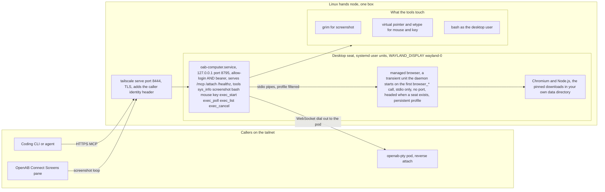
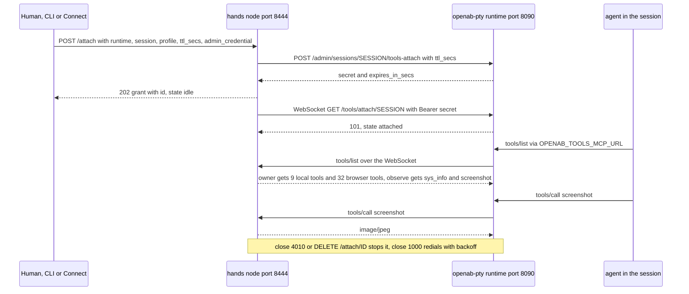

# Linux hands node setup

How to turn a Linux desktop box into an `oab-computer` hands node with the Rust PoC in
[`poc/reverse-attach-linux/`](../poc/reverse-attach-linux/). Written from two deployments,
both verified end to end on 2026-09-28 (lending to an openab-pty session, the OpenAB Connect
Screens pane, browser tools):

- Pi node: Raspberry Pi OS / Debian 13, aarch64, the stock labwc desktop (a display exists).
- Headless server: Ubuntu 24.04 Server, Intel N95, **no desktop at all**: a headless sway seat is created
  by the installer (`--headless-seat`).

The browser tools (`browser_*`) come from a **managed** Playwright that the daemon starts and
supervises, in releases after 0.12.0 (see [Browser tools](#4-browser-tools-playwrightmcp)). 0.12.0
and earlier ran Playwright as a separate unit on loopback `8794`; that path is described under
[Old external browser](#old-external-browser-deprecated).

Read the trust warning at the top of the [README](../README.md) first. On Linux it is stricter,
not looser: `bash`, `mouse`, `key`, the background-job tools (`exec_start` and friends, see
[Background jobs](#background-jobs)) and every browser tool are in the `owner` profile, so anyone
who can attach this node under `owner` gets a shell as the user running the daemon. `observe`
(the default for an attach that names no profile) serves only `sys_info` and `screenshot`. Those
are the only two profiles (#59); the retired `desktop` runs as `observe`.

## What you end up with



One systemd **user** unit with linger enabled, binding loopback only; `tailscale serve`
terminates TLS and stamps the caller's Tailscale identity. The browser is a managed child of the
daemon with no listening port of its own, the same shape as macOS
([#119](https://github.com/openabdev/openab-computer/issues/119),
[ADR](adr/linux-browser-tier.md)). The installer writes no browser unit and no `MCP_UPSTREAM` line.
The old `8794` listener, which has no authentication, exists only on a host that still runs an old
browser unit; see [Browser tools](#4-browser-tools-playwrightmcp) and
[Upgrading a host that already has a browser unit](#upgrading-a-host-that-already-has-a-browser-unit).

## Supported systems

Supported: Debian 12 and later, Raspberry Pi OS, and Ubuntu 22.04 and later, on amd64 and arm64,
with glibc 2.28 or newer (the floor measured from the pinned Node.js and Chromium builds; Node.js
needs 2.28 and Chromium 2.25). Other glibc distributions get the generic preflight and are best
effort. Alpine and other musl systems are refused with a clear message.

| System | glibc | amd64 and arm64 | Automated check | Manual run per release |
| --- | --- | --- | --- | --- |
| Debian 12 | 2.36 | supported | Debian 12 container job (install, preflight, health check), from the first release that contains L5 | full run on a Debian 12 host, recorded per release |
| Raspberry Pi OS (Debian 12 or 13 based) | 2.36 (Debian 12), 2.41 (Debian 13) | supported (arm64) | none of its own (the Debian 12 based container job covers the Debian 12 glibc on arm64; Debian 13 is not claimed as tested) | full run on Raspberry Pi OS hardware, recorded per release |
| Ubuntu 22.04 | 2.35 | supported | release smoke, amd64 and arm64, from the first release that contains L5 | covered by the smoke |
| Ubuntu 24.04 | 2.39 | supported | release smoke, amd64 and arm64, from the first release that contains L5 | covered by the smoke |
| Debian 13 and newer, newer Ubuntu | 2.41 and newer | supported by the rule above only; no automated or manual run is listed, so it is not claimed as tested | none | none |
| Other glibc distributions | 2.28 or newer | best effort | none | none |
| Alpine, other musl systems | n/a | refused | none | none |

"Tested" means an automated release smoke, a Debian 12 container job, and a manual full run per
release (ADR D16). The smoke matrix, the container job and the per-release record are defined in
`.github/workflows/linux-release-smoke.yml` and in [Releasing](releasing.md#linux-release-gates). No
release that contains them has been published yet. Until one is, and until its record is filled in, the
columns above describe what a release will be checked against, not a run that happened, and the table
is a statement of intent plus what the preflight checks. `oab-computer browser preflight` checks libc,
the glibc floor, user namespaces, disk and missing libraries on the host in front of you.

## Prerequisites

- A **wlroots compositor** as the seat (labwc, sway, wayfire): the daemon shells out to `grim`
  (screenshot) and `wtype` (keyboard) and holds its own virtual pointer, which need the compositor's
  `wlr-screencopy`, `virtual-pointer` and `virtual-keyboard` protocols. GNOME/Mutter and KDE do
  not expose these. Two ways to have one:
  - a desktop already running on seat0 (Raspberry Pi OS labwc, a sway login) — see
    [Raspberry Pi notes](#raspberry-pi-notes) for the no-monitor case;
  - **none** — pass `--headless-seat` to the installer and it runs `sway` with the headless
    wlroots backend as user unit `oab-seat.service`: one 1920×1080 virtual output, no input
    devices, no GPU or monitor needed (verified on a headless server, Ubuntu 24.04 Server).
- The node on the tailnet with **MagicDNS + HTTPS certificates** enabled (needed for
  `tailscale serve`). Do **not** do this on a k3s node that hosts openab-pty pods: host-level
  `tailscaled` gives every pod tailnet egress as the node (measured, see
  [`docs/adr/reverse-attach.md`](adr/reverse-attach.md)).
- `sudo` for the root actions the installer prints (see [Root actions](#root-actions)). The
  installer runs `sudo` only for those actions, and only when you pass `--apply-system-changes`. Rust ≥ 1.85 (`rustup`) is needed only to build from source.

```sh
sudo apt-get install -y grim wtype python3       # + sway for --headless-seat
```

The daemon needs `grim` (screenshots) and `wtype` (keys); the installer needs `tailscale` and
`python3`. Nothing needs `wlrctl`: the daemon never calls it, since it holds its own virtual
pointer, and `install-linux.sh` no longer asks for it
([#130](https://github.com/openabdev/openab-computer/issues/130)). No system `node`, `npm` or
`chromium` is needed either: the managed browser brings its own pinned Node.js and Chromium
(see [Browser tools](#4-browser-tools-playwrightmcp)), so Ubuntu's snap-only Chromium is no
longer a problem.

## 1. Tailscale

```sh
curl -fsSL https://pkgs.tailscale.com/stable/debian/$(. /etc/os-release; echo $VERSION_CODENAME).noarmor.gpg \
  | sudo tee /usr/share/keyrings/tailscale-archive-keyring.gpg >/dev/null
curl -fsSL https://pkgs.tailscale.com/stable/debian/$(. /etc/os-release; echo $VERSION_CODENAME).tailscale-keyring.list \
  | sudo tee /etc/apt/sources.list.d/tailscale.list >/dev/null
sudo apt-get update && sudo apt-get install -y tailscale
sudo tailscale up --hostname="$(hostname)" --accept-dns=false --accept-routes=false
```

`tailscale up` prints a login URL; approve it in the browser (or pass `--authkey`). If it hangs
with no URL at all, check `curl -4 -m 8 https://controlplane.tailscale.com/` — see
[Gotchas](#gotchas).

## 2. Get the daemon

**Prebuilt (preferred).** Every `v*` release ships `oab-computer-VERSION-linux-arm64.tar.gz`
and `-linux-amd64.tar.gz` (built and smoke-tested in CI on native runners) beside the macOS
installer, with a `.sha256` each:

```sh
V=X.Y.Z   # a release after 0.12.0: this page describes its installer. 0.12.0 ships the older installer
         # (unauthenticated browser unit on 8794, root actions through sudo, exits 78 on Ubuntu arm64)
A=$(dpkg --print-architecture)          # arm64 or amd64
curl -fsSLO "https://github.com/openabdev/openab-computer/releases/download/v$V/oab-computer-$V-linux-$A.tar.gz"
curl -fsSLO "https://github.com/openabdev/openab-computer/releases/download/v$V/oab-computer-$V-linux-$A.tar.gz.sha256"
sha256sum -c "oab-computer-$V-linux-$A.tar.gz.sha256"
# Optional, from the first release that carries an attestation (0.12.x has none, so this fails there).
# gh attestation verify "oab-computer-$V-linux-$A.tar.gz" --repo openabdev/openab-computer
tar xzf "oab-computer-$V-linux-$A.tar.gz" && cd "oab-computer-$V-linux-$A"
./install-linux.sh                    # does steps 3 and 5 below, then asks about the browser (step 4)
./install-linux.sh --headless-seat    # same, on a box with no desktop (creates oab-seat.service)
```

The attestation check is optional. It needs the GitHub CLI, and it shows that the tarball was built by
this repository's release workflow from a stated commit. It does not make the download safe (ADR D12);
the `.sha256` check stays the required one. Only a release built after the attestation step was added
carries an attestation: the 0.12.x tarballs have none, and `gh attestation verify` finds nothing for
them. See [Verifying a Linux tarball](releasing.md#verifying-a-linux-tarball).

A unit file the installer did not write (no installer marker line) is never rewritten: the installer
leaves it as it is and writes the unit it would have used next to it as `*.proposed`. That holds for
`oab-computer.service` and `oab-seat.service`.

`install-linux.sh` is idempotent: it keeps an existing token, detects your Tailscale login and
writes the daemon unit, with no `MCP_UPSTREAM` line and no browser unit. It then does the browser
step, which you can decline (`--browser none`), accept without a question (`--browser managed` or
`--yes`) or leave to the default. On a terminal the default is to show what a browser install
downloads (the output of `oab-computer browser plan`) and ask `[Y/n]`. With no terminal, nothing is
downloaded unless you gave `--browser managed` or `--yes`, and the installer prints the command to
run later (`~/.local/oab-computer/oab-computer browser install`). The installer exits 1 when you
asked for the browser (by flag or by answering yes) and it did not install; the daemon and the
token are then in place. If it did everything, skip to [Verify](#6-verify-from-another-tailnet-machine);
steps 3 to 5 describe what it did. After a successful browser install it restarts the daemon once more (not while an old `oab-instance-mcp.service` is live), because the daemon chooses its browser backend when it starts. A tarball older than the managed tier has the old behavior; see
[Old external browser](#old-external-browser-deprecated).

### Root actions

The installer does not run `sudo` unless you pass `--apply-system-changes`. It collects each action that needs root, prints the
exact command and why, and runs them only with `--apply-system-changes`, in this order: the
AppArmor profile and missing libraries (before the browser install, so its health check sees them),
then fonts, linger and `tailscale serve` at the end. `scripts/install-linux.sh` is the only entry
point for `--apply-system-changes`; `oab-computer browser ...` never runs a root action and refuses
the flag.

| Action | Command | Why |
| --- | --- | --- |
| Linger | `sudo loginctl enable-linger $USER` | The daemon and the browser keep running after you log out and start again at boot. Printed only when linger is off. |
| Publish | `sudo tailscale serve --bg --https=8444 http://127.0.0.1:8795` | Exposes the daemon on your tailnet over HTTPS (tailnet only). |
| AppArmor | `printf ... \| sudo tee /etc/apparmor.d/oab-computer-chromium-<id>` then `sudo apparmor_parser -r ...` | Only where `kernel.apparmor_restrict_unprivileged_userns` is 1 (Ubuntu 24.04): Chromium cannot make its sandbox without it. The profile names your own data path, not `/home/*`, and covers every version directory, so it serves later updates. The single glob is the decided design (ADR D7): its path lies in your own data directory, so code running as you could place a file named `chrome` there and run it with `userns` allowed; it needs code execution as you first and gives back only the unprivileged user namespace. `oab-computer browser preflight` prints the exact text. |
| Libraries | `sudo apt-get install ...` | Libraries the preflight found missing, with the package names. |
| Fonts | `sudo apt-get install -y fonts-dejavu-core fonts-liberation fonts-noto-cjk fonts-noto-color-emoji` | A server has none and pages render as boxes. Printed only when no font is found, and only in a run that does the browser step (not with `--browser none`). |

`oab-computer browser preflight --root-actions` prints the preflight's own actions, one `command`, a
tab and the reason per line, for scripts.

**From source** (needs Rust ≥ 1.85):

```sh
git clone https://github.com/openabdev/openab-computer ~/repo/oab-computer
cd ~/repo/oab-computer/poc/reverse-attach-linux
cargo build --release              # ~30 s cold on a Pi 4/5; the stripped binary stays under 6 MiB
bash smoke.sh                      # checks against the bundled mock runtime; all must pass
```

`smoke.sh` runs the binary with `MCP_INSECURE_LOCAL=1` against `mock_runtime.py` on loopback.
It does not need the desktop or the network, so run it first when something is off. The same
smoke runs in CI on amd64 and arm64 for every push.

## 3. Bearer token and the daemon unit

```sh
mkdir -p ~/.config/oab-computer
head -c 32 /dev/urandom | base64 | tr -d '=+/\n' | head -c 40 > ~/.config/oab-computer/token
chmod 600 ~/.config/oab-computer/token

LOGIN=$(sudo tailscale status --json | python3 -c \
  'import sys,json;d=json.load(sys.stdin);print(d["User"][str(d["Self"]["UserID"])]["LoginName"])')

mkdir -p ~/.config/systemd/user
cat > ~/.config/systemd/user/oab-computer.service <<EOF
[Unit]
Description=oab-computer (Rust hands node: /mcp + /attach)
After=graphical-session.target

[Service]
# (from source, use …/target/release/oab-computer in ExecStart)
ExecStart=%h/.local/oab-computer/oab-computer
Environment=BIND=127.0.0.1:8795
Environment=MCP_TOKEN_FILE=%h/.config/oab-computer/token
Environment=MCP_ALLOW_LOGIN=$LOGIN
Environment=WAYLAND_DISPLAY=wayland-0
Environment=XDG_RUNTIME_DIR=/run/user/%U
Restart=always
RestartSec=2
# Exit 64 is a configuration the daemon refuses; restarting cannot fix it.
RestartPreventExitStatus=64
# Apps opened via `bash` belong to the desktop, not to this daemon: a restart must not kill them.
KillMode=process

[Install]
WantedBy=default.target
EOF
systemctl --user daemon-reload
systemctl --user enable --now oab-computer.service
sudo loginctl enable-linger "$USER"      # keep user units alive without a login shell

curl -s 127.0.0.1:8795/healthz           # ok
curl -s -o /dev/null -w '%{http_code}\n' -X POST 127.0.0.1:8795/mcp -d '{}'   # 401
```

Configured checks are AND-combined, exactly like the Swift daemon: a request must carry the
bearer **and** arrive with an allow-listed `Tailscale-User-Login`. That header is only
trustworthy because `BIND` is loopback and `tailscale serve` overwrites it; never bind to a
LAN or tailnet address. A loopback request without the header is refused (`deny … no
Tailscale-User-Login header` in `journalctl --user -u oab-computer`), which is why even
local `POST /attach` goes through the `https://…:8444` URL below.

The unit has no `MCP_UPSTREAM` line. The managed browser needs none. If one is there (an older
installer wrote it), a managed install wins over it and the daemon logs one
`external_upstream_ignored` event; see
[Upgrading a host that already has a browser unit](#upgrading-a-host-that-already-has-a-browser-unit).

## 4. Browser tools (`@playwright/mcp`)

The daemon serves the 32 `browser_*` tools from a **managed** Playwright MCP: Node.js, the npm
packages and Chromium that `oab-computer browser install` downloads once, pinned by size and SHA-256
into the binary, into your own data directory. The daemon starts it on the first `browser_*` call
as a child talking over stdin and stdout, and stops it with the daemon. The daemon starts it with no
TCP port to listen on and does not use port `8794`. The child's own Unix sockets are described under
[Ports](#ports). This is the same design as macOS
([Browser tools](browser-tools.md)); this section is what differs on Linux.

The installer puts the binary at `~/.local/oab-computer/oab-computer`, which is not on `PATH`. The
commands below write `oab-computer` for short; run them with that full path, or set
`alias oab-computer=~/.local/oab-computer/oab-computer` first.

```sh
oab-computer browser plan        # what is downloaded, from where, how much, where it goes. Writes nothing
oab-computer browser preflight   # libc, glibc floor, user namespaces, disk, seat, missing libraries
oab-computer browser install     # shows the plan, installs, runs a headless health check
oab-computer browser status      # what is installed, what is running, what is left from before
oab-computer browser update      # prompted, never silent; the old version stays if the check fails
oab-computer browser remove      # deletes what the installer created, and says what it left
oab-computer browser signin      # a window for the one-time login, see Sign in
```

Run these as the user that runs the daemon (`~/.local/oab-computer/oab-computer browser ...`).
`install-linux.sh` runs `plan`, `preflight` and `install` for you.

### What the install downloads

Nothing is bundled in the release tarball and nothing is fetched until you agree. The install
downloads three things into `${XDG_DATA_HOME:-$HOME/.local/share}/oab-computer/playwright/` (not
`~/.local/oab-computer`, which holds the installer's binary), for the architecture of this node:

| What | From | Version |
| --- | --- | --- |
| Node.js (includes `npm`) | `https://nodejs.org/dist/v24.22.3/` | 24.22.3 |
| `@playwright/mcp` and its dependencies (3 npm packages) | `https://registry.npmjs.org/`, fetched by the downloaded Node's `npm ci --ignore-scripts` | 0.0.82 (with `playwright-core` 1.64.0-alpha-1789764292000) |
| Chromium (Chrome for Testing) | `https://storage.googleapis.com/chrome-for-testing-public/154.0.8037.0/` | 154.0.8037.0 |

| | linux-x64 (amd64) | linux-arm64 |
| --- | --- | --- |
| Download | about 259 MB | about 259 MB |
| On disk once installed | about 632 MB | about 629 MB |
| Free space needed while it runs | about 891 MB | about 888 MB |

The free space needed is the larger of three times the download and the download plus the unpacked
size; it is not the on-disk figure, which is what remains afterwards. An internet connection is
needed, unless you install from files (see [Offline install](#offline-install)).

- Every file is checked against sizes and SHA-256 digests built into the binary **before** it is
  extracted. The npm packages are checked against a lockfile built into the binary (`sha512`
  integrity for each package, all from `registry.npmjs.org`). A mismatch installs nothing. Redirects
  to any other host are refused.
- Archives are checked before anything is written (no absolute paths, `..`, links that leave the
  folder, devices, or oversize entries) and are extracted by the binary itself, not by `tar` or
  `unzip`.
- `npm` makes its own connections to `registry.npmjs.org`; the host list does not bound `npm`,
  which is why the lockfile allows no other host.
- Unlike macOS, the downloaded Node.js gets no code-signature check, only the pinned SHA-256.
  There is no quarantine step on Linux.
- The Chromium it installs is a browser: the connections it makes while running are Chromium's,
  not the installer's. In the project's own measurement of the pinned build the managed tree held no
  TCP or UDP socket and two private Unix sockets (see [Ports](#ports)); the rule for those (V2, decided in
  the [ADR](adr/linux-browser-tier.md)) is checked by every release smoke, and whether the browser exits when its
  stdin closes (V3) has not been measured. The daemon stops the child's whole process tree itself
  when it stops it.
- The install adds no unit and no network port. An update is only ever offered, never applied silently.
- The figures come from the manifest in `release/playwright-pins/`; the release check
  (`scripts/playwright-pins.py`, run in CI) fails if they drift, and a test fails if this page
  stops matching it.

### What `remove` deletes

`oab-computer browser remove` deletes the version folders that carry the installer's marker
(`.oab-owned`), and, only when `install.json` is readable and was written by this installer, also
`install.json`, `pending-cleanup.json`, `pw-config.json`, `profile/` (the browser profile and its
cookies), `output/`, `home/` and `run/`, each only when it carries the installer's marker. Anything
else stays, and `remove` prints `left in place:` for it, including the root directory that holds
the lock file. A hand-made or unreadable `install.json` is never replaced or removed, and with it
the profile and output folders stay. `remove` refuses while a managed browser is running
(`browser_running`). It never touches the old locations: `~/.local/oab-computer/pw-mcp`,
`~/.local/oab-computer/pw-profile`, `~/.local/oab-computer/pw-config.json`,
`~/.local/oab-instance-mcp/pw-mcp`, `~/.cache/ms-playwright`, the old units and drop-ins, or the old AppArmor profile.

### Ports

The managed browser has no TCP or UDP port and does not use `8794`. The daemon listens on
`127.0.0.1:8795`; `tailscale serve` uses `--https=8444`. Chromium and Playwright hold two Unix listening sockets in the child's own `0700` temporary
directory. They are not TCP or UDP ports, but they are listeners: another process of the same user
can connect to them and drive the managed browser, so the claim "no socket of any kind" is not made.
The rule (V2, decided in the ADR and requirement R1.1): no TCP or UDP listener, and every Unix listener
inside that private directory, which must be a real directory of the daemon's uid with mode exactly
`0700`. A socket counts as inside only when its directory, with every link followed, is that directory. `browser status` shows `listeners: tcp=0 udp=0 unix=2 unix_outside=0 tmpdir=ok result=pass`
while the browser runs, and `result=fail` for anything else (run it in the daemon's user session, so
`XDG_RUNTIME_DIR` matches the daemon's). The TMPDIR path is derived from `XDG_RUNTIME_DIR` in the shell that runs `status`; a shell without it looks in another place and can report `tmpdir=missing` on a healthy host, which is why `status` prints a hint on stderr when it fails. A tree that listens on nothing prints `listeners: none` only when its TMPDIR is clean; a wrong TMPDIR with no listener prints the counts with `result=fail`. While `browser signin` holds the browser, `status` counts that tree's
Unix sockets, which sit in another temporary directory, as `unix_outside>0 result=fail`. This is a false alarm that fails
closed; close the sign-in window and run `status` again. Another local user is refused by the directory and the socket
mode, and a web page cannot reach a Unix socket path. The release smoke measures the rule on amd64
and arm64 for every release. Port `8794` is bound only by
an old browser unit (unauthenticated, loopback) or by whatever you start yourself for
`MCP_BROWSER_BACKEND=external`.

### Where it runs, and what keeps it contained

- **Containment.** The daemon starts the browser as a transient systemd user unit with
  `KillMode=control-group`, bound to the daemon's unit, with an environment rebuilt from an
  allow-list. Stopping the daemon, or killing it with `SIGKILL`, ends every process in the unit,
  detached Chromium helpers included. A host with no user manager or where the self-test fails has
  no managed browser (`unavailable: containment_unverified`) rather than a browser that could
  outlive the daemon. `oab-computer browser status` says which.
- **Headed or headless.** The browser is headed when the seat's Wayland socket exists, else
  headless. `pw-config.json` records the mode and the daemon rewrites it before every start, so an
  edit that drops a flag cannot survive.
- **Passwords and cookies.** The password-store line in the generated table below applies: it is
  obfuscation, not strong encryption.
- **Sites.** Some sites block automated browsers. This page makes no claim about any site.
- **Not set up by the installer.** Chromium's camera, microphone, notification and geolocation
  prompts are not blocked by a policy file any more (writing it needed root, and whether the
  pinned Chromium reads that directory is not established). A prompt that a page raises needs
  `mouse` to dismiss. This is a known limit.
- **Display on a headless seat.** The first headed run on a node with only a headless sway seat is
  the one that has not been verified for this build (Chromium's choice of Wayland or X11 on such a
  seat). If the window does not open, `browser signin` reports `launch_refused` or `spawn_failed`;
  please file an issue with the class.

### Preflight

`oab-computer browser preflight` reports libc, the glibc floor, whether user namespaces are
available, whether the AppArmor restriction is on, disk needed and free, whether a seat exists, and
every shared library the pinned builds need that the loader cache does not list, with package
hints for Debian-family hosts. It never installs a package and never uses root. The library list
covers libraries linked at build time; libraries a program loads at run time are not listed, so the
headless health check at install is the final test. On a blocker it exits 1 and prints one line on
stderr, `browser: preflight_failed class=<class>`, where the class is `musl`, `glibc_too_old`,
`disk_full`, `libraries_missing` or `unsupported_platform` (no pinned build for this CPU or OS).

### Offline install

A node with no route to the download hosts keeps the pinned build:

```sh
./install-linux.sh --browser none
# on a machine that can download, fetch the pinned files into DIR (the names and sizes are in
# `oab-computer browser plan`), copy DIR to the node, then:
~/.local/oab-computer/oab-computer browser install --from-dir DIR
```

The same checks apply (embedded sizes and digests, the lockfile integrity values, `npm ci
--offline`). Neither the download hosts nor the npm registry are contacted, and `plan` and the
install say so. `--from-dir` makes no network preflight. The installed-browser fallback
(`--use-system-chromium`) is not available in this build; it is allowed only after a recorded
sandbox refusal, and a failed libc or architecture check is not one.

### Update, remove, status

`browser update` offers a newer pinned set when the binary carries one, installs it beside the old
one, runs the health check, and keeps the old one if the check fails. Without a terminal it needs
`--yes`. `browser remove` is described above. `browser status` prints the state, the installed and pinned ids, whether an update is available,
the install path, the Chromium revision, any pending cleanup, the containment mode, whether an
external configuration is present (yes or no, no URL), the listener count and the last recorded
refusal, with no URL, token or page data; `--json` emits only fixed fields. `status --retry` clears
the "unavailable after failures" latch and runs the containment check and the hardening probes again.

Four more fields say how far the hardening of the browser's unit is verified on this host. Each is
checked by its effect, not by whether systemd accepted the property: `hardening_base` is `verified`
when every base probe saw its effect, `partial` when some did not, `unverified` when the check or the
base probe could not run, and `not_checked` unless `--retry` ran it. `hardening_mount` is `verified`,
`partial`, `unverified` (a `--retry` check ran and failed), `dropped` (this host's user manager starts the unit but does not apply `PrivateTmp`,
`ProtectHome` and `ProtectSystem`, or none of their effects could be observed, so the browser runs
without that tier), `not_applicable` (nothing is installed yet) or `not_checked`.
`hardening_unverified` names the probe tokens that did not read `1` in a tier that is applied
(`none` when all did). `run_records` is `ok`, `full` (a managed start would be refused with
`run_records_full`) or `unavailable`. A tier that is `partial` or `dropped` is reported, not hidden: the
mount tier still runs without the protection the probes did not confirm. The base tier is
different: where the full base list cannot start at all (a user manager that refuses a property such
as `ProtectKernelModules`, as on some Ubuntu 24.04 hosts with restricted user namespaces), the
containment check reports `unverified` and the managed browser is unavailable until that is fixed.

Three more fields list what the old external setup left behind. They exist from the first release
that contains L5, and they only read: `status` never stops, moves or deletes any of it (D10).
`legacy_units` is `none` or a comma list of `oab-pw-mcp.service`, `oab-computer-pw-mcp.service`
(unit files in `~/.config/systemd/user/`) and `drop-in:oab-computer.service.d` or
`drop-in:oab-instance-mcp.service.d` (a drop-in directory with a `*.conf` with an active
`Environment=MCP_UPSTREAM=` line; the file's content and the URL are never shown). `legacy` is `none` or a comma
list of `<path>:<size>` for the old directories and files (`~/.local/oab-computer/pw-mcp`,
`pw-profile`, `pw-output`, `pw-config.json`, `pw-mcp.sh`, `~/.local/oab-instance-mcp/pw-mcp`,
`~/.cache/ms-playwright`); the old profile carries `:holds_cookies`, a link is `:symlink` and is not
followed, and a size that could not be taken is `:size_unknown`. Sizes are apparent sizes in a
fixed unit (`B`, `KiB`, `MiB`, `GiB`). `legacy_listener` is `8794` when a TCP socket listens on the
old unit's port (any owner, since that port has no authentication), `none`, or `unknown` when the
table cannot be read. `legacy_units` and `legacy` say `unknown` when `HOME` is not set; `legacy_listener` is still probed. When any of them shows
something, the human output adds one line that points at
[the cutover guide](linux-cutover.md); `--json` has the fixed fields only. Removing what they list
is a person's job: use that guide and the checklist under
[Removing the old browser setup after the soak](#removing-the-old-browser-setup-after-the-soak).

### Flags and environment variables

This table is generated from `poc/reverse-attach-linux/src/docs_table.rs`; CI fails when it is out
of date (`cargo test` in the Linux jobs, and `scripts/test-install-linux.sh` for the installer rows).
To change it, edit that file and run `OAB_UPDATE_DOCS=1 cargo test --release docs_table` in
`poc/reverse-attach-linux`.

<!-- BEGIN GENERATED: linux-flags-env (source: poc/reverse-attach-linux/src/docs_table.rs; rewrite with OAB_UPDATE_DOCS=1 cargo test --release docs_table) -->

| Command | Flag | What it does |
| --- | --- | --- |
| `scripts/install-linux.sh` | `--allow-login LOGIN` | The Tailscale login that may use this node. Default: the login this node is signed in with. |
| `scripts/install-linux.sh` | `--browser MODE` | `managed` shows what is downloaded and then downloads and installs the pinned browser without asking (the flag is the consent); `none` skips it. Without either, a terminal gets the question and no terminal means nothing is downloaded: the installer prints the command to run later. |
| `scripts/install-linux.sh` | `--no-browser` | Same as `--browser none`. Cannot be combined with `--browser managed` or `--yes`. |
| `scripts/install-linux.sh` | `--yes` | Agrees to the browser download without asking. It runs no root action. |
| `scripts/install-linux.sh` | `--apply-system-changes` | Runs the root actions the installer prints (linger, `tailscale serve`, the AppArmor profile, missing libraries, fonts), each with `sudo`. Without it they are only printed. |
| `scripts/install-linux.sh` | `--headless-seat` | No desktop on this node: run sway headless as the user unit `oab-seat.service`. sway must already be installed (`apt-get install sway`); the installer exits 78 if it is missing. |
| `scripts/install-linux.sh` | `--port N` | The daemon's loopback port. Default 8795. |
| `scripts/install-linux.sh` | `--serve-port N` | The HTTPS port `tailscale serve` uses. Default 8444. |
| `oab-computer browser plan` | - | Prints what an install downloads, from where, how much, and where it goes. Downloads and writes nothing. |
| `oab-computer browser preflight` | - | Checks this host (libc and its floor, user namespaces, disk, seat, missing libraries). Installs nothing and never uses root. |
| `oab-computer browser preflight` | `--root-actions` | Prints only the root actions, one `command`, a tab and the reason per line. The installer reads this. |
| `oab-computer browser install` | - | Installs the pinned browser from the network. |
| `oab-computer browser install` | `--from-dir DIR` | Installs from files in DIR instead of the network. The same checks apply. |
| `oab-computer browser update` | `--yes` | Updates without asking. Without it a terminal is needed. |
| `oab-computer browser update` | `--from-dir DIR` | Updates from files in DIR. |
| `oab-computer browser remove` | - | Deletes what the installer created and nothing else. It prints what it left. |
| `oab-computer browser status` | `--json` | Prints the state as one JSON object. |
| `oab-computer browser status` | `--retry` | Clears the unavailable latch and runs the containment check again. |
| `oab-computer browser signin` | `--url URL` | Opens a window on the node's seat on the persistent profile, at URL (`http://` or `https://`, default a blank page), and waits for Enter. Run it over `ssh -t`. |
| `oab-computer browser` (every subcommand) | `--apply-system-changes` | Refused with exit 2. This flag belongs to the installer script. |
| `oab-computer browser` (every subcommand) | `--use-system-chromium` | Refused with exit 2: not available in this build. |

| Variable | Read by | Meaning |
| --- | --- | --- |
| `BIND` | daemon | Listen address. The unit sets `127.0.0.1:8795`. The daemon does not refuse another address, so keep it on loopback and publish it with `tailscale serve`. |
| `MCP_TOKEN` | daemon | The bearer token, inline. Prefer `MCP_TOKEN_FILE`. |
| `MCP_TOKEN_FILE` | daemon | A file that holds the bearer token. The installer writes it with mode 600. |
| `MCP_ALLOW_LOGIN` | daemon | Comma list of Tailscale logins, matched against the `Tailscale-User-Login` header that `tailscale serve` adds. Every check that is configured must pass: with a token and a login set, a call needs both. |
| `MCP_INSECURE_LOCAL` | daemon | `1` or `true` lets the daemon start with no token and no login set. It is for loopback debugging only; never set it on a node reachable through `tailscale serve`. |
| `MCP_AUDIT_FILE` | daemon | Where the audit log is written. Default: `$XDG_STATE_HOME` or `~/.local/state`. |
| `MCP_GRANTS_FILE` | daemon | Where lend grants are stored. Same default directory. |
| `MCP_UPSTREAM` | daemon | `name=url` entries of tool servers the daemon forwards to. Every entry the daemon uses must be a literal loopback address, `http://127.0.0.1:PORT` or `http://[::1]:PORT`; any other host stops the daemon with exit 64. A `browser=` entry that a managed install ignores is not checked. The installer no longer writes it. Used only for the old external browser. |
| `MCP_BROWSER_BACKEND` | daemon | `external` is the explicit decision to use the `browser=` entry of `MCP_UPSTREAM` even when a managed install exists. Unset: a managed install wins. |
| `OAB_BROWSER` | daemon | `off` switches the managed tier off. With a managed install the result is no `browser_*` tools at all, and a stale `MCP_UPSTREAM` line is ignored. With nothing installed, a lone `MCP_UPSTREAM browser=` line still serves as external. |
| `WAYLAND_DISPLAY` | daemon, `browser signin` | The seat's socket name. The units set it. `signin` falls back to the highest `wayland-N` socket in `XDG_RUNTIME_DIR`. |
| `XDG_RUNTIME_DIR` | daemon, `browser` | The user's runtime directory (`/run/user/UID`). Needed for the seat, the child's short `TMPDIR` and the containment check. |
| `XDG_DATA_HOME` | `browser` | Where the browser is installed: `$XDG_DATA_HOME/oab-computer/playwright`. Default `~/.local/share`. |
| `XDG_STATE_HOME` | daemon | Base of the audit log, the grants file and the job store. Default `~/.local/state`. |
| `HOME` | daemon, `browser` | The user's home. `~/.local/oab-computer` holds the installer's binary, `~/.config/oab-computer` the token. |
| `DBUS_SESSION_BUS_ADDRESS` | daemon, `browser` | Lets the containment check reach the user manager. |
| `PATH` | daemon, `browser` | Where `systemd-run` and `systemctl` are found. |
| `TERM` | daemon | Set to `xterm-256color` for a terminal job when it is unset. |

The browser always starts with `--password-store=basic`: saved passwords and cookies are protected by obfuscation under a profile directory only you can read, not strong encryption. Anyone who can read your home directory as you can recover them.

<!-- END GENERATED: linux-flags-env -->

### Sign in

A login the browser keeps (a site you want the agent to use) is made once, in a headed window, on
the persistent profile:

```sh
ssh -t <node> '~/.local/oab-computer/oab-computer browser signin'                 # opens about:blank
ssh -t <node> '~/.local/oab-computer/oab-computer browser signin --url https://example.com/login'
```

`signin` needs a terminal (use `ssh -t`), an installed browser and a Wayland seat. It starts the
same pinned browser, headed, as a child of the command (in its own unit with a 30 minute bound, so a
daemon restart does not close it), opens the page, prints `Sign in in the browser window. Press
Enter here when finished.`, and waits. Press Enter, interrupt it, or wait out the bound; the browser
is then closed so it writes its cookies, and everything it started is stopped. If a browser already
holds the profile it reports `profile_locked`. The daemon's own browser is not stopped when it is
idle, so restart the daemon (`systemctl --user restart oab-computer.service`) to release it. While
a sign-in runs it holds the profile, so a `browser_*` call through the daemon fails with
`profile_locked`, and the daemon then treats the managed browser as unavailable. It does not retry on
its own after you press Enter: run `~/.local/oab-computer/oab-computer browser status --retry` (or restart
the daemon) to bring it back. If the
terminal closes before Enter (end of input, for example a dropped SSH session), the sign-in counts
as `cancelled`, not as finished. Its failure classes are `terminal_required`, `not_installed`,
`no_seat`, `profile_locked`, `lock_held` (an install, update or remove holds the install lock), `launch_refused`, `spawn_failed`, `invalid_url`, `cancelled`,
`browser_exited`, `close_failed` (the browser did not confirm its close, so the login may not be saved), `timed_out`, `install_invalid`, `state_unavailable` and `tmp_unavailable`; none prints page data. Killing the command with `kill -9` leaves its unit running until the bound (30 minutes for
sign-in, 5 minutes for an install's health check) or the next sweep, which a later `browser`
command that starts a child runs.

**On a node with a seat you can see** (a desktop on a monitor, or a Raspberry Pi desktop), the
window is on that screen and you use it directly.

**On a headless seat** you drive the window through the daemon's own tools. From a coding CLI with
this node attached, use `screenshot` to see it, `mouse` to click and `key` to type. The caution
that goes with this: a password you type through `key` passes through every system between you and
the node. **Switchboards older than 0.2.2 log tool arguments**, so a typed password would sit in
their audit log. Prefer a login that needs no typed secret, or type it only through a path you
trust.

**Recipe, not installed by this project:** a VNC server for the headless seat. It is a listener
that exposes the whole desktop, which is why the project does not ship or start it. If you choose to
run `wayvnc`, bind it to loopback with authentication, reach it through an SSH port forward, and
stop it afterwards. This recipe is **not tested by this project**. The options below are the ones the
`wayvnc` README names (checked against its README, not run here); check them against the manual of
your version:

```sh
# on the node. ~/.config/wayvnc/config, mode 600 (the password stays in this file, not in a command line):
#   address=127.0.0.1
#   enable_auth=true
#   username=<a user name you choose>
#   password=<a password you choose>
#   use_relative_paths=true
#   rsa_private_key_file=rsa_key.pem    # relative to this file; key from: ssh-keygen -m pem -f ~/.config/wayvnc/rsa_key.pem -t rsa -N ""
WAYLAND_DISPLAY=wayland-1 XDG_RUNTIME_DIR=/run/user/$(id -u) wayvnc --config ~/.config/wayvnc/config 127.0.0.1 5900

# on your machine
ssh -N -L 5900:127.0.0.1:5900 <node>     # then point a VNC viewer at 127.0.0.1:5900

# when done, on the node: stop wayvnc, then check that nothing listens on 5900 any more
pkill -x wayvnc
ss -ltn 'sport = :5900'                  # must print no listener line
```

## 5. Expose it

```sh
sudo tailscale serve --bg --https=8444 http://127.0.0.1:8795
sudo tailscale serve status
# https://<host>.<tailnet>.ts.net:8444 (tailnet only)
# |-- / proxy http://127.0.0.1:8795
```

Only the daemon is served on the tailnet. The managed browser has no port. A host that still runs
an old browser unit has a Playwright on loopback `8794` **without authentication**: any local user
can reach it and call every browser tool, including `browser_run_code_unsafe` (arbitrary Node
code). Turn that unit off after the cutover (see
[Upgrading a host that already has a browser unit](#upgrading-a-host-that-already-has-a-browser-unit)).

## 6. Verify from another tailnet machine

```sh
TOKEN=$(ssh <host> 'cat ~/.config/oab-computer/token')
U=https://<host>.<tailnet>.ts.net:8444
curl -s $U/healthz                                                  # ok
curl -s -o /dev/null -w '%{http_code}\n' -X POST $U/mcp -H 'Authorization: Bearer nope' -d '{}'   # 401
curl -s -X POST $U/mcp -H "Authorization: Bearer $TOKEN" -H 'Content-Type: application/json' \
  -d '{"jsonrpc":"2.0","id":1,"method":"tools/list","params":{}}' \
  | python3 -c 'import sys,json;print([t["name"] for t in json.load(sys.stdin)["result"]["tools"]])'
```

Expect the local tools plus 32 `browser_*` (with the managed browser installed; the daemon must have been restarted after the install, which the installer does) (owner surface; direct `/mcp` is always owner).

**OpenAB Connect Screens pane:** Add a Mac screen with Name `<host>`, URL
`https://<host>.<tailnet>.ts.net:8444/mcp`, Display `0`, the token above, Max FPS `1`. Frames are
JPEG, encoded in the daemon because Debian's `grim` has no libjpeg: about 50 KB for a 1080p
desktop at Connect's quality 0.6, against about 2 MB as PNG.

**Lend to an openab-pty session:**



```sh
curl -s -X POST -H "Authorization: Bearer $TOKEN" -H 'Content-Type: application/json' $U/attach \
  -d '{"runtime":"ws://<pod-tailnet-ip>:8090","session":"<name>","profile":"owner",
       "ttl_secs":3600,"admin_credential":"<openab-pty admin credential>"}'
# → 202 {"id":"grant-…","profile":"owner","requested_profile":"owner","state":"idle",…}
#   GET $U/attach lists, DELETE $U/attach/<id> revokes
```

The runtime may be `ws://` or `wss://`. With `wss://` the daemon mints over `https` and checks the
runtime's certificate against the system root store (bundled Mozilla roots if the host has none;
the WebSocket dial itself still needs system roots); there is no switch to skip that check. The
admin credential goes into one request header, is never written to a log, a file or an error
message, and a redirect from the runtime is refused rather than followed. A bad certificate shows up as
`mint failed: mint to HOST failed: … invalid peer certificate …`: serve the runtime with a
certificate for the name you dial, or add its CA to the node's system roots.

`"profile"` is `owner` (full control) or `observe` (look only). A request without it gets
`observe`; up to 0.8.2 it got `owner`. Any other name is a 400
`profile must be one of [owner, observe]`. A request for the retired `desktop` gets `observe`,
and the grant shows `requested_profile: desktop` and a `warning`; a grant stored as `desktop`
resumes as `observe` the same way. See [`tool-profiles.md`](tool-profiles.md#upgrading-from-08x-59).

OpenAB Connect stores the runtime's admin credential in the macOS Keychain (service
`dev.openab.connect`, account = pod name). Inside the session, `$OPENAB_TOOLS_MCP_URL` then
lists, under `owner`, `sys_info screenshot bash mouse key exec_start exec_poll exec_list
exec_cancel` + 32 `browser_*` + the runtime's `instance_status`.

## Operate

```sh
# `oab-computer` below is ~/.local/oab-computer/oab-computer (not on PATH; see section 4)
systemctl --user status oab-computer
oab-computer browser status                       # the managed browser: state, containment, display
journalctl --user -u oab-computer -f            # one line per deny / upstream error
systemctl --user restart oab-computer           # grants are in memory: re-lend afterwards
sudo tailscale serve --https=8444 off               # stop exposing
WAYLAND_DISPLAY=wayland-0 XDG_RUNTIME_DIR=/run/user/$(id -u) wlr-randr    # outputs the tools see
```

Grants survive a daemon restart (#12): live grants are kept in
`~/.local/state/oab-computer/grants.json` (mode 600; override with `MCP_GRANTS_FILE`, or
`MCP_GRANTS_FILE=off` to disable), and on start every grant still inside its deadline is re-dialled
under its original id — `journalctl --user -u oab-computer` shows `grants: resuming <id>`. The
file holds the attach secrets, at the same trust level as the bearer token file. A grant whose
runtime has forgotten it (pod replaced) ends with `handshake_rejected_401`; lend again.

A request or stored grant that names the retired `desktop` profile runs as `observe` (#59). Each
such mapping is logged and appended to `~/.local/state/oab-computer/audit.jsonl` (mode 600;
override with `MCP_AUDIT_FILE`, or `MCP_AUDIT_FILE=off` to disable). See
[Upgrading from 0.8.x](tool-profiles.md#upgrading-from-08x-59).

### Background jobs

Under `owner`, `exec_start` / `exec_poll` / `exec_list` / `exec_cancel` run long work without one
long call: same arguments and `structuredContent` as on macOS (README Tools table), with
`bash -c` instead of `zsh -f -c`. On a reverse attach `bash` refuses `timeout_secs` over 100 s
(the runtime fails a call after 120 s), and both that refusal and the `initialize` instructions
point the agent here. Under `observe` neither `bash` nor the job tools exist, and a long `bash`
call is an *unknown tool*, not a refusal that names it.

- **Logs**: `$XDG_STATE_HOME/oab-computer/jobs/<job_id>.out` / `.err` (default
  `~/.local/state/…`; directory mode 700, files 600). The job writes to them directly, so they
  are never truncated and can be followed with `tail -f`. `exec_poll` reads them by byte offset
  (`stdout_since` / `stderr_since` → `stdout_next` / `stderr_next`), at most 1 MiB per stream per
  call.
- **States**: `running` while the shell or anything it left in the job's process group runs
  (`server &`), then `exited` (the shell ended on its own, `exit_code` = its status) or `killed`
  (cancelled, timed out or ended by a signal, `exit_code` = 128 + signal). `timeout_secs` 0, the default, means
  none.
- **Cancel**: `exec_cancel` sends `KILL` (default) or `TERM` to the job's process group (each job
  runs in its own session), children the shell left behind included. The shell is reaped only
  once the group is empty, and the group is signalled only before that, so a recycled pid is never
  hit (#72). Only a process that leaves the group (`setsid` or `setpgid`, as daemonizing code
  usually does) escapes the job and its cancel; a plain double fork stays in the group.
- **Lifetime**: jobs belong to the daemon, not to a connection. When a reverse-attach socket drops,
  its in-flight calls are cancelled, but a job it started keeps running and the next attach can
  poll it. A daemon restart forgets the jobs: their processes keep running (the unit uses
  `KillMode=process`) and their logs stay on disk. Running jobs plus the 10 most recently finished
  are listed; older finished jobs are forgotten. Seven days after a job finishes, its logs are
  deleted and the job is forgotten even if it is among those 10; a running job's logs are kept
  whatever their age. GC runs at start-up and on each `exec_start`.

```sh
ls -lt ~/.local/state/oab-computer/jobs/            # <job_id>.out / .err
tail -f ~/.local/state/oab-computer/jobs/<job_id>.out
```

## Headless server notes (Ubuntu 24.04)

What a box with no desktop needed beyond the Pi, all handled by `install-linux.sh --headless-seat`:

- **Seat**: `sway` with `WLR_BACKENDS=headless WLR_LIBINPUT_NO_DEVICES=1 WLR_RENDERER=pixman`
  as `oab-seat.service`; `~/.config/sway/config` declares `output HEADLESS-1 1920x1080`. sway
  ignores `WAYLAND_DISPLAY` and takes the first free socket name — usually **`wayland-1`** — so
  the installer reads the socket back from `/run/user/<uid>` and writes that into the daemon unit.
- **Chromium**: the pinned Chrome for Testing build that `browser install` downloads (Ubuntu's own
  is a snap, unusable from a user unit). Ubuntu 24.04 restricts unprivileged user namespaces with
  AppArmor and Chromium's sandbox aborts with `No usable sandbox!`; `browser preflight` prints the
  profile that grants `userns` to the Chromium under your own data path (the distro-endorsed fix, the
  sandbox stays on; do not reach for `--no-sandbox`), and `install-linux.sh --apply-system-changes`
  loads it with `sudo`. The launch vector runs headed on the headless seat when its socket exists.
  Whether this build's Chromium picks Wayland on a seat with no Xwayland ("launched a headed
  browser without having a XServer" was the old unit's symptom, fixed there with
  `--ozone-platform=wayland`) is the open display check described under
  [Browser tools](#4-browser-tools-playwrightmcp).
- **Fonts and locale**: a server has neither; the first page rendered as tofu boxes, the second
  in Arabic (no `Accept-Language`, so example.com picked one). The installer prints the
  `fonts-dejavu-core`, `fonts-liberation`, `fonts-noto-cjk`, `fonts-noto-color-emoji` install as a
  root action. The old unit also set `--lang=en-US`, `locale: en-US` and `LANG=en_US.UTF-8`; the
  managed launch vector sets `LANG=C.UTF-8` and no locale option, so the page language follows the
  pages' own defaults.
- **Node from fnm/nvm**: no longer relevant. The managed browser runs its own downloaded Node.js
  and ignores the system `node` and `npm`.
- **Pod-host rule still applies**: The headless server runs k3s (ARC controller, traefik) *and* host
  `tailscaled`. That is fine only because it hosts no openab-pty pods; it must never start to.

## Raspberry Pi notes

- **Raspberry Pi OS's stock desktop is already a headless seat.** With no monitor plugged in,
  labwc keeps a 1920×1080 output alive (`wlr-randr`: `NOOP-1 "Headless output 2"`), the panel and
  file manager run on it, and `grim` captures it. Nothing from the "sway headless" spike (#23)
  is needed. Plug a monitor in and the geometry changes; `sys_info` and the captured frame follow.
  `mouse` keeps the old layout until the virtual pointer reconnects, and while that pointer is live
  `screenshot` reports the same layout for `points` and the `region` clip, so the two agree.
- labwc also runs an Xwayland on `:0`. The old browser unit set `DISPLAY=:0` alongside
  `WAYLAND_DISPLAY`; the managed child gets `WAYLAND_DISPLAY` and `XDG_RUNTIME_DIR` only.
- The pinned Chromium is an arm64 build; the old unit used the Debian package, which was fast enough for
  `browser_snapshot`-style work (a first page load was ~10 s on a Pi 4, ~1 s warm on example.com).
  The managed build has not been timed on a Pi.
- `~/.cargo/bin` is not on the PATH of non-login shells (`ssh host cargo …` fails with "command
  not found"); use `export PATH=$HOME/.cargo/bin:$PATH` in scripts.
- 8 GB RAM is plenty: daemon ≈ 5 MB, Playwright MCP ≈ 80 MB, headed Chromium 300–600 MB.

## Gotchas

- **Tailscale login never prints a URL** and `curl https://controlplane.tailscale.com/` times out
  while github/8.8.8.8 work: a consumer router (TP-Link Deco here) was dropping the whole
  `192.200.0.0/24` control-plane range for one wifi client, keyed on a months-old association.
  `sudo nmcli con down <profile>; sudo nmcli con up <profile>` fixed it instantly; no reboot.
- **`nmcli` needs sudo** on Raspberry Pi OS ("Not authorized to control networking").
- **Anything that talks to the seat needs `WAYLAND_DISPLAY` + `XDG_RUNTIME_DIR`.** An
  ssh-started or systemd-started process has neither; the daemon defaults them to `wayland-0` /
  `/run/user/<uid>` when unset, the units set them explicitly, and `browser signin` over `ssh`
  looks for the highest `wayland-N` socket in your runtime directory.
- **`grim -t jpeg` → "jpeg support disabled"** on Debian's build. The daemon never asks grim
  for JPEG: it takes raw PPM from grim and encodes the JPEG itself.
- **A seat with no physical input silently drops transient virtual devices.** Headless sway
  and a Pi with no mouse advertise no pointer/keyboard capability, so a one-shot `wtype` call (or any short-lived virtual pointer) that
  creates a device, sends and exits within milliseconds is lost: Chromium never binds
  `wl_pointer`/`wl_keyboard` in time, yet the tool exits 0 and `mouse`/`key` report `ok: true`.
  The daemon therefore holds a **persistent** virtual pointer (its own Wayland connection, absolute
  motion over the output layout) and a long-lived `wtype -s` keyboard anchor from startup; the
  journal logs `seat: virtual pointer up` / `virtual keyboard anchor up`, and
  `swaymsg -t get_seats` shows `capabilities 3`. `wtype -s` overflows a C `int` above ~35 min and
  exits at once, so the anchor sleeps 30 min and is respawned.
- **Chromium's `ctrl+l` focuses the omnibox but typed text may append** rather than replace; send
  `ctrl+a` before typing a URL.
- **Playwright `--allowed-hosts` needs the `host:port` form** or every request is 403. This
  concerns only the old external listener; the managed child has no host check to pass.
- **A stale upstream `Mcp-Session-Id` must be dropped before re-`initialize`**, or the upstream
  404s the initialize too and the browser tools never come back after a Playwright restart.
  Fixed in the daemon; symptom was `tools/list` shrinking to the local tools. External path
  only.
- **The daemon's `/attach` refuses loopback callers** without `Tailscale-User-Login` by design;
  use the `tailscale serve` URL even from the node itself.
- **`pkill -f` inside `ssh host 'sh -c …'` kills the `sh -c`** whose command line matches.
  Use `pkill -x <name>` — but `-x` matches at most 15 characters of the process name, so
  `pkill -x oab-computer` silently matches nothing.
- **Chromium `No usable sandbox!` / `Trace/breakpoint trap`** on Ubuntu 24.04+: AppArmor
  userns restriction; see [Headless server notes](#headless-server-notes-ubuntu-2404). The
  managed browser reports it as `sandbox_unavailable` and does not retry.
- **Headed browser "without having a XServer"** on a headless seat: Chromium picked X11. The old
  unit's `pw-config.json` added `--ozone-platform=wayland`; the managed launch vector does not, and
  whether it needs to is the open display check in [Browser tools](#4-browser-tools-playwrightmcp).

## Upgrading from 0.11

0.12.0 renamed the units to `oab-computer.service` and `oab-computer-pw-mcp.service`. The
installer only warns about the old ones. The old `oab-instance-mcp.service` holds port 8795, so
stop it before the new unit can bind:

```sh
systemctl --user disable --now oab-instance-mcp.service
systemctl --user enable oab-computer.service   # `restart` alone does not enable it for the next login
systemctl --user restart oab-computer.service
```

In releases after 0.12.0 the installer does the `enable` itself once the old unit is gone, when `oab-computer.service` carries the installer's marker line (a unit written by the 0.12.0 installer does not): run it again after the `disable --now`, and for an unmarked unit run the `enable --now` command it prints.

An old browser unit (`oab-pw-mcp.service`) is handled as described in the next section. Full
steps, with backup and rollback: [Upgrading from 0.11 or earlier](upgrade-0.12.md). The README has
the table of old and new names:
[Upgrading from 0.11 or earlier](../README.md#upgrading-from-011-or-earlier).

## Upgrading a host that already has a browser unit

The installer never stops, disables, edits or deletes an old browser unit, a drop-in, an old
directory, an old profile or an old AppArmor profile, and never copies cookies. The managed browser
starts with a fresh profile, so a migrated host signs in again (`browser signin`); the old profile
stays where it is and holds the old cookies until you delete it. The cutover itself is a procedure
for a person: [the cutover guide](linux-cutover.md) has the commands, the checks and the rollback of each step
([requirements, section 2](requirements/linux-browser-tier.md#2-cutover-runbook) is the design). What the
installer does on each kind of host:

| Host | What the installer does | What you do at cutover |
| --- | --- | --- |
| New: nothing from before | Writes the daemon unit without `MCP_UPSTREAM`, asks about the browser. | Nothing. |
| New-style unit: `oab-computer-pw-mcp.service` from 0.12.0, and an `MCP_UPSTREAM` line inside `oab-computer.service` | Warns, with the exact command to turn the unit off. The installer rewrites `oab-computer.service` only when the unit carries its own marker line (`# oab-computer-installer:`). A unit without it, which includes any unit from before the marker existed, is left byte for byte as it is (whatever it contains, `MCP_UPSTREAM` included); the unit this run would have written is put beside it as `oab-computer.service.proposed`. The binary is still replaced. The installer restarts that unit only if it is already running, and never enables or starts it (the same rule as for `oab-seat.service`). | After `browser status` shows the managed browser working: `systemctl --user disable --now oab-computer-pw-mcp.service`, then remove the `MCP_UPSTREAM` line (back it up first), or review and move `.proposed` over the unit, `daemon-reload`, restart. |
| Old-style unit: `oab-pw-mcp.service` and an `MCP_UPSTREAM` drop-in under `oab-computer.service.d/` or `oab-instance-mcp.service.d/` | Warns the same way for `oab-pw-mcp.service`, names the drop-in file, writes `oab-computer.service` without the line when there is none or it carries the installer's marker (an unmarked existing one is left as it is, with `.proposed` beside it, and is restarted only if it is already running, never enabled or started; no backup copy is made) and leaves the drop-in alone. If `oab-instance-mcp.service` (0.11 or earlier) is still live it holds port 8795: the installer warns, writes the new unit but does not enable, start or restart `oab-computer.service` and does not check the daemon; disable that unit first (`systemctl --user disable --now oab-instance-mcp.service`), then `systemctl --user enable --now oab-computer.service`. | `systemctl --user disable --now oab-pw-mcp.service`, then remove the drop-in file (back it up first), `daemon-reload`, restart. If a `.proposed` file sits beside `oab-computer.service`, adopt it too (review it, move it over the unit): until then later installer runs leave the unmarked unit alone. |

A plain `systemctl stop` is not enough: those units come back at the next login or boot, and each
is an unauthenticated Playwright on loopback `8794`. While the old unit and its line exist, a
managed install still wins over them: the daemon uses the managed browser and logs one
`external_upstream_ignored` event, and `sys_info` shows it. With **nothing** installed, a lone
`MCP_UPSTREAM=browser=...` line still serves as the external browser, as before. To use the old
external unit on purpose after a managed install, set `MCP_BROWSER_BACKEND=external` (that is the
explicit decision to trust it). `OAB_BROWSER=off` switches the managed tier off. With a managed install that
means no `browser_*` tools at all, and a stale line is ignored; it is not a way back to the external
path. With nothing installed, a lone `MCP_UPSTREAM browser=` line still serves as external even with
`OAB_BROWSER=off`. Every `name=url`
entry the daemon uses must be a literal loopback `http://127.0.0.1:PORT` or `http://[::1]:PORT`
URL; any other host stops the daemon with exit 64 (the installer's unit sets `RestartPreventExitStatus=64`,
so it does not loop). A `browser=` entry that a managed install ignores is not checked.

## Removing the old browser setup after the soak

Only a person does this, after the managed browser has run for about a week without trouble. The
installer never deletes any of it. Take the old paths from your inventory of the host; each command
below is marked if it needs root.

1. Find what the host has. No root:

   ```sh
   ls ~/.config/systemd/user/ | grep -E 'pw-mcp|oab-instance-mcp'
   grep -nE "^[[:space:]]*Environment=(['\"]|[^#;]*[[:space:]'\"])?MCP_UPSTREAM=" \
     ~/.config/systemd/user/oab-computer.service.d/*.conf \
     ~/.config/systemd/user/oab-instance-mcp.service.d/*.conf 2>/dev/null     # file:line of each active assignment
   ```

   Disable each old unit that exists and delete the old unit files. Then, for each file the `grep`
   printed, run `cat` on it. If it holds nothing but `[Service]`, that one `Environment=MCP_UPSTREAM=`
   line, comments and blank lines, it is the dedicated drop-in and `rm -f` removes it. If it holds
   any other setting, delete only that line (`sed -i '/^Environment=MCP_UPSTREAM=browser=http:\/\/127\.0\.0\.1:8794\/mcp$/d' FILE`, or an
   editor if the line also sets other variables) and keep the file. A file the `grep` did not list
   is not touched: it may belong to something else. Reload last. No root:

   ```sh
   for u in oab-pw-mcp.service oab-computer-pw-mcp.service; do
     if systemctl --user cat "$u" >/dev/null 2>&1; then systemctl --user disable --now "$u"; fi
   done
   rm -f ~/.config/systemd/user/oab-pw-mcp.service ~/.config/systemd/user/oab-computer-pw-mcp.service
   cat FILE                                    # for each file the grep printed
   rm -f FILE                                  # only a dedicated file, as described above
   systemctl --user daemon-reload
   ```

   If an earlier installer run left `~/.config/systemd/user/oab-computer.service.proposed` (it keeps
   a unit that has no installer marker, see
   [Upgrading a host that already has a browser unit](#upgrading-a-host-that-already-has-a-browser-unit)),
   either adopt it (review it, `mv` it over `oab-computer.service`, `daemon-reload`, restart) or
   delete it. Same for `oab-seat.service.proposed`. No root.

2. Delete the old directories, after looking inside: the old profile holds cookies. No root:

   ```sh
   du -sh ~/.local/oab-computer/pw-mcp ~/.local/oab-computer/pw-profile ~/.local/oab-instance-mcp/pw-mcp
   rm -rf ~/.local/oab-computer/pw-mcp ~/.local/oab-computer/pw-profile ~/.local/oab-instance-mcp/pw-mcp
   rm -f ~/.local/oab-computer/pw-config.json ~/.local/oab-computer/pw-mcp.sh
   rm -rf ~/.cache/ms-playwright    # only if nothing else of yours uses Playwright's cache
   ```

3. Unload the old AppArmor profile that allowed `/home/*/.cache/ms-playwright/...`, then delete
   it (in this order: once the file is gone the profile can no longer be unloaded by name).
   **Root:**

   ```sh
   sudo apparmor_parser -R /etc/apparmor.d/playwright-chromium && sudo rm /etc/apparmor.d/playwright-chromium
   ```

   The profile for the managed browser is a different file, `/etc/apparmor.d/oab-computer-chromium-<id>` (`<id>` is a short hash of the install
   path, so each user on a host has their own), and stays. A host that ran a pre-release `main` build
   may also have an unsuffixed `/etc/apparmor.d/oab-computer-chromium`; no release shipped it, and it can be removed the same way as the file above (`sudo apparmor_parser -R` it, then `sudo rm` it).

4. Delete the old Chromium policy file the old installer wrote. **Root:**
   `sudo rm /etc/chromium/policies/managed/oab-computer.json`. Installers from the 0.11 era named
   it `oab-instance-mcp.json`; if `ls /etc/chromium/policies/managed/` shows that file, remove it the
   same way (`sudo rm /etc/chromium/policies/managed/oab-instance-mcp.json`).

## Old external browser (deprecated)

0.12.0 and earlier started Playwright as a separate unit, `oab-computer-pw-mcp.service`, on
`127.0.0.1:8794`, with `MCP_UPSTREAM=browser=http://127.0.0.1:8794/mcp` in the daemon unit, started
by `poc/reverse-attach-linux/pw-mcp.sh` (kept in the tarball for one more release so that a binary
rollback has a script to restore, and, from the first release that contains L5, marked deprecated: a
header comment, and a notice on stderr each time it starts, in the tarball's copy only: the installer
does not copy the script, so an old unit still runs the copy it already has and shows no notice; the
launch itself is unchanged). The script is removed in the minor release after that (D14). Moving off
it is described in [the cutover guide](linux-cutover.md). That path has no authentication on the listener
and no pinned downloads; it is only for a host that has not moved, or for
`MCP_BROWSER_BACKEND=external`. Its pieces: `PW_CHROMIUM` and `PW_NODE_BIN` (the script's own
environment, default `/usr/bin/chromium`), a persistent profile under
`~/.local/oab-computer/pw-profile`, and `--allowed-hosts` in both `host` and `host:port` forms.
Nothing here is written by the current installer.
