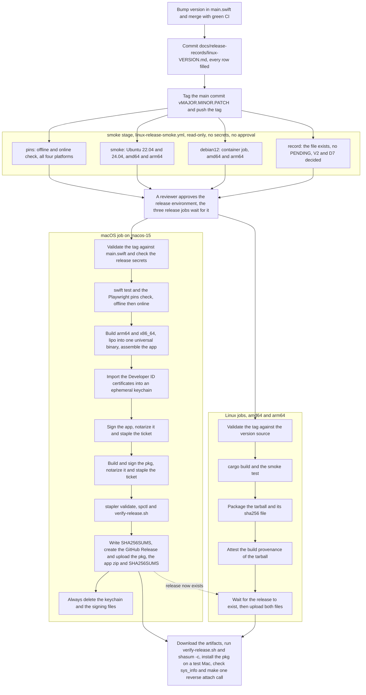
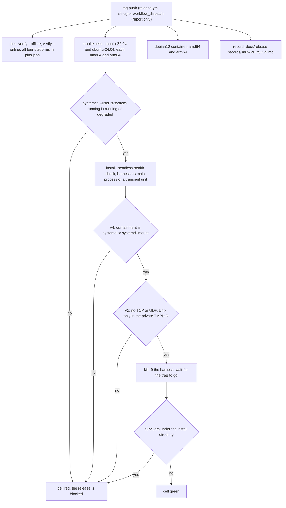

# Releasing oab-computer

A release is a **universal (arm64 + x86_64), Developer-ID-signed and Apple-notarized** macOS app plus a
signed/notarized installer package, and two Linux tarballs. The package is the normal macOS download;
the app zip is for advanced users and inspection. v0.12.0 was published this way, signed and notarized.

## Artifacts

A `vMAJOR.MINOR.PATCH` tag publishes a GitHub Release titled `oab-computer VERSION` with:

| Artifact | Use |
|---|---|
| `oab-computer-VERSION-universal.pkg` | Recommended. Double-click; installs/configures the app for the logged-in desktop user |
| `oab-computer-VERSION-universal.app.zip` | Pre-signed app, no package receipt. Contains `Contents/Resources/install-prebuilt.sh` for manual installation |
| `SHA256SUMS` | SHA-256 of the two macOS artifacts |
| `oab-computer-VERSION-linux-amd64.tar.gz`, `oab-computer-VERSION-linux-arm64.tar.gz` | The Linux node and `install-linux.sh`, each with a `.sha256` file beside it. From the first release built by the attesting workflow, each tarball also has a build-provenance attestation (see [Verifying a Linux tarball](#verifying-a-linux-tarball)) |

Since 0.12.0 the asset names (`oab-computer-VERSION-*`), the binary, the bundle id and the install
paths all use `oab-computer` (up to 0.11 they were `oab-instance-mcp`).

The installer:

1. verifies bundle id, code signature and team `6LPQNY95AQ` **before** stopping the running service;
2. detects the current Tailscale login and MagicDNS name from structured `tailscale status --json`;
3. installs to `~/.local/oab-computer/oab-computer.app` without re-signing it;
4. creates a bearer token once at `~/.config/oab-computer/token`, mode 600, and preserves it on updates. A 0.11 token at
   `~/.config/oab-instance-mcp/token` is copied (cp, never mv; the old file stays in place) by these rules:
   - macOS: only when this run creates the directory `~/.config/oab-computer`. If that directory already exists nothing is copied,
     and a new token is generated only if the new token file does not exist. `FirstRunSetup.swift` applies the same one-shot rule.
   - Linux: whenever `~/.config/oab-computer/token` is missing; a token is generated only when neither file has one.
   - Either platform: a user who never had an old token gets a new one and must update clients.
5. writes/starts the Aqua-user LaunchAgent `dev.openab.computer`;
6. adds the Playwright upstream when `dev.openab.computer.pw-mcp` is installed; and
7. configures `tailscale serve --https=8444` to loopback port 8795.

A logged-in GUI user and a logged-in Tailscale app are prerequisites. Package scripts run as root,
but immediately enter the console user's GUI bootstrap namespace and drop to that user; no token,
LaunchAgent or config is written to root's home.

## One-time TCC grant

After the first Developer-ID release install, enable **OpenAB Computer** once under System Settings →
Privacy & Security (builds before 0.12.0 used the bundle id `dev.openab.instance-mcp`, so their
entries do not carry over and must be granted again):

- Screen & System Audio Recording
- Accessibility
- Full Disk Access (optional; the setup wizard has a Skip link for it)

The one-time switch from the former Apple Development signature to Developer ID may require that
re-grant. Every later release carries the same bundle id and Developer ID team, so the grant remains.
Neither the installer nor CI ever ad-hoc re-signs a release app. `install-prebuilt.sh` refuses a wrong
or missing TeamIdentifier before replacing the running app.

## Required GitHub environment and secrets

The workflow uses the `release` environment. Create it with required-reviewer protection if the repo
plan supports that, then add:

| Secret | Value |
|---|---|
| `MACOS_APP_CERT_P12_BASE64` | Base64 of the **Developer ID Application** certificate + private key `.p12` |
| `MACOS_APP_CERT_PASSWORD` | `.p12` export password |
| `MACOS_APP_SIGN_IDENTITY` | Exact common name, e.g. `Developer ID Application: Name (6LPQNY95AQ)` |
| `MACOS_INSTALLER_CERT_P12_BASE64` | Base64 of the **Developer ID Installer** certificate + private key `.p12` |
| `MACOS_INSTALLER_CERT_PASSWORD` | `.p12` export password |
| `MACOS_INSTALLER_SIGN_IDENTITY` | Exact common name, e.g. `Developer ID Installer: Name (6LPQNY95AQ)` |
| `APPLE_NOTARY_KEY_P8_BASE64` | Base64 of an App Store Connect API `.p8` key allowed to notarize |
| `APPLE_NOTARY_KEY_ID` | API key id |
| `APPLE_NOTARY_ISSUER_ID` | API issuer id |

**Use team `6LPQNY95AQ` only.** The machine still contains a deprecated team
`UM92U863A8` Developer ID Application certificate; it must never sign these releases.
The signing and notarization secrets are set on the `release` environment (v0.12.0 shipped a signed
and notarized `.pkg` from them), so there is no signing blocker. Only secret names are listed here.

The tag workflow validates that both identity names are Developer ID identities, verifies the app's
TeamIdentifier is exactly `6LPQNY95AQ`, submits/staples both app and pkg, and runs signature/Gatekeeper
checks before creating the GitHub Release. Signing material lives in an ephemeral keychain and is
deleted in an `always()` cleanup step.

## Cut a release

The flow below is what the steps and the `Release macOS installer` workflow do. A `smoke` stage (the
Linux release gates, see [Linux release gates](#linux-release-gates)) runs first and needs no approval,
because it holds no secret. Both release jobs `need` it: a red gate stops everything before anything
is signed or published. After the approval the macOS job and the two Linux jobs run in parallel, and
the Linux jobs wait for the release that the macOS job creates.



1. Update `let version = "…"` in `Sources/oab-computer/main.swift` and merge with green CI.
   This is the only version to bump. The Linux binary takes its version from the tag at build
   time (see [Linux version](#linux-version)); do not bump `poc/reverse-attach-linux/Cargo.toml`.
2. Ensure the matching active-team release secrets above exist, and that the Playwright pins are
   current (see [Playwright pins](#playwright-pins)). The workflow runs the same check and a
   drifted pin stops the release before anything is built.
   Go through the [Linux release checklist](#linux-release-checklist) before tagging: the smoke
   dispatch is green, `docs/release-records/linux-VERSION.md` is committed and finished, and the two
   open owner decisions are closed.
3. Tag the exact main commit and push:

   ```sh
   git tag v0.12.1
   git push origin v0.12.1
   ```

4. The `Release macOS installer` workflow first runs the Linux release gates (the `smoke` job), then the tests and the Playwright pins check, then builds,
   signs, notarizes and publishes the macOS artifacts. From the same run it also publishes
   `oab-computer-VERSION-linux-{arm64,amd64}.tar.gz` and a `.sha256` for each (Linux tarballs
   exist since 0.6.5; before 0.12.0 they were named `oab-instance-mcp-VERSION-linux-*`).
   The three release jobs wait for a reviewer to approve the `release` environment, so open the run
   and approve it, or nothing starts. Check first that the `smoke` job of the run is green
   (`gh run view RUN_ID`); approve only then. A manual
   dispatch can retry an existing tag; it is not a way to release an untagged commit, and it
   **must run on the tag ref** — the environment only allows `v*` refs, so a dispatch from
   `main` is rejected before any job starts ("Branch main is not allowed to deploy to release"):

   ```sh
   gh workflow run release.yml --ref v0.12.0 -f tag=v0.12.0
   ```

5. Download both artifacts and verify before installing:

   ```sh
   scripts/verify-release.sh \
     oab-computer-0.12.0-universal.app.zip \
     oab-computer-0.12.0-universal.pkg
   shasum -a 256 -c SHA256SUMS
   ```

6. Install the `.pkg` on a clean/test Mac, verify `sys_info`, and make one reverse-attach call
   before announcing it.

Never move or recreate a tag after an artifact has been published.

**Breaking changes need a migration section in the release notes.** The first release that
contains #59 (two profiles, `observe` and `owner`; `desktop` removed and mapped to `observe`)
must carry the upgrade table and the operator steps from
[`tool-profiles.md` → Upgrading from 0.8.x](tool-profiles.md#upgrading-from-08x-59): what
happens to `desktop` requests, to stored `desktop` grants and to a `switchboard.profile` of
`desktop`, and how to grant `owner` again.

## Linux release gates

The Linux managed browser tier ([requirements](requirements/linux-browser-tier.md), section 3.3 to
3.5, and ADR D16) is released only when these pass. They live in
`.github/workflows/linux-release-smoke.yml`, which `release.yml` calls as its first job (`smoke`) and
which can be dispatched on its own. The dispatch builds and smokes only: it publishes nothing,
creates no tag and no release, and holds no secret.

```sh
gh workflow run linux-release-smoke.yml --ref BRANCH_OR_TAG
gh run list --workflow linux-release-smoke.yml --limit 3
gh run view RUN_ID
```



Each cell prints one `GATE <id> pass|fail|info` line per gate, so the manual record can quote it.
The release is blocked when any of these is red.

### The matrix

| Job | Where | What it runs |
| --- | --- | --- |
| `pins` | `ubuntu-latest` | `playwright-pins.py verify --offline`, then `verify --online` (every platform artifact re-downloaded, `minGlibc`, `needed` and hints recomputed), then an assertion that Node.js and Chromium are pinned for `darwin-arm64`, `darwin-x64`, `linux-x64` and `linux-arm64` (V1, V5, V10) |
| `smoke` Ubuntu 22.04 amd64 | `ubuntu-22.04` | real `browser install` into a temporary `HOME`, headless health check, harness, listener self-check, `kill -9`, survivor check |
| `smoke` Ubuntu 22.04 arm64 | `ubuntu-22.04-arm` | the same |
| `smoke` Ubuntu 24.04 amd64 | `ubuntu-24.04` | the same, with the AppArmor user-namespace restriction relaxed on the runner |
| `smoke` Ubuntu 24.04 arm64 | `ubuntu-24.04-arm` | the same |
| `debian12` amd64 | `ubuntu-24.04`, Debian 12 container pinned by digest | install, preflight and the health check, as a non-root user, up to the containment check (a container has no user manager) |
| `debian12` arm64 | `ubuntu-24.04-arm`, the same image | the same |
| `record` | `ubuntu-latest` | `scripts/check-release-record.sh VERSION` (fails a release, reports on a dispatch) |

The smoke cells provide their own user manager (linger, the per-user service of the runner uid, `XDG_RUNTIME_DIR`) and
check `systemctl --user is-system-running` before they start. Unlike the optional per-PR
`linux-systemd.yml`, a cell **fails** when no manager is available, because that blocks the release
(requirements 3.3). On the throwaway runner the cells set
`kernel.apparmor_restrict_unprivileged_userns=0` and the log says so. That is a property of the
ephemeral runner, not advice for hosts. The Debian 12 job also runs its container with
`seccomp=unconfined` and `apparmor=unconfined`, for the same reason (Chromium's sandbox needs a user
namespace), and its log says so. The binary under test is built on the runner and is the one that runs
on Debian 12, so the job also shows that it runs on glibc 2.36.

Not automated, a person does them once per release and records them: Debian 12 hosts and Raspberry Pi
OS hardware (a full run per architecture, M4), and M1 to M3 and M5 to M10 of
[the requirements](requirements/linux-browser-tier.md#34-manual-checklist-on-real-nodes).

### Gates, as the requirements define them

Section 3.5 decides which facts block a release. Only V1, V2 and V7 are named as blocking there. V4
fails a cell because its self-test fails when `BindsTo` does not fire. V3 is informational: the smoke
prints how long the tree took to go after `kill -9`, and no job fails on it.

| Gate | Where it is checked | Blocks a release |
| --- | --- | --- |
| V1 a pinned Chromium source for each platform | `pins` job, and `GATE V1` in each cell | yes |
| V2 no TCP or UDP listener, Unix listeners only inside the private TMPDIR, both architectures | `GATE V2` in each cell | **yes** (decided) |
| V3 Chromium exit timing after `kill -9` | `GATE V3`, informational | no |
| V4 `BindsTo` fires, containment verified | `GATE V4` in each cell | yes, through the cell |
| V5 `minGlibc` below the oldest supported OS | `verify --online` and the Ubuntu 22.04 and Debian 12 jobs | narrows the matrix |
| V6 headed Wayland Chromium, sign-in survives a restart | manual record | doc fix |
| V7 cookies readable headed and headless | manual record | yes, for the sign-in flow |
| V8 policy directory against a launch flag | manual record | no |
| V9 ELF preflight against the loader | `GATE V9` (informational) and the record | no |
| V10 `playwright-core` dependency table | `verify --online` | no |
| V11 `ProtectHome=read-only` in a user manager | `GATE V11` (informational) and the record | no |
| V12 `/proc/net/tcp` owner uid | code fails closed; the record | no |
| V13 `wayvnc` options | manual record | no |

### Owner decisions: V2 and D7 (decided)

Both are decided. Neither was decided by this workflow, and neither gate is weakened by the decision.

- **V2: listeners.** Requirement R1.1 now reads: no TCP or UDP listener, and any Unix listener in the
  managed tree inside the child's private per-run `0700` `TMPDIR`, owned by the daemon's uid. The tree
  holds two such sockets (Playwright's browser socket and Chromium's `SingletonSocket`). `GATE V2` fails
  on any TCP or UDP listener, on any Unix listener outside that directory, on a `TMPDIR` that is not
  mode `0700` or not the daemon's uid, and on a listener table that cannot be read, and it has no
  other allow-list. The gate is blocking and is measured by every release on both architectures; it is
  closed for a release only when both cells print `GATE V2 pass`.
- **D7: the AppArmor profile.** The single path-scoped glob profile that `browser preflight` prints is
  kept as built; the residual risk (code running as the same user can place a file named `chrome` under
  the data path and run it with `userns` allowed) is written in the ADR and in `linux-setup.md`.
  M3 stays in the record as the evidence. Do not confuse this with the ADR's other D7 rule, that the
  installer never runs root actions on its own.

`scripts/check-release-record.sh` still fails a record whose `V2` or `D7` row is missing or says
`open, owner decision pending`: a row that reopens the decision blocks the release.

### The per-release manual record

The record for a release is `docs/release-records/linux-VERSION.md` (VERSION without the `v`), copied
from [`docs/release-records/TEMPLATE.md`](release-records/TEMPLATE.md). A person fills it in against
the release candidate (the commit the smoke dispatch just passed on) and commits it to `main`
**before** the tag. It lists the smoke run URL and the six automated cells, M1 to M10, V1 to V13 with
the blocking column, and the support-table rows to update. Every unfilled cell is the word `PENDING`.

The `record` job fails a release when the file is missing, when any table row still has `PENDING`, or
when the `V2` or `D7` row is missing or still says `open, owner decision pending`. It never fills a
row for anyone. On a dispatch it reports and passes. The requirements ask for "a release requirement"
and "a person records each result"; this file and this check are how that becomes verifiable.

### Linux release checklist

Before tagging a release that contains the managed Linux tier:

1. `python3 scripts/playwright-pins.py verify --offline` and `scripts/test-release-smoke-linux.sh`
   pass locally or in CI.
2. Dispatch `linux-release-smoke.yml` on the release candidate and read every `GATE` line. All of
   `pins`, the four cells and the two Debian 12 jobs are green, including `GATE V2 pass` on amd64 and
   arm64.
3. Copy `docs/release-records/TEMPLATE.md` to `docs/release-records/linux-VERSION.md`, run the manual
   rows, fill every `PENDING`, and commit it to `main`.
4. The `V2` row of the record quotes the two `GATE V2 pass` lines (amd64 and arm64). The decision
   itself is in the ADR.
5. The `D7` row of the record says the single glob profile is kept, with the M3 result beside it.
6. Update the supported-systems table in [`linux-setup.md`](linux-setup.md#supported-systems) from the
   record.
7. Tag. After the run starts, check that `smoke` is green before approving the `release` environment.

## Verifying a Linux tarball

Every `oab-computer-VERSION-linux-ARCH.tar.gz` has a `.sha256` file beside it, and the checksum is
the required check:

```sh
sha256sum -c "oab-computer-$V-linux-$A.tar.gz.sha256"
```

A Linux tarball built by this workflow also carries a signed build-provenance attestation (GitHub
artifact attestations, SLSA provenance). It is an **optional** extra check. With the GitHub CLI:

```sh
gh attestation verify "oab-computer-$V-linux-$A.tar.gz" --repo openabdev/openab-computer
```

Add `--signer-workflow openabdev/openab-computer/.github/workflows/release.yml` to also require that
the file was built by the release workflow. The attestation proves that this repository's workflow
built that exact file from a stated commit. It does **not** make the download safe: it says where the
file came from, not what the code does (ADR D12). Only the tarball is attested, not its `.sha256`
file. Attestations exist only for releases built after the attestation step was added to
`release.yml`; the 0.12.x tarballs have none, and `gh attestation verify` finds nothing for them.

## Playwright pins

`release/playwright-pins/pins.json` is schema 2. Node and Chromium artifacts are keyed by platform id
(`darwin-arm64`, `darwin-x64`, `linux-x64`, `linux-arm64`); `package.json`, the lockfile and the
version fields are shared. Each Chromium artifact records its source: Chrome for Testing wherever it
hosts the pinned version, else the pinned Playwright CDN build. Linux artifacts also record `minGlibc`,
`needed` (shared libraries linked at build time that the host must provide; libraries a program loads at run time are not listed, so the headless health check at install is the final test) and `packageHints` (Debian package names, advice only).

The release job runs `scripts/playwright-pins.py verify --offline` and `verify --online`. The online
check re-downloads every platform artifact and compares size and SHA-256, checks Node's digest against
`SHASUMS256.txt`, recomputes `minGlibc`, `needed` and the hints from the downloaded binaries, and fails
when a platform has neither source, when a platform that Chrome for Testing hosts pins another source,
or when a version drifts between platforms. It needs about 1.1 GB of downloads.

To add or refresh the Linux platforms without touching the shared and macOS pins, run
`python3 scripts/playwright-pins.py add-linux --workdir <temp dir>`, then `render-swift`. A full
`python3 scripts/playwright-pins.py generate --node-version X --mcp-version Y --node-team-id TEAMID --workdir DIR` rewrites the lockfile too and refuses to run without `--node-team-id`: `TEAMID` is the `TeamIdentifier` of the Node project's macOS binary, which you read from a Node download you have checked yourself (`codesign --verify --strict <node>` must pass, then `codesign -dvv <node>` prints it on stderr). The generator repeats that check on the Node it downloads. See `python3 scripts/playwright-pins.py --help` for the other options. After either, run `swift test` (the macOS pins test pins the
schema 1 values) and `python3 scripts/test-playwright-pins.py`.

The Swift validator and the future Rust validator both satisfy `conformance/pins_vectors.json`.

## Linux version

The Linux hands node reports the release version in `sys_info.agent.version` and in MCP
`serverInfo.version` (#74). It is not read from `poc/reverse-attach-linux/Cargo.toml`:

- The release workflow's Linux job checks that the tag equals `let version` in
  `Sources/oab-computer/main.swift`, the same gate as the macOS job, then builds with
  `OAB_RELEASE_VERSION=<tag without v>`, which `option_env!` compiles into the binary.
  Both jobs and PR CI read the version with `scripts/release-version.sh [tag]`, which
  requires one `MAJOR.MINOR.PATCH` line and exact string equality with the tag.
- `smoke.sh` runs with `EXPECT_AGENT_VERSION=<same>` and fails unless both fields report it.
  PR CI does the same with the version read from `main.swift`, then smokes a plain build.
- A build without `OAB_RELEASE_VERSION` (local `cargo build`, `cargo test`) reports
  `<crate version>-dev`, so it can never pass for a release.

## Local/no-secret smoke

CI runs this on every PR:

```sh
swift build
scripts/test-packaging.sh .build/debug/oab-computer
```

It assembles the app, proves unsigned input is rejected by the production installer, exercises the
explicit unsigned test seam in a temporary home, verifies token persistence/LaunchAgent arguments,
builds an unsigned flat pkg, expands it, and checks its payload and postinstall scripts. It never
launches an agent or changes the user's Tailscale serve config.

To build a universal unsigned artifact manually on a Mac:

```sh
swift build -c release --arch arm64 --scratch-path /tmp/imcp-arm64
swift build -c release --arch x86_64 --scratch-path /tmp/imcp-x86_64
lipo -create /tmp/imcp-arm64/release/oab-computer \
             /tmp/imcp-x86_64/release/oab-computer \
             -output /tmp/oab-computer
chmod +x /tmp/oab-computer
scripts/assemble-app.sh /tmp/oab-computer /tmp/oab-computer.app 0.12.0
ALLOW_UNSIGNED=1 scripts/package-pkg.sh /tmp/oab-computer.app /tmp/oab-computer.pkg 0.12.0
```

Unsigned artifacts are testing inputs only; do not install or publish them.
