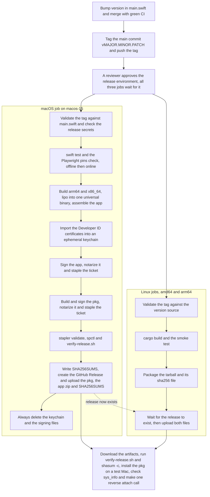

# Releasing oab-computer

A release is a **universal (arm64 + x86_64), Developer-ID-signed and Apple-notarized** macOS app plus a
signed/notarized installer package, and two Linux tarballs. The package is the normal macOS download;
the app zip is for advanced users and inspection. v0.12.0 was published this way, signed and notarized.

## Artifacts

A `vMAJOR.MINOR.PATCH` tag publishes a GitHub Release titled `oab-computer VERSION` with:

| Artifact | Use |
|---|---|
| `oab-computer-VERSION-universal.pkg` | Recommended. Double-click; installs/configures the app for the logged-in desktop user |
| `oab-computer-VERSION-universal.app.zip` | Pre-signed app, no package receipt. Contains `Contents/Resources/install-prebuilt.sh` for manual installation |
| `SHA256SUMS` | SHA-256 of the two macOS artifacts |
| `oab-computer-VERSION-linux-amd64.tar.gz`, `oab-computer-VERSION-linux-arm64.tar.gz` | The Linux node and `install-linux.sh`, each with a `.sha256` file beside it |

Since 0.12.0 the asset names (`oab-computer-VERSION-*`), the binary, the bundle id and the install
paths all use `oab-computer` (up to 0.11 they were `oab-instance-mcp`).

The installer:

1. verifies bundle id, code signature and team `6LPQNY95AQ` **before** stopping the running service;
2. detects the current Tailscale login and MagicDNS name from structured `tailscale status --json`;
3. installs to `~/.local/oab-computer/oab-computer.app` without re-signing it;
4. creates a bearer token once at `~/.config/oab-computer/token`, mode 600, and preserves it on updates. A 0.11 token at
   `~/.config/oab-instance-mcp/token` is copied (cp, never mv; the old file stays in place) by these rules:
   - macOS: only when this run creates the directory `~/.config/oab-computer`. If that directory already exists nothing is copied,
     and a new token is generated only if the new token file does not exist. `FirstRunSetup.swift` applies the same one-shot rule.
   - Linux: whenever `~/.config/oab-computer/token` is missing; a token is generated only when neither file has one.
   - Either platform: a user who never had an old token gets a new one and must update clients.
5. writes/starts the Aqua-user LaunchAgent `dev.openab.computer`;
6. adds the Playwright upstream when `dev.openab.computer.pw-mcp` is installed; and
7. configures `tailscale serve --https=8444` to loopback port 8795.

A logged-in GUI user and a logged-in Tailscale app are prerequisites. Package scripts run as root,
but immediately enter the console user's GUI bootstrap namespace and drop to that user; no token,
LaunchAgent or config is written to root's home.

## One-time TCC grant

After the first Developer-ID release install, enable **OpenAB Computer** once under System Settings →
Privacy & Security (builds before 0.12.0 used the bundle id `dev.openab.instance-mcp`, so their
entries do not carry over and must be granted again):

- Screen & System Audio Recording
- Accessibility
- Full Disk Access (optional; the setup wizard has a Skip link for it)

The first switch from the current Apple Development signature to Developer ID may require that one
re-grant. Every later release carries the same bundle id and Developer ID team, so the grant remains.
Neither the installer nor CI ever ad-hoc re-signs a release app. `install-prebuilt.sh` refuses a wrong
or missing TeamIdentifier before replacing the running app.

## Required GitHub environment and secrets

The workflow uses the `release` environment. Create it with required-reviewer protection if the repo
plan supports that, then add:

| Secret | Value |
|---|---|
| `MACOS_APP_CERT_P12_BASE64` | Base64 of the **Developer ID Application** certificate + private key `.p12` |
| `MACOS_APP_CERT_PASSWORD` | `.p12` export password |
| `MACOS_APP_SIGN_IDENTITY` | Exact common name, e.g. `Developer ID Application: Name (6LPQNY95AQ)` |
| `MACOS_INSTALLER_CERT_P12_BASE64` | Base64 of the **Developer ID Installer** certificate + private key `.p12` |
| `MACOS_INSTALLER_CERT_PASSWORD` | `.p12` export password |
| `MACOS_INSTALLER_SIGN_IDENTITY` | Exact common name, e.g. `Developer ID Installer: Name (6LPQNY95AQ)` |
| `APPLE_NOTARY_KEY_P8_BASE64` | Base64 of an App Store Connect API `.p8` key allowed to notarize |
| `APPLE_NOTARY_KEY_ID` | API key id |
| `APPLE_NOTARY_ISSUER_ID` | API issuer id |

**Use team `6LPQNY95AQ` only.** The machine still contains a deprecated team
`UM92U863A8` Developer ID Application certificate; it must never sign these releases.
The signing and notarization secrets are set on the `release` environment (v0.12.0 shipped a signed
and notarized `.pkg` from them), so there is no signing blocker. Only secret names are listed here.

The tag workflow validates that both identity names are Developer ID identities, verifies the app's
TeamIdentifier is exactly `6LPQNY95AQ`, submits/staples both app and pkg, and runs signature/Gatekeeper
checks before creating the GitHub Release. Signing material lives in an ephemeral keychain and is
deleted in an `always()` cleanup step.

## Cut a release

The flow below is what the steps and the `Release macOS installer` workflow do. The three jobs
run in parallel after approval. The Linux jobs wait for the release that the macOS job creates.



1. Update `let version = "…"` in `Sources/oab-computer/main.swift` and merge with green CI.
   This is the only version to bump. The Linux binary takes its version from the tag at build
   time (see [Linux version](#linux-version)); do not bump `poc/reverse-attach-linux/Cargo.toml`.
2. Ensure the matching active-team release secrets above exist, and that the Playwright pins are
   current (see [Playwright pins](#playwright-pins)). The workflow runs the same check and a
   drifted pin stops the release before anything is built.
3. Tag the exact main commit and push:

   ```sh
   git tag v0.12.1
   git push origin v0.12.1
   ```

4. The `Release macOS installer` workflow runs the tests and the Playwright pins check, then builds,
   signs, notarizes and publishes the macOS artifacts. From the same run it also publishes
   `oab-computer-VERSION-linux-{arm64,amd64}.tar.gz` and a `.sha256` for each (Linux tarballs
   exist since 0.6.7; before 0.12.0 they were named `oab-instance-mcp-VERSION-linux-*`).
   All three jobs wait for a reviewer to approve the `release` environment, so open the run and
   approve it, or nothing starts. A manual
   dispatch can retry an existing tag; it is not a way to release an untagged commit, and it
   **must run on the tag ref** — the environment only allows `v*` refs, so a dispatch from
   `main` is rejected before any job starts ("Branch main is not allowed to deploy to release"):

   ```sh
   gh workflow run release.yml --ref v0.12.0 -f tag=v0.12.0
   ```

5. Download both artifacts and verify before installing:

   ```sh
   scripts/verify-release.sh \
     oab-computer-0.12.0-universal.app.zip \
     oab-computer-0.12.0-universal.pkg
   shasum -a 256 -c SHA256SUMS
   ```

6. Install the `.pkg` on a clean/test Mac, verify `sys_info`, and make one reverse-attach call
   before announcing it.

Never move or recreate a tag after an artifact has been published.

**Breaking changes need a migration section in the release notes.** The first release that
contains #59 (two profiles, `observe` and `owner`; `desktop` removed and mapped to `observe`)
must carry the upgrade table and the operator steps from
[`tool-profiles.md` → Upgrading from 0.8.x](tool-profiles.md#upgrading-from-08x-59): what
happens to `desktop` requests, to stored `desktop` grants and to a `switchboard.profile` of
`desktop`, and how to grant `owner` again.

## Playwright pins

`release/playwright-pins/pins.json` is schema 2. Node and Chromium artifacts are keyed by platform id
(`darwin-arm64`, `darwin-x64`, `linux-x64`, `linux-arm64`); `package.json`, the lockfile and the
version fields are shared. Each Chromium artifact records its source: Chrome for Testing wherever it
hosts the pinned version, else the pinned Playwright CDN build. Linux artifacts also record `minGlibc`,
`needed` (shared libraries the host must provide) and `packageHints` (Debian package names, advice only).

The release job runs `scripts/playwright-pins.py verify --offline` and `verify --online`. The online
check re-downloads every platform artifact and compares size and SHA-256, checks Node's digest against
`SHASUMS256.txt`, recomputes `minGlibc`, `needed` and the hints from the downloaded binaries, and fails
when a platform has neither source, when a platform that Chrome for Testing hosts pins another source,
or when a version drifts between platforms. It needs about 1.1 GB of downloads.

To add or refresh the Linux platforms without touching the shared and macOS pins, run
`python3 scripts/playwright-pins.py add-linux --workdir <temp dir>`, then `render-swift`. A full
`python3 scripts/playwright-pins.py generate --node-version X --mcp-version Y --node-team-id TEAMID --workdir DIR` rewrites the lockfile too and refuses to run without `--node-team-id`: `TEAMID` is the `TeamIdentifier` of the Node project's macOS binary, which you read from a Node download you have checked yourself (`codesign --verify --strict <node>` must pass, then `codesign -dvv <node>` prints it on stderr). The generator repeats that check on the Node it downloads. See `python3 scripts/playwright-pins.py --help` for the other options. After either, run `swift test` (the macOS pins test pins the
schema 1 values) and `python3 scripts/test-playwright-pins.py`.

The Swift validator and the future Rust validator both satisfy `conformance/pins_vectors.json`.

## Linux version

The Linux hands node reports the release version in `sys_info.agent.version` and in MCP
`serverInfo.version` (#74). It is not read from `poc/reverse-attach-linux/Cargo.toml`:

- The release workflow's Linux job checks that the tag equals `let version` in
  `Sources/oab-computer/main.swift`, the same gate as the macOS job, then builds with
  `OAB_RELEASE_VERSION=<tag without v>`, which `option_env!` compiles into the binary.
  Both jobs and PR CI read the version with `scripts/release-version.sh [tag]`, which
  requires one `MAJOR.MINOR.PATCH` line and exact string equality with the tag.
- `smoke.sh` runs with `EXPECT_AGENT_VERSION=<same>` and fails unless both fields report it.
  PR CI does the same with the version read from `main.swift`, then smokes a plain build.
- A build without `OAB_RELEASE_VERSION` (local `cargo build`, `cargo test`) reports
  `<crate version>-dev`, so it can never pass for a release.

## Local/no-secret smoke

CI runs this on every PR:

```sh
swift build
scripts/test-packaging.sh .build/debug/oab-computer
```

It assembles the app, proves unsigned input is rejected by the production installer, exercises the
explicit unsigned test seam in a temporary home, verifies token persistence/LaunchAgent arguments,
builds an unsigned flat pkg, expands it, and checks its payload and postinstall scripts. It never
launches an agent or changes the user's Tailscale serve config.

To build a universal unsigned artifact manually on a Mac:

```sh
swift build -c release --arch arm64 --scratch-path /tmp/imcp-arm64
swift build -c release --arch x86_64 --scratch-path /tmp/imcp-x86_64
lipo -create /tmp/imcp-arm64/release/oab-computer \
             /tmp/imcp-x86_64/release/oab-computer \
             -output /tmp/oab-computer
chmod +x /tmp/oab-computer
scripts/assemble-app.sh /tmp/oab-computer /tmp/oab-computer.app 0.12.0
ALLOW_UNSIGNED=1 scripts/package-pkg.sh /tmp/oab-computer.app /tmp/oab-computer.pkg 0.12.0
```

Unsigned artifacts are testing inputs only; do not install or publish them.
