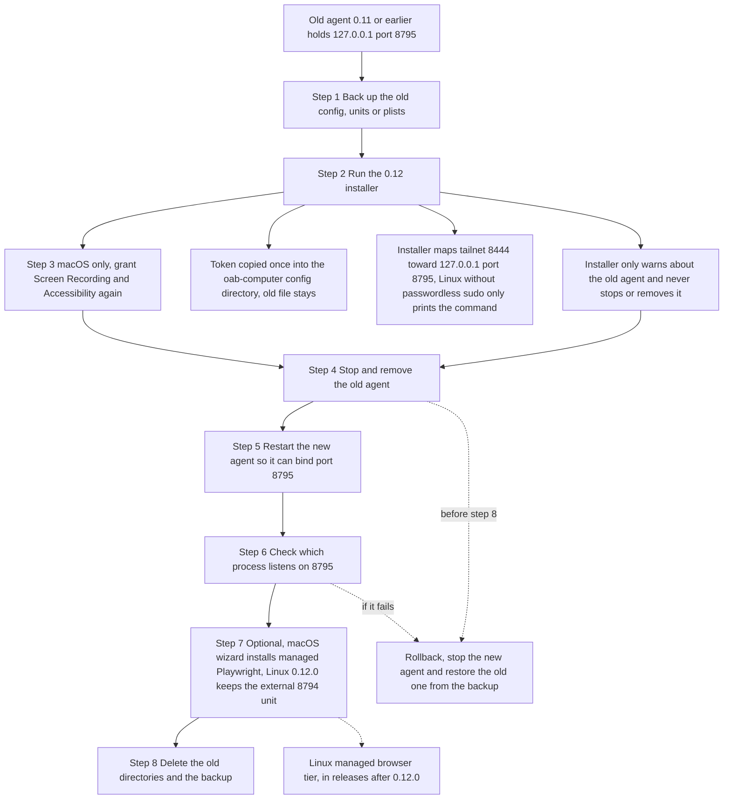

# Upgrading from 0.11 or earlier to 0.12

0.12.0 renamed the technical names of the product from `oab-instance-mcp` to `oab-computer`. The
product name is still OpenAB Computer. The rename has no compatibility layer: the new agent reads
nothing from the old names, except one token copy (below). The old agent is **not** removed for you,
and it holds port 8795, so the new agent cannot bind that port until the old one is gone.

This page is the step-by-step guide. The README keeps a shorter version with the full table of old
and new names: [Upgrading from 0.11 or earlier](../README.md#upgrading-from-011-or-earlier). Linux
nodes also have [Upgrading from 0.11](linux-setup.md#upgrading-from-011) in their setup guide.

> **Which installer this page describes.** The steps are for upgrading to 0.12.0. Releases after
> 0.12.0 change the Linux installer: it no longer asks for `wlrctl`, runs no `sudo` by itself
> (root actions are printed, or run with `--apply-system-changes`), writes no
> `oab-computer-pw-mcp.service` and no `MCP_UPSTREAM` line, and offers the managed browser instead.
> Where a step differs, the text says "0.12.0" and "after 0.12.0". The host shapes in
> [Upgrading a host that already has a browser unit](linux-setup.md#upgrading-a-host-that-already-has-a-browser-unit)
> cover a host that already runs a browser unit.

## What changes

| | 0.11 and earlier | 0.12.0 |
|---|---|---|
| Executable | `oab-instance-mcp` | `oab-computer` |
| macOS bundle id and LaunchAgent label | `dev.openab.instance-mcp` | `dev.openab.computer` |
| macOS Playwright LaunchAgent | `dev.openab.instance-mcp.pw-mcp` | `dev.openab.computer.pw-mcp` |
| Linux units | `oab-instance-mcp.service`, `oab-pw-mcp.service` | `oab-computer.service`, `oab-computer-pw-mcp.service` (the second only in 0.12.0 and earlier installers; later ones write no browser unit) |
| Config and token | `~/.config/oab-instance-mcp/` | `~/.config/oab-computer/` |
| Install directory | `~/.local/oab-instance-mcp` | `~/.local/oab-computer` |
| macOS logs, saved grants and audit | `~/Library/Logs/oab-instance-mcp`, `~/Library/Application Support/oab-instance-mcp` | `~/Library/Logs/oab-computer`, `~/Library/Application Support/oab-computer` |
| Linux state | `$XDG_STATE_HOME/oab-instance-mcp` | `$XDG_STATE_HOME/oab-computer` |
| Keychain service for attach secrets | `dev.openab.instance-mcp.grant` | `dev.openab.computer.grant` |
| Environment variables | `OAB_INSTANCE_MCP_*` | `OAB_COMPUTER_*` |
| Release assets | `oab-instance-mcp-VERSION-*` | `oab-computer-VERSION-*` |

Things that do **not** change: the MCP URL shape, port 8795 on `127.0.0.1`, the tailnet port 8444,
the bearer token (it is copied, see below), and the tools.

Things that are new in 0.12.0 and are worth knowing before you install:

- **Installers map the tailnet port.** The `.pkg`, `install-prebuilt.sh` and (in 0.12.0, with
  passwordless `sudo`) `install-linux.sh` run `tailscale serve --bg --https=8444` toward
  `127.0.0.1:8795`. After a package install the computer is reachable on your tailnet at `:8444`
  before the wizard asks anything. A caller still needs the bearer token and an allowed Tailscale
  login. Without passwordless `sudo`, the 0.12.0 `install-linux.sh` prints the command instead of
  running it; later versions always print it and run it only with `--apply-system-changes`.
  A plain app launch without the installer creates no mapping until you turn tailnet access on,
  but it leaves an existing `:8444` mapping in place (for example one from an earlier install) and
  never overwrites one it does not own. Remove it with **Turn Off Tailnet Access** or
  `tailscale serve --https=8444 off`. On macOS, the wizard's tailnet page and the menu item **Turn Off Tailnet Access**
  control the mapping afterwards (the menu item **Allow tailnet access…** turns it on).
- **macOS browser tools are managed by the app.** The wizard offers to install Playwright
  (about 249 MB download, about 593 MB installed, about 842 MB free space needed while it runs on Apple silicon).
  See [Browser tools](browser-tools.md).
- **macOS permissions are asked again** (next section).

## How the upgrade flows

The diagram shows the order of the steps below. Dotted arrows are optional or failure paths. The
Linux managed browser tier arrives after 0.12.0.



## Before you start

1. Write down where the old agent runs. macOS: `launchctl print gui/$(id -u)/dev.openab.instance-mcp`.
   Linux: `systemctl --user status oab-instance-mcp.service`.
2. Keep the old install directory (`~/.local/oab-instance-mcp`) until step 8. A rollback needs it.
3. On macOS you need a desktop user logged in. On Linux, run as the desktop user, not root.

## Step 1: back up

The backup holds your bearer token in plain text. Keep it private and delete it in step 8. The commands
use `umask 077` so only you can read it.

macOS:

```sh
umask 077
B=~/oab-instance-mcp-backup
mkdir -p "$B"
cp -R ~/.config/oab-instance-mcp "$B/config"
cp ~/Library/LaunchAgents/dev.openab.instance-mcp*.plist "$B/"
[ -d "$HOME/Library/Application Support/oab-instance-mcp" ] && cp -R "$HOME/Library/Application Support/oab-instance-mcp" "$B/support"
```

Linux:

```sh
umask 077
B=~/oab-instance-mcp-backup
mkdir -p "$B"
cp -R ~/.config/oab-instance-mcp "$B/config"
cp ~/.config/systemd/user/oab-instance-mcp.service "$B/"
[ -f ~/.config/systemd/user/oab-pw-mcp.service ] && cp ~/.config/systemd/user/oab-pw-mcp.service "$B/"
[ -d "${XDG_STATE_HOME:-$HOME/.local/state}/oab-instance-mcp" ] && cp -R "${XDG_STATE_HOME:-$HOME/.local/state}/oab-instance-mcp" "$B/state"
```

The Keychain items on macOS (attach secrets for lent sessions) are not in this backup. They cannot be
reused by 0.12 anyway: lend each session again after the upgrade.

## Step 2: install 0.12

- macOS: download `oab-computer-VERSION-universal.pkg` from
  [GitHub Releases](https://github.com/openabdev/openab-computer/releases) and open it, or run
  `install-prebuilt.sh` from the unzipped `.app.zip`
  ([Download and install](../README.md#download-and-install)).
- Linux: download `oab-computer-VERSION-linux-ARCH.tar.gz`, unpack it and run `./install-linux.sh`
  ([Quick start](../README.md#quick-start), [Linux setup](linux-setup.md)). The 0.12.0 installer
  stops with exit 78 unless `wlrctl` is installed, although nothing uses it; Ubuntu packages it only
  for amd64 (universe), so on Ubuntu arm64 install the units by hand ([Linux setup](linux-setup.md),
  steps 3-5) ([#130](https://github.com/openabdev/openab-computer/issues/130)). Later installers no
  longer ask for it.

The installer prints a warning when it finds the old agent. It never stops, disables or removes it.
Until you finish step 4, `/healthz` on port 8795 may be answered by the old agent, so a healthy check
does not prove the new agent is running.

### What happens to the token

The bearer token is copied, never moved. The old file stays where it is.

- **macOS:** the copy happens only when `~/.config/oab-computer` does not exist yet (the first run of
  the installer or the app). It copies from `~/.config/oab-instance-mcp/token`, then from
  `~/.config/oab-mac-agent/token` (a pre-0.4 location) if the first has no usable token. The new file
  is mode 600. If `~/.config/oab-computer` already exists, nothing is copied, and a new token is
  generated when the token file is missing. An existing new token is never overwritten. If you
  delete the new token later, the old one is not copied again.
- **Linux:** `install-linux.sh` copies `~/.config/oab-instance-mcp/token` whenever
  `~/.config/oab-computer/token` is missing or empty. A new token is generated only when neither
  file has one.
- If you never had an old token, you get a new one. Copy it into your clients from the menu bar
  (macOS) or from `~/.config/oab-computer/token` (Linux).

Not copied, so redo them after the first run: `switchboard.url`, `switchboard.secret`,
`switchboard.profile` and `switchboard.secure-set-value` in the config directory; saved grants (lend
again); logs and audit files. You may copy the switchboard files, logs and audit files by hand. Do not
copy `grants.json`.

## Step 3: macOS only, grant permissions again

macOS ties Screen Recording, Accessibility and Full Disk Access grants to the bundle id, and the
bundle id changed from `dev.openab.instance-mcp` to `dev.openab.computer`. The new app starts with no
grants. On first launch the **Set Up Mac Permissions** window asks for Screen Recording and
Accessibility (required) and offers Full Disk Access (optional, with a Skip link). Click Allow on
each row and turn the switch on in System Settings.

Leave the old app's entries alone for now, so a rollback keeps its grants. Step 8 resets them.

Future releases keep the same Developer ID and the new bundle id, so these grants survive later
upgrades. Linux has no equivalent step.

## Step 4: retire the old agent

Do this only after step 1. The old agent keeps port 8795 and fights the new one.

macOS:

```sh
launchctl bootout gui/$(id -u)/dev.openab.instance-mcp
rm ~/Library/LaunchAgents/dev.openab.instance-mcp.plist
# only if you used the external Playwright agent:
launchctl bootout gui/$(id -u)/dev.openab.instance-mcp.pw-mcp
rm ~/Library/LaunchAgents/dev.openab.instance-mcp.pw-mcp.plist
```

Linux:

```sh
systemctl --user disable --now oab-instance-mcp.service
rm ~/.config/systemd/user/oab-instance-mcp.service
# only if you used the Playwright unit:
systemctl --user disable --now oab-pw-mcp.service
rm ~/.config/systemd/user/oab-pw-mcp.service
systemctl --user daemon-reload
```

The installer also names leftovers it does not touch: on macOS the old payload under
`/Library/Application Support/OpenAB/instance-mcp` and the Keychain items with service
`dev.openab.instance-mcp.grant`. They stay until you remove them.

## Step 5: restart the new agent

The new agent could not bind port 8795 while the old one held it.

```sh
# macOS
launchctl kickstart -k gui/$(id -u)/dev.openab.computer
# Linux
systemctl --user restart oab-computer.service
```

## Step 6: check

Confirm that the new agent, not a leftover, owns the port.

```sh
# macOS
lsof -nP -iTCP:8795 -sTCP:LISTEN
# Linux
ss -ltnp 'sport = :8795'
ss -ltnp 'sport = :8794'   # only on a node with the old browser unit (0.12.0): that unit should own it
```

Browser sign-ins live in the old profile, which step 8 deletes, so sign in again after the upgrade.

You should see one `oab-computer` process (macOS may shorten the name). Then `curl -s http://127.0.0.1:8795/healthz` prints `ok`,
and a client with the token should reach the MCP URL (`https://<host>.<tailnet>.ts.net:8444/mcp`).
On macOS the menu bar shows the state of tailnet access and of the browser tools.

On a Mac that ran an old `poc/pw-mcp/install.sh`, also check for a stale `:8443` mapping that exposed
the unauthenticated Playwright port to the tailnet: `tailscale serve status`, and if it is there,
`tailscale serve --https=8443 off`. Details: [README, Network interfaces and ports](../README.md#network-interfaces-and-ports).

## Step 7: browser tools (optional)

- **macOS.** If you used the old external Playwright agent, you can stop using it: open the wizard
  from the menu (**Set up browser tools…**) and install the managed Playwright, then keep the old
  agent removed. To keep the external agent instead, install the new one from a clone of this repo
  (`poc/pw-mcp/install.sh`) and run the main installer again so it adds `--upstream`.
- **Linux.** The 0.12.0 installer sets up the external Playwright unit `oab-computer-pw-mcp.service`
  on `127.0.0.1:8794` unless you pass `--no-browser`. That port has no authentication. The old policy
  file `/etc/chromium/policies/managed/oab-instance-mcp.json` is not removed; the 0.12.0 installer
  writes `oab-computer.json` with the same settings, so you can remove the old file with `sudo rm`.
  Installers after 0.12.0 write neither a browser unit nor that policy file: they offer the managed
  browser, which has no port ([linux-browser-tier ADR](adr/linux-browser-tier.md),
  [Linux setup](linux-setup.md#4-browser-tools-playwrightmcp)).

Full guide: [Browser tools](browser-tools.md).

## Step 8: clean up

Do this when you are satisfied. A rollback after this point means reinstalling 0.11.

```sh
rm -rf ~/.local/oab-instance-mcp ~/.config/oab-instance-mcp ~/oab-instance-mcp-backup
# macOS also: ~/Library/Logs/oab-instance-mcp and ~/Library/Application Support/oab-instance-mcp
# Linux also: $XDG_STATE_HOME/oab-instance-mcp (default ~/.local/state/oab-instance-mcp)
```

Check each path before you delete it. Now reset the old app's grants (macOS only):

```sh
tccutil reset ScreenCapture dev.openab.instance-mcp
tccutil reset Accessibility dev.openab.instance-mcp
tccutil reset SystemPolicyAllFiles dev.openab.instance-mcp   # only if you used Full Disk Access
```

## Rollback

Possible until step 8, as long as the old install directory and the backup exist.

Optional, macOS: if you installed the managed Playwright and will not try 0.12 again, remove it first from the menu (**Remove Playwright…**), before the commands below boot the app out. Otherwise it stays installed and unused. The managed browser has no listener on `127.0.0.1:8794`, so it does not conflict with the old Playwright agent.

macOS:

```sh
launchctl bootout gui/$(id -u)/dev.openab.computer
launchctl bootout gui/$(id -u)/dev.openab.computer.pw-mcp   # only if step 7 installed the external Playwright agent; it holds 127.0.0.1:8794
mv ~/Library/LaunchAgents/dev.openab.computer.pw-mcp.plist ~/oab-instance-mcp-backup/ 2>/dev/null   # else it starts again at login and holds 127.0.0.1:8794 (only if step 7 installed it)
mv ~/Library/LaunchAgents/dev.openab.computer.plist ~/oab-instance-mcp-backup/   # else it starts again at login and races the old agent for 127.0.0.1:8795
cp ~/oab-instance-mcp-backup/dev.openab.instance-mcp*.plist ~/Library/LaunchAgents/
launchctl bootstrap gui/$(id -u) ~/Library/LaunchAgents/dev.openab.instance-mcp.plist
launchctl bootstrap gui/$(id -u) ~/Library/LaunchAgents/dev.openab.instance-mcp.pw-mcp.plist   # only if you had the old Playwright agent
```

If the old app the plist points to is gone, install the 0.11.0 package from its release page instead.
If you ran the step 8 `tccutil` resets anyway, grant the old app its permissions again.

Linux:

```sh
systemctl --user disable --now oab-computer.service
systemctl --user disable --now oab-computer-pw-mcp.service   # only if the 0.12.0 installer installed the browser unit
cp ~/oab-instance-mcp-backup/*.service ~/.config/systemd/user/
# restore the old MCP_UPSTREAM line in the daemon unit now, before daemon-reload (the backup copy already has it)
systemctl --user daemon-reload
systemctl --user enable --now oab-pw-mcp.service   # only if you used the Playwright unit; start it first
ss -ltnp 'sport = :8794'                           # the old Playwright unit must be listening before the daemon starts
systemctl --user enable --now oab-instance-mcp.service
```

The tailnet mapping on `:8444` points at `127.0.0.1:8795` in both versions, so it can stay. The old
token file was never changed, so clients that used it keep working. Remove the new agent's files
(`~/.local/oab-computer`, `~/.config/oab-computer`) only if you will not try again.
